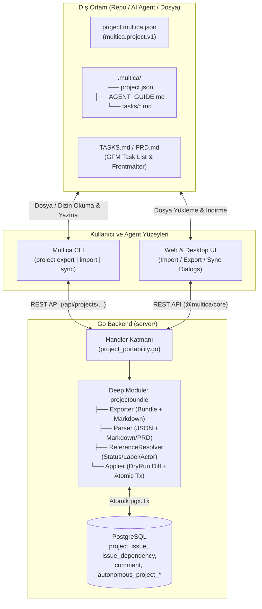
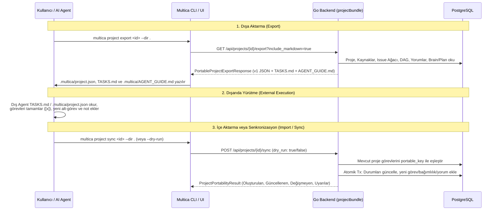

# Multica Proje Taşınabilirlik Altyapısı (Import / Export / External Execution & Sync) Planı

## 1. Hedef ve Mimari Vizyon

Multica üzerinde yürütülen bir projenin tüm bağlamıyla (**Proje üst verisi, Kaynaklar, Görev/Alt-Görev hiyerarşisi, Aşama bariyerleri `stage`, `blocked_by` DAG bağımlılıkları, Yorumlar, Etiketler ve Autonomous Project Brain/Plan**) dışarıya aktarılıp (`export`) harici ortamlarda (yerel kod deposunda Claude Code, Cursor, Codex gibi dış AI ajanlarla veya başka bir Multica çalışma alanında) yürütülebilmesini; aynı şekilde dışarıda oluşturulmuş veya dışarıda ilerletilmiş bir projenin Multica üzerine yüklenerek (`import` / `sync`) kaldığı yerden kesintisiz devam ettirilebilmesini sağlayan uçtan uca taşınabilirlik (portability) altyapısını kuruyoruz.

> [!IMPORTANT]
> **Mimari Prensip (`codebase-design` — Deep Module & Clean Seam):**
> Tüm serileştirme, Markdown/JSON ayrıştırma (parsing), semantik referans çözümleme (statü/aktör/etiket eşleme), DAG topolojik sıralama, döngü (cycle) kontrolü ve idempotent birleştirme (`create` vs `sync`) karmaşıklığı dar bir arayüz (`Interface`) arkasına gizlenmiş derin bir modülde (`server/internal/projectbundle`) toplanacaktır. Veritabanı şemasında yeni bir Yabancı Anahtar (Foreign Key) veya kırılgan yan tablo açmak yerine, mevcut `issue.metadata` JSONB alanı (`multica_portable_key`, `multica_origin_id`) ve atomik `pgx.Tx` işlemleri kullanılacaktır.

---

## 2. Mimari Karar Kayıtları (ADR — `senior-architect`)

### ADR-001: İdempotent Görev Eşleme ve Kimlik Saklama Stratejisi
- **Bağlam:** Dışa aktarılan bir proje farklı bir çalışma alanına (workspace) yüklendiğinde veya dışarıda yürütülüp aynı projeye `sync` edildiğinde, dış paketteki görevlerin (`MUL-101` veya `TASK-1`) Multica veritabanındaki `issue` satırlarıyla deterministik olarak eşleşmesi gerekir.
- **Değerlendirilen Seçenekler:**
  1. *Yeni Veritabanı Tablosu (`project_import_mapping`):* Ekstra migration ve her sorguda JOIN maliyeti yaratır.
  2. *Mevcut `issue.metadata` JSONB Alanında Taşınabilir Anahtar (`multica_portable_key`, `multica_origin_id`):* Şema değişikliği (migration) gerektirmez, zaten her `Issue` yanıtında mevcuttur ve hem API hem CLI tarafından doğrudan okunabilir.
- **Karar:** Seçenek 2 seçildi. İçe aktarılan her görevin `issue.metadata["multica_portable_key"]` alanına taşınabilir anahtarı (`key`) kaydedilir. Senkronizasyon (`sync`) sırasında görev şu öncelik sırasıyla eşleştirilir:
  1. `issue.metadata["multica_portable_key"] == task.key`
  2. `issue.identifier == task.key` (aynı workspace içindeki round-trip senkronizasyonu)
  3. `issue.id == task.origin_id`

### ADR-002: Çift Modlu Taşınabilirlik Formatı (`multica.project.v1` JSON + `.multica/` & `TASKS.md`)
- **Bağlam:** Makine-makine (API/UI) transferleri kayıpsız (lossless) ve tipli bir şema gerektirirken, dış ortamdaki AI ajanlar (Claude Code, Cursor, Codex) ve geliştiriciler kod deposu içinde okunabilir/düzenlenebilir Markdown (`TASKS.md`) dosyalarıyla çok daha verimli çalışır.
- **Karar:**
  - Kanonik format `multica.project.v1` JSON şemasıdır (`.multica.json` veya `.multica/project.json`).
  - CLI (`multica project export --dir .`) ve UI üzerinden hem kanonik JSON hem de insan/ajan dostu `TASKS.md` + `.multica/AGENT_GUIDE.md` üretilir.
  - `multica project sync` çalıştığında, dış ajanın `TASKS.md` üzerinde yaptığı durum değişiklikleri (`- [x]`), yeni eklediği görevler ve notlar `.multica/project.json` ile birleştirilerek (reconcile) sunucuya tek bir atomik paket halinde gönderilir.

### ADR-003: Ortama Bağımlı Referansların Semantik Çözümlenmesi (Graceful Degradation)
- **Bağlam:** Kaynak projedeki `workflow_id`, özel `status`, `label_id`, `assignee_id` ve `local_directory` (`daemon_id`) başka bir çalışma alanında veya dış ortamda birebir aynı UUID'ye sahip olmayabilir.
- **Karar:**
  - **Statü:** Önce hedef workspace'in `issue_status` kataloğunda `status` anahtarı aranır; bulunamazsa `status_category` (`unstarted` → `todo`, `started` → `in_progress`, `done` → `done`, `closed` → `cancelled`) üzerinden yerleşik statüye düşülür.
  - **Etiket:** İsme göre (`LOWER(name)`) eşleştirilir; hedefte yoksa `create_missing_labels: true` ile otomatik oluşturulur.
  - **Aktör (Lead / Assignee):** İsim veya e-posta ile hedef workspace üyeleri/ajanları arasında aranır; bulunamazsa `null` bırakılıp `warnings` listesine eklenir (işlemi bloklamaz).
  - **Yerel Dizin (`local_directory`):** Yalnızca hedef ortamda geçerli bir `daemon_id` eşleşirse bağlanır; aksi halde uyarı üretilir ve `github_repo` kaynakları korunur.

---

## 3. Sistem Mimarisi ve Derin Modül Tasarımı (`codebase-design`)

### 3.1 Bileşen ve Veri Akışı Diyagramı



### 3.2 Derin Modül ve Dikiş Noktası (Seam) Spesifikasyonu

| Kavram (`codebase-design`) | Karşılığı ve Tasarım Kararı |
| --- | --- |
| **Module** | `server/internal/projectbundle` (Go) ve `@multica/core/projects/portability` (TypeScript) |
| **Interface (Dış Yüzey)** | Yalnızca 4 ana operasyon: `ExportProject`, `ParseInputToBundle`, `PreviewPortability`, `ApplyPortability`. Çağıran katman (HTTP Handler / CLI) topolojik sıralama, DAG doğrulaması veya statü/etiket çözümleme detaylarını bilmez. |
| **Seam (Dikiş Noktası)** | `projectbundle.Store` arayüzü: Veritabanı okuma/yazma işlemlerini soyutlar; birim testlerde bellek-içi (in-memory) adaptörle, üretimde PostgreSQL/`sqlc` adaptörüyle çalışır. |
| **Leverage & Locality** | Hem JSON hem Markdown (`TASKS.md` / `PRD.md`) girdileri tek bir `Bundle` ara temsiline (IR) indirgenir; böylece doğrulama, dry-run diff ve veritabanı yazma mantığı tek bir yerde (`Locality`) yaşar ve tüm yüzeylere (`Web`, `Desktop`, `CLI`) hizmet eder (`Leverage`). |

### 3.3 Uçtan Uca Dışarıda Yürütme ve Geri Senkronizasyon (Round-Trip) Akışı



---

## 4. Kanonik Veri Şeması (`multica.project.v1`)

```json
{
  "schema_version": "multica.project.v1",
  "exported_at": "2026-10-28T19:00:00Z",
  "origin": {
    "workspace_id": "uuid",
    "project_id": "uuid"
  },
  "project": {
    "title": "Payment Gateway v2",
    "description": "Yeni ödeme altyapısı geçiş projesi",
    "icon": "💳",
    "status": "in_progress",
    "priority": "high",
    "start_date": "2026-10-28",
    "due_date": "2026-11-15",
    "lead": {
      "type": "agent",
      "name": "Architecture Lead"
    }
  },
  "resources": [
    {
      "resource_type": "github_repo",
      "label": "Backend Repo",
      "resource_ref": {
        "url": "https://github.com/org/payment-service",
        "default_branch_hint": "main"
      }
    }
  ],
  "bootstrap": {
    "autonomy_mode": "autonomous",
    "autonomy_level": "development",
    "brief": "Mimari geçiş özeti...",
    "knowledge": [
      {
        "kind": "architecture",
        "title": "System Architecture",
        "content": "..."
      }
    ],
    "plan": {
      "goal": "Complete Stripe + Iyzico adapter layer",
      "requirements": [
        { "id": "REQ-1", "text": "Idempotent webhook processing", "rationale": "Prevent double charge" }
      ],
      "nodes": [
        {
          "key": "MUL-101",
          "title": "Webhook Signature Verifier",
          "kind": "implementation",
          "status": "done",
          "acceptance_criteria": ["HMAC-SHA256 verified", "Replay attack window < 5m"]
        }
      ],
      "edges": [
        { "from": "MUL-101", "to": "MUL-102", "type": "hard" }
      ]
    }
  },
  "tasks": [
    {
      "key": "MUL-101",
      "origin_id": "uuid-1",
      "title": "Webhook Signature Verifier",
      "description": "Implement HMAC verification...",
      "status": "done",
      "status_category": "done",
      "priority": "high",
      "parent_key": null,
      "stage": 1,
      "position": 0,
      "blocked_by_keys": [],
      "labels": [
        { "name": "security", "color": "#ef4444" }
      ],
      "assignee": {
        "type": "agent",
        "name": "Backend Agent"
      },
      "acceptance_criteria": [
        "HMAC-SHA256 verified",
        "Replay attack window < 5m"
      ],
      "metadata": {
        "pr_url": "https://github.com/org/payment-service/pull/42"
      },
      "comments": [
        {
          "author_type": "agent",
          "author_name": "Backend Agent",
          "type": "comment",
          "content": "Completed implementation and added unit tests.",
          "created_at": "2026-10-28T18:30:00Z"
        }
      ]
    }
  ]
}
```

---

## 5. Önerilen Değişiklikler (Proposed Changes)

### Katman 1: Go Backend — `projectbundle` Derin Modülü ve HTTP Handler

#### [NEW] [schema.go](file:///Users/caglar/Desktop/Frontend/multica/server/internal/projectbundle/schema.go)
- `SchemaVersionV1 = "multica.project.v1"` sabiti ve tüm taşınabilir veri yapıları (`Bundle`, `PortableProject`, `PortableResource`, `PortableBootstrap`, `PortablePlan`, `PortableTask`, `PortableComment`, `PortableActorRef`, `PortableLabelRef`).
- `ImportRequest`, `SyncRequest`, `PortabilityPreview`, `TaskSyncDiff`, `PortabilityResult` tipleri.

#### [NEW] [exporter.go](file:///Users/caglar/Desktop/Frontend/multica/server/internal/projectbundle/exporter.go)
- Projeyi, kaynaklarını (`project_resource`), tüm görevlerini (`issue`), görev bağımlılıklarını (`issue_dependency`), etiketlerini (`label`), yorumlarını (`comment`) ve varsa `autonomous_project_bootstrap` + `autonomous_project_plan` + `autonomous_project_brain_entry` verilerini tek bir tutarlı anlık görüntü (snapshot) olarak okuyan ve `Bundle` üreten modül.

#### [NEW] [markdown.go](file:///Users/caglar/Desktop/Frontend/multica/server/internal/projectbundle/markdown.go)
- `RenderTasksMarkdown(bundle Bundle) string`: İnsan ve AI ajanların okuyup düzenleyebileceği `TASKS.md` dosyasını üretir.
- `RenderAgentGuideMarkdown(bundle Bundle) string`: `.multica/AGENT_GUIDE.md` dış yürütme kılavuzunu üretir.
- `ParseMarkdownToBundle(projectTitleHint, markdownContent string) (Bundle, error)`: Hem Multica `TASKS.md` formatını hem de dışarıda oluşturulmuş GFM görev listelerini (`- [ ]`, `- [x]`, başlıklar, alt-görev girintileri, meta etiketler) deterministik olarak `Bundle` yapısına ayrıştırır.
- `ReconcileBundleWithMarkdown(base Bundle, markdownContent string) (Bundle, error)`: `.multica/project.json` ile dış ajanın güncellediği `TASKS.md` dosyasını birleştirir (`TASKS.md` içindeki durum değişikliklerini ve yeni eklenen görevleri koruyarak tam JSON bağlamıyla birleştirir).

#### [NEW] [importer.go](file:///Users/caglar/Desktop/Frontend/multica/server/internal/projectbundle/importer.go)
- Şema doğrulaması, görev anahtarlarının (`key`) tekilliği, `parent_key` ve `blocked_by_keys` referanslarının doğrulanması ve **DFS algoritması ile döngüsel bağımlılık (cycle) tespiti**.
- `DryRun: true` durumunda hiçbir veritabanı yazması yapmadan oluşturulacak/güncellenecek/değişmeyen görevleri, statü/etiket/aktör eşlemelerini ve uyarıları hesaplama.
- `DryRun: false` durumunda tek bir `pgx.Tx` içinde projeyi, kaynakları, autonomous bootstrap/brain verilerini, görevleri (topolojik ebeveyn-çocuk sırasıyla), `issue_dependency` kenarlarını, etiketleri ve yeni yorumları idempotent olarak yazma.

#### [NEW] [project_portability.go](file:///Users/caglar/Desktop/Frontend/multica/server/internal/handler/project_portability.go)
- `GET /api/projects/{id}/export`: Projeyi `PortableProjectExportResponse` (`bundle`, `tasks_markdown`, `agent_guide_markdown`) olarak döndürür.
- `POST /api/projects/import`: Yeni bir projeyi JSON `bundle` veya `markdown` girdisinden içe aktarır (`dry_run: true/false` destekli).
- `POST /api/projects/{id}/sync`: Mevcut bir projeyi dışarıda güncellenmiş `bundle` veya `markdown` ile senkronize eder (`dry_run: true/false` destekli).

#### [MODIFY] [router.go](file:///Users/caglar/Desktop/Frontend/multica/server/cmd/server/router.go)
- `/api/projects` altına `POST /import`, `/api/projects/{id}` altına `GET /export` ve `POST /sync` uçlarının bağlanması.

#### [NEW] [project_portability_test.go](file:///Users/caglar/Desktop/Frontend/multica/server/internal/handler/project_portability_test.go)
- Export, Import (JSON + Markdown), Dry-Run Preview, İdempotent Sync, Cycle Detection ve Cross-Workspace Referans Çözümleme entegrasyon testleri.

---

### Katman 2: Multica CLI (`server/cmd/multica`)

#### [NEW] [cmd_project_portability.go](file:///Users/caglar/Desktop/Frontend/multica/server/cmd/multica/cmd_project_portability.go)
- `multica project export <id> [--file <path> | --dir <path> | --output json|markdown]`
- `multica project import [--file <path> | --dir <path>] [--title <title>] [--dry-run] [--output table|json]`
- `multica project sync [<id>] [--file <path> | --dir <path>] [--dry-run] [--output table|json]`

#### [MODIFY] [cmd_project.go](file:///Users/caglar/Desktop/Frontend/multica/server/cmd/multica/cmd_project.go)
- Yeni CLI alt komutlarının `projectCmd` altına eklenmesi.

#### [NEW] [cmd_project_portability_test.go](file:///Users/caglar/Desktop/Frontend/multica/server/cmd/multica/cmd_project_portability_test.go)
- CLI dosya/dizin (`.multica/project.json`, `TASKS.md`, `AGENT_GUIDE.md`) okuma, yazma ve `Reconcile` birim testleri.

---

### Katman 3: Core Paket (`packages/core`)

#### [MODIFY] [project.ts](file:///Users/caglar/Desktop/Frontend/multica/packages/core/types/project.ts) & [index.ts](file:///Users/caglar/Desktop/Frontend/multica/packages/core/types/index.ts)
- Taşınabilir proje, görev, önizleme ve senkronizasyon TypeScript arayüzlerinin tanımlanması.

#### [MODIFY] [schemas.ts](file:///Users/caglar/Desktop/Frontend/multica/packages/core/api/schemas.ts) & [client.ts](file:///Users/caglar/Desktop/Frontend/multica/packages/core/api/client.ts)
- `ProjectExportResponseSchema` ve `ProjectPortabilityResultSchema` zod şemalarının ve `api.exportProject`, `api.importProject`, `api.syncProject` metodlarının `parseWithFallback` ile eklenmesi.

#### [NEW] [portability.ts](file:///Users/caglar/Desktop/Frontend/multica/packages/core/projects/portability.ts) & [MODIFY] [index.ts](file:///Users/caglar/Desktop/Frontend/multica/packages/core/projects/index.ts)
- `useExportProject`, `useImportProject`, `useSyncProject` TanStack Query mutation/query hook'ları.

#### [NEW] [portability.test.ts](file:///Users/caglar/Desktop/Frontend/multica/packages/core/projects/portability.test.ts)
- Zod şema doğrulama, fallback ve API istemci birim testleri.

---

### Katman 4: Shared Views & Web/Desktop UI (`packages/views`)

#### [NEW] [project-export-dialog.tsx](file:///Users/caglar/Desktop/Frontend/multica/packages/views/projects/components/project-export-dialog.tsx)
- Proje Detay sayfasından açılan **Export Project** diyaloğu (`.multica.json` indirme, `TASKS.md` + `AGENT_GUIDE.md` indirme/kopyalama ve `multica project export/sync` CLI komut kopyalama).

#### [NEW] [project-import-dialog.tsx](file:///Users/caglar/Desktop/Frontend/multica/packages/views/projects/components/project-import-dialog.tsx)
- Hem **Projects** liste sayfasında ("Import Project") hem de **Project Detail** sayfasında ("Sync / Import Tasks") çalışan, dosya seçimi (`.multica.json`, `.md`) + metin yapıştırma + Dry-Run Önizleme adımlarını içeren diyalog.

#### [MODIFY] [projects-page.tsx](file:///Users/caglar/Desktop/Frontend/multica/packages/views/projects/components/projects-page.tsx) & [project-detail.tsx](file:///Users/caglar/Desktop/Frontend/multica/packages/views/projects/components/project-detail.tsx)
- `ProjectsPage` başlığına **Import** aksiyonu ve `ProjectDetail` `⋯` menüsüne **Export project...** / **Sync / Import tasks...** aksiyonlarının bağlanması.
- `packages/views/locales/en/projects.json` (ve mevcut dil dosyalarına) çeviri anahtarlarının eklenmesi.

---

## 6. Doğrulama Planı ve Unlazy Kabul Kapıları (`GATES.md`)

| Gate ID | Kabul Kriteri (Observable Outcome) | Doğrulama Komutu (`CHECK`) | Beklenen Çıktı (`EXPECT`) |
| --- | --- | --- | --- |
| **G1** | Go `projectbundle` birim testleri (JSON/Markdown parse, render, reconcile, cycle detection) geçmeli | `cd server && go test -v ./internal/projectbundle/...` | `PASS` |
| **G2** | Go HTTP Handler Export / Import / Sync / Dry-Run entegrasyon testleri geçmeli | `cd server && go test -v ./internal/handler -run 'TestProjectPortability'` | `PASS` |
| **G3** | Multica CLI `project export`, `project import`, `project sync` testleri geçmeli | `cd server && go test -v ./cmd/multica -run 'TestProjectPortability'` | `PASS` |
| **G4** | `@multica/core` ve `@multica/views` TypeScript tip kontrolü, ESLint ve Vitest testleri sıfır hatayla geçmeli | `pnpm typecheck && pnpm lint && pnpm --filter @multica/core test && pnpm --filter @multica/views test` | `0 errors` |
