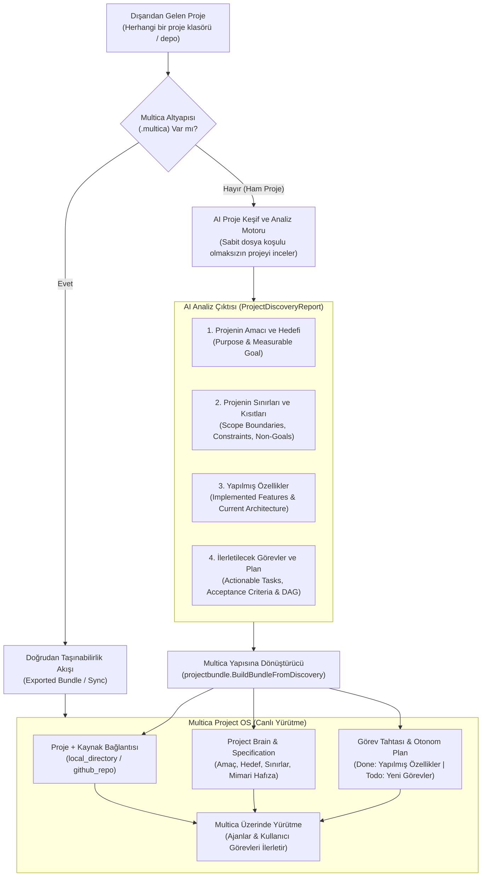
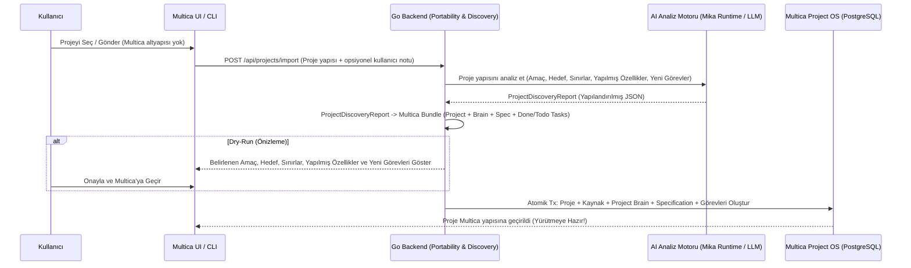

# Multica Proje Taşınabilirlik & AI-Güdümlü Proje Keşfi (Onboarding) Altyapı Planı

## 1. Hedef ve Mimari Vizyon

Dışarıdaki bir projenin Multica'ya taşınması ve Multica üzerindeki bir projenin dışarıya aktarılması iki temel akıştan oluşur:

1. **Akış 1 — Multica Altyapısı Olan Projeler (`.multica/project.json` veya `TASKS.md`) *(Uygulandı)*:**
   Önceden Multica'dan dışa aktarılmış (`export`) veya hazır görev listesi bulunan projelerin kayıpsız olarak içe aktarılması (`import`) ve çift yönlü senkronize edilmesi (`sync`).
2. **Akış 2 — Multica Altyapısı Olmayan Projeler İçin Serbest AI Analizi ve Multica'ya Geçiş (`Agentic Project Discovery & Onboarding`) *(Yeni Katman)*:**
   Hiçbir Multica altyapısı olmayan, rastgele/manuel oluşturulmuş herhangi bir proje verildiğinde **sabit dosya isimlerine, belirli uzantılara veya katı kurallara bağlı kalmaksızın**:
   - **Adım 1 (AI Proje Analizi):** AI, proje yapısının içine girerek projeyi bütünüyle inceler ve şu 4 temel unsuru çıkarır:
     1. **Projenin Amacı ve Hedefi (`Purpose & Goal`):** Projenin ne olduğu, hangi problemi çözdüğü ve nereye ulaşmak istediği.
     2. **Projenin Sınırları ve Kısıtları (`Boundaries, Constraints & Non-Goals`):** Projenin mimari sınırları, çalışma kuralları, kapsam dışı alanları ve teknik kısıtları.
     3. **Yapılmış Özellikler (`Implemented Features`):** Projede şu ana kadar hayata geçirilmiş, çalışan mevcut özellikler ve modüller.
     4. **Yol Haritası ve Görevler (`Actionable Tasks & Dependencies`):** Projenin hedefine ulaşması için yarım kalmış, eksik veya bundan sonra yapılması gereken görevler ve bunların birbirine olan bağımlılıkları.
   - **Adım 2 (Multica Yapısına Dönüştürme):** Çıkarılan bu analiz doğrudan Multica'nın yerel yapılarına (**Proje + Kaynak Bağlantısı `project_resource` + Project Brain `autonomous_project_brain_entry` + `ProjectSpecification` + Tamamlanmış/Yapılacak `issue` ve `autonomous_project_plan` DAG**) dönüştürülür.
   - **Adım 3 (Multica Üzerinde Yürütme):** Proje artık tam teşekküllü bir Multica projesi haline gelir; Multica'nın görev tahtası, Project Leader / Technology Team ajanları ve otonom iş akışı (`workflowruntime`) üzerinden doğrudan Multica'da yürütülmeye devam eder.

---

## 2. Mimari Karar Kayıtları (ADR — `senior-architect`)

### ADR-001: Sabit Kurallar Yerine Ajan Tabanlı Dinamik Proje Analizi (`Agentic Discovery`)
- **Bağlam:** Dışarıda oluşturulmuş projelerin yapısı öngörülemezdir; farklı dillerde, alışılmadık klasör düzenlerinde, dokümansız veya tamamen kendine özgü bir mimaride olabilir. Sabit dosya adlarına (`package.json`, `TODO` regex'leri vb.) dayalı katı kurallar her projeyi anlayamaz.
- **Karar:** Projede `.multica` altyapısı yoksa, sabit kurallar yerine **AI Keşif Oturumu (`ProjectDiscoveryExecutor`)** çalıştırılır:
  - Multica'nın mevcut ajan çalışma zamanı (Mika'nın bağlı olduğu `agent_runtime` / yerel daemon veya yapılandırılmış AI modeli) proje bağlamını doğrudan inceler.
  - AI, projeyi bir yazılım mimarı ve ürün yöneticisi gözüyle okuyarak **Amacı (`purpose`)**, **Hedefi (`goal`)**, **Sınırları (`boundaries` & `constraints`)**, **Yapılmış Özellikleri (`implemented_features`)** ve **Sıradaki Görevleri (`next_tasks`)** yapılandırılmış bir keşif raporu (`ProjectDiscoveryReport`) olarak üretir.

### ADR-002: Keşif Çıktısının Doğrudan Multica "Project OS" Yapısına Bağlanması
- **Bağlam:** Analiz edilen projenin sadece statik bir görev listesi olarak kalmaması, Multica üzerinde aktif olarak yürütülebilmesi (ajanların kod yazabilmesi, planlama yapabilmesi, görevlerin ilerletilebilmesi) gerekir.
- **Karar:** AI analizinden çıkan `ProjectDiscoveryReport`, Multica'nın mevcut çekirdek yapılarına birebir eşlenir:
  1. **Proje & Kaynak (`project` + `project_resource`):** Proje dizini (`local_directory`) ve varsa git deposu (`github_repo`) projeye kaynak olarak bağlanır; böylece Multica ajanları görevleri yürütürken doğrudan bu dizin üzerinde çalışır.
  2. **Proje Spesifikasyonu (`ProjectSpecification` & `autonomous_project_bootstrap`):**
     - `Goal` ← AI'ın belirlediği proje hedefi ve amacı.
     - `Summary` ← Projenin genel tanımı ve mevcut durumu.
     - `Constraints` & `NonGoals` ← AI'ın belirlediği proje sınırları ve kısıtları.
     - `Requirements` & `DefinitionOfDone` ← Projenin tamamlanma kriterleri.
  3. **Project Brain (`autonomous_project_brain_entry`):**
     - Projenin amacı, sınırları, mimari yapısı ve mevcut özellik envanteri kalıcı proje hafızası (`architecture_decision`, `product_decision`, `requirement`, `repository_fact`) olarak kaydedilir; böylece projede çalışacak tüm Multica ajanları projeyi tanıyarak işe başlar.
  4. **Görevler ve Otonom Plan (`issue` + `issue_dependency` + `autonomous_project_plan`):**
     - **Yapılmış Özellikler (`implemented_features`):** Multica'da `status: "done"` (`stage: 0`) olarak kaydedilir; projede nelerin halihazırda tamamlanmış olduğu tahtada net biçimde görülür.
     - **Yapılacak Görevler (`next_tasks`):** Hiyerarşik görevler (`parent_key`), aşamalar (`stage`), bağımlılıklar (`blocked_by`) ve kabul kriterleri (`acceptance_criteria`) ile `todo` / `backlog` statüsünde oluşturulur ve Multica üzerinde yürütülmeye hazır hale gelir.

---

## 3. Sistem Mimarisi ve Akış Diyagramı

### 3.1 Uçtan Uca AI Analizi ve Multica'ya Geçiş Mimarisi



### 3.2 Adım Adım Sıralı Akış (Sequence Diagram)



---

## 4. AI Analiz Sözleşmesi (`ProjectDiscoveryReport`)

AI analiz motorunun (sabit dosya kurallarına bağlı kalmadan projeyi inceleyerek) üreteceği ve doğrudan Multica `Bundle` + `ProjectSpecification` yapısına dönüştürülecek kanonik şema:

```json
{
  "project": {
    "title": "Tespit Edilen Proje Adı",
    "purpose": "Projenin varlık amacı ve çözdüğü temel problem",
    "goal": "Projenin ulaşmak istediği somut ve ölçülebilir nihai hedef",
    "architecture_summary": "Projenin mevcut çalışma yapısı, bileşenleri ve teknoloji özeti"
  },
  "boundaries": {
    "in_scope": [
      "Projenin doğrudan sorumluluk alanında olan yetenekler"
    ],
    "out_of_scope": [
      "Projenin sınırları dışında kalan alanlar (Non-Goals)"
    ],
    "constraints": [
      "Mimari, teknik veya iş kuralları / kısıtlar"
    ],
    "definition_of_done": [
      "Projenin tamamlanmış sayılması için gereken ana kriterler"
    ]
  },
  "implemented_features": [
    {
      "key": "feature-auth-session",
      "title": "Kullanıcı Kimlik Doğrulama ve Oturum Yönetimi",
      "description": "Halihazırda projede tamamlanmış ve çalışan özellik özeti",
      "evidence": ["İlgili modül/dosya/akış referansları"]
    }
  ],
  "next_tasks": [
    {
      "key": "task-complete-checkout",
      "title": "Ödeme Onay Akışının Tamamlanması",
      "description": "Projenin hedefine ulaşması için yapılması gereken işin detayı",
      "priority": "high",
      "stage": 1,
      "parent_key": null,
      "blocked_by_keys": ["feature-auth-session"],
      "acceptance_criteria": [
        "Ödeme sağlayıcı yanıtı doğrulandığında sipariş durumu güncellenmeli",
        "Hata durumunda kullanıcıya geri bildirim dönülmeli"
      ]
    }
  ]
}
```

### Bu Çıktının Multica Yapısına Eşlenmesi (`Mapping to Multica`)

| AI Analiz Çıktısı | Multica Karşılığı | Yürütme Etkisi |
| --- | --- | --- |
| `project.title` & `purpose` | `project.title`, `project.description`, `bootstrap.brief` | Proje kimliği ve özet bağlamı oluşur. |
| `project.goal` & `boundaries.*` | `autonomous_project_specification_revision` (`Goal`, `Constraints`, `NonGoals`, `DefinitionOfDone`) + `Project Brain` | Multica ajanları projenin hedefini ve **aşmaması gereken sınırlarını** bilir. |
| `project.architecture_summary` | `autonomous_project_brain_entry` (`architecture_decision` / `repository_fact`) | Ajanlar kod tabanının mimarisini tekrar sıfırdan aramak zorunda kalmaz. |
| `implemented_features[]` | `issue` (`status: "done"`, `stage: 0`, `labels: ["implemented"]`) + `Project Brain` | Projede şu ana kadar yapılmış özellikler tahtada tamamlanmış olarak görünür. |
| `next_tasks[]` | `issue` (`status: "todo"`, `stage: 1..N`) + `issue_dependency` + `autonomous_project_plan` | Proje Multica'ya geçer geçmez kullanıcı veya ajanlar bu görevleri yürütmeye başlar. |
| Proje Dizini / Git Deposu | `project_resource` (`local_directory` / `github_repo`) | Multica daemon/ajanları doğrudan proje dizinine bağlanıp kod geliştirmeye devam eder. |

---

## 5. Katman Bazlı Uygulama Tasarımı

### Katman 1: `server/internal/projectbundle` — Dinamik Proje Bağlamı ve Keşif Dönüştürücüsü

#### [MODIFY] [schema.go](file:///Users/caglar/Desktop/Frontend/multica/server/internal/projectbundle/schema.go)
- `ProjectDiscoveryReport`, `DiscoveredProjectMeta`, `DiscoveredBoundaries`, `DiscoveredFeature`, `DiscoveredTask` ve `ProjectContextPayload` (projenin dizin yapısını ve okunabilir dosya içeriklerini sabit dosya adı dayatmadan taşıyan esnek yapı) tiplerinin eklenmesi.
- `ImportRequest` ve `SyncRequest` içine `ProjectContext *ProjectContextPayload` ve `Discovery *ProjectDiscoveryReport` alanlarının eklenmesi.

#### [NEW] [discovery.go](file:///Users/caglar/Desktop/Frontend/multica/server/internal/projectbundle/discovery.go)
- `CollectProjectContext(rootDir string, opts CollectOptions) (ProjectContextPayload, error)`:
  - Sabit dosya isimleri (`package.json` şartı vb.) aramak yerine, verilen proje dizinindeki dosya ağacını ve metin tabanlı dosyaları (binary, `.git`, `node_modules` gibi derleme/bağımlılık klasörlerini hariç tutarak) bütçe dahilinde toplar; böylece proje hangi dilde veya yapıda olursa olsun AI'ın okuyabileceği tam bir proje görünümü sunar.
- `BuildBundleFromDiscovery(report ProjectDiscoveryReport, ctxPayload *ProjectContextPayload) (Bundle, error)`:
  - AI'ın ürettiği `ProjectDiscoveryReport` verisini kanonik `multica.project.v1` `Bundle` yapısına dönüştürür:
    - Projenin amacını, hedefini ve sınırlarını (`in_scope`, `out_of_scope`, `constraints`, `definition_of_done`) hem `Bootstrap.Brief` & `Bootstrap.Knowledge` içine hem de `Bootstrap.Plan` spesifikasyonuna yerleştirir.
    - `implemented_features` listesini `status: "done"`, `stage: 0` görevleri olarak ekler.
    - `next_tasks` listesini `status: "todo"`, `stage: 1..N` ve `blocked_by_keys` bağımlılıklarıyla ekler.
    - Yerel dizin / git deposu bilgisini `Bundle.Resources` içine bağlar.

### Katman 2: `server/internal/handler` — AI Analiz Orkestrasyonu

#### [NEW] [project_discovery.go](file:///Users/caglar/Desktop/Frontend/multica/server/internal/handler/project_discovery.go) & [MODIFY] [project_portability.go](file:///Users/caglar/Desktop/Frontend/multica/server/internal/handler/project_portability.go)
- Projede `.multica` altyapısı olmadığında (`ProjectContext` gönderildiğinde veya yapılandırılmamış bir proje dizini/içeriği verildiğinde):
  1. **AI Analiz Aşaması (`AnalyzeProjectStructure`):**
     - Çalışma alanındaki aktif AI çalışma zamanını (Mika'nın bağlı olduğu `agent_runtime` — yerel dizini doğrudan inceleyebilen ajan — veya sunucu AI istemcisi) kullanarak projeyi analiz eder.
     - AI'dan projenin **Amacını, Hedefini, Sınırlarını, Yapılmış Özelliklerini ve Yapılacak Görevlerini** (`ProjectDiscoveryReport`) çıkarır.
  2. **Multica'ya Geçiş Aşaması (`BuildBundleFromDiscovery` → `ApplyPortability`):**
     - Çıkarılan raporu `Bundle` yapısına çevirir; `dry_run: true` ise kullanıcıya AI'ın belirlediği **Amaç, Hedef, Sınırlar, Yapılmış Özellikler ve Yeni Görevler** önizlemesini döner; `dry_run: false` ise atomik olarak Multica projesini, Project Brain'i, kaynak bağlantılarını ve görevleri oluşturur.
     - İsteğe bağlı olarak (`start_autonomous: true` veya otonom mod seçildiğinde) `EventProjectCreated` tetiklenerek Multica'nın kendi otonom yürütme motoru (`workflowruntime`) doğrudan devreye sokulur.

### Katman 3: Multica CLI (`server/cmd/multica`)

#### [MODIFY] [cmd_project_portability.go](file:///Users/caglar/Desktop/Frontend/multica/server/cmd/multica/cmd_project_portability.go)
- `multica project import --dir <proje-dizini> [--goal "..."] [--autonomous] [--dry-run]`:
  - Verilen dizinde `.multica/project.json` veya `TASKS.md` varsa mevcut şekilde içe aktarır.
  - **Hiçbir Multica altyapısı yoksa**, hata vermek yerine otomatik olarak proje bağlamını toplar (`CollectProjectContext`), AI analizini çalıştırarak projenin amacını, hedefini, sınırlarını, yapılmış özelliklerini ve görevlerini belirler ve projeyi Multica yapısına geçirir.

### Katman 4: Web & Desktop UI (`packages/core` & `packages/views`)

#### [MODIFY] [project-import-dialog.tsx](file:///Users/caglar/Desktop/Frontend/multica/packages/views/projects/components/project-import-dialog.tsx)
- İçe aktarma penceresinde kullanıcıya sadece `.multica.json` / `TASKS.md` yükleme değil, **"Herhangi Bir Projeyi AI Analizi ile Multica'ya Taşı"** deneyimi sunulur:
  - Kullanıcı proje klasörünü (veya proje dosyalarını) seçer ve isterse tek cümlelik bir yönlendirme notu yazar.
  - **AI Analiz Önizleme Ekranı:** Proje Multica'ya oluşturulmadan hemen önce kullanıcıya AI'ın çıkardığı:
    - 🎯 **Projenin Amacı ve Hedefi**
    - 🛡️ **Projenin Sınırları ve Kısıtları**
    - ✅ **Tespit Edilen Yapılmış Özellikler (`Done`)**
    - 📋 **Oluşturulacak Yeni Görevler (`Todo` & Bağımlılıklar)**
    gösterilir. Onaylandığı anda proje Multica'ya aktarılır ve doğrudan proje ekranına yönlendirilir.

---

## 6. Doğrulama Planı ve Kabul Kapıları (`GATES.md`)

| Gate ID | Kabul Kriteri (Observable Outcome) | Doğrulama Komutu (`CHECK`) | Beklenen Çıktı (`EXPECT`) |
| --- | --- | --- | --- |
| **G1** | Multica altyapısı olmayan rastgele bir proje yapısından bağlam toplama (`CollectProjectContext`) ve AI keşif raporunu (`ProjectDiscoveryReport`: amaç, hedef, sınırlar, yapılmış özellikler, görevler) Multica `Bundle` yapısına dönüştürme testleri geçmeli | `cd server && go test -v ./internal/projectbundle/...` | `PASS` |
| **G2** | Backend HTTP Handler üzerinde ham proje analizi (`purpose`, `goal`, `boundaries`, `implemented_features`, `next_tasks`) ve Multica projesine/Brain'e/görevlere tam geçiş entegrasyon testleri geçmeli | `cd server && go test -v ./internal/handler -run 'TestProjectPortability|TestProjectDiscovery'` | `PASS` |
| **G3** | CLI `multica project import --dir <ham-proje>` komutu `.multica` veya `.md` olmayan projeleri hata vermeden AI analiziyle Multica'ya taşıyabilmeli | `cd server && go test -v ./cmd/multica -run 'TestProjectPortability'` | `PASS` |
| **G4** | `@multica/core` ve `@multica/views` TypeScript tip kontrolü, ESLint ve Vitest testleri sıfır hatayla geçmeli | `pnpm --filter @multica/core test -- portability && pnpm --filter @multica/views test -- project-portability && pnpm typecheck && pnpm lint` | `0 errors` |
