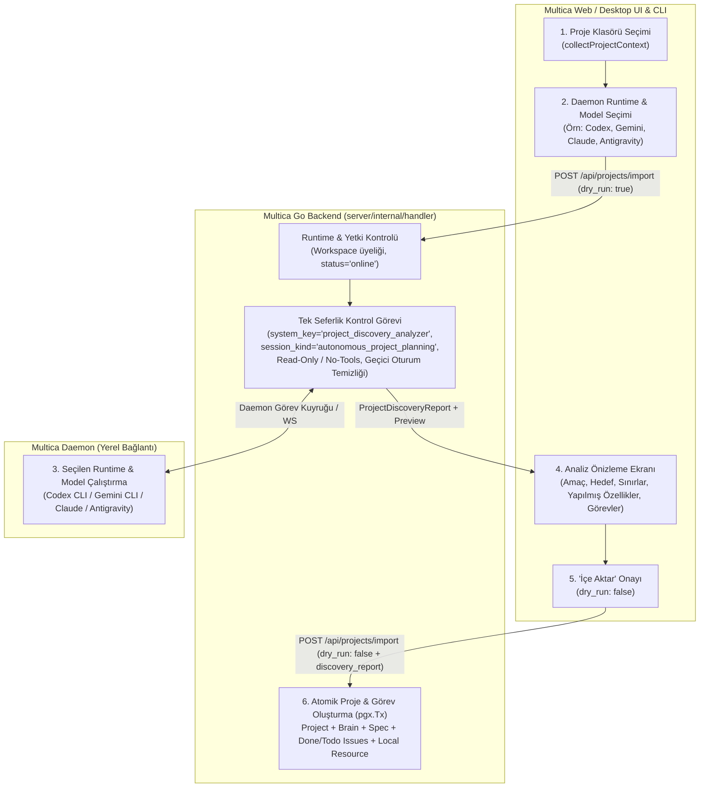
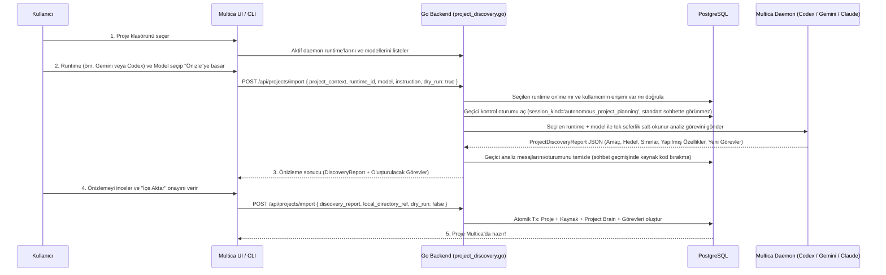

# Multica Daemon-Tabanlı Proje Keşfi ve İçe Aktarma (Daemon-First Project Discovery) Planı

## 1. Hedef ve Mimari Prensip

Multica'ya dışarıdan bir proje klasörü aktarıldığında yapılan AI ön analizinin sunucu tarafındaki `.env` (`MULTICA_LLM_API_KEY` / `MULTICA_LLM_BASE_URL`) ayarlarına bağımlı olması Multica'nın mimarisine ve çalışma zamanı özgürlüğüne aykırıdır.

Bu plan ile proje keşif ve analizi **her zaman bağlı Multica Daemon (`agent_runtime`) üzerinden** çalışacak şekilde dönüştürülmektedir:

1. **Sıfır `.env` Bağımlılığı — Her Zaman Daemon Üzerinden Çalışma:**
   - Sunucu içi `server/pkg/llm` (`MULTICA_LLM_*`) bağımlılığı proje keşfinden **tamamen kaldırılır**.
   - Proje analizi her zaman kullanıcının çalışma alanında bağlı olan **Multica Daemon runtime'ı** üzerinden yürütülür.
2. **Runtime ve Model Seçim Özgürlüğü (Codex, Gemini, Claude, Antigravity, OpenCode vb.):**
   - Kullanıcı klasörü seçtiğinde, bağlı daemon üzerindeki aktif runtime'lardan istediğini (**Codex, Gemini, Claude, Antigravity vb.**) ve o runtime'ın desteklediği **modeli** (`runtimeModelsOptions`) seçebilir (varsayılan olarak Mika'nın veya kullanıcının aktif `online` runtime'ı otomatik seçili gelir).
3. **Kalıcı Sohbet Bırakmayan, Dosyaları Değiştirmeyen Tek Seferlik Analiz ve Onaylı Oluşturma:**
   - Analiz aşaması (`dry_run: true`) projeyi veya görevleri veritabanında **oluşturmaz**; yalnızca seçilen daemon runtime ve modeli üzerinden tek seferlik analiz yaparak **Projenin Amacı, Hedefi, Sınırları, Yapılmış Özellikleri ve Yeni Görevleri** çıkarır ve Multica arayüzünde **önizletir**.
   - Bu analiz normal kullanıcı sohbetlerini (`session_kind = 'standard'`) kullanmaz, kaynak dosyaları kalıcı sohbet geçmişine yazmaz (analiz bittiğinde geçici kontrol oturumu temizlenir) ve kaynak dosyalarda hiçbir değişiklik yapmaz.
   - Proje, Project Brain ve görevler **yalnızca kullanıcı "İçe Aktar" onayını verdikten sonra (`dry_run: false`)** oluşturulur.
4. **Yerel Klasörün (`local_directory`) Otomatik Kaynak Olarak Bağlanması:**
   - CLI (`multica project import --dir <path>`) veya Desktop uygulaması üzerinden tam dizin yoluyla içe aktarma yapıldığında, analizi yapan daemon'un `daemon_id` bilgisi ve klasör yolu projenin `local_directory` kaynağı (`project_resource`) olarak otomatik bağlanır; böylece içe aktarma biter bitmez ajanlar kodu okuyup geliştirmeye devam edebilir.

---

## 2. Mimari Tasarım ve Akış Diyagramı

### 2.1 Daemon-Tabanlı Analiz ve İçe Aktarma Mimarisi

### 2.2 Adım Adım Sıralı Akış (Sequence Diagram)

---

## 3. Mimari Karar Kayıtları (ADR)

### ADR-001: Sunucu `.env` LLM Yolu Yerine Daemon Runtime Taşıyıcısı (`DaemonDiscoveryExecutor`)
- **Problem:** `server/pkg/llm` yalnızca sunucuda `.env` (`MULTICA_LLM_API_KEY` / `MULTICA_LLM_BASE_URL`) tanımlıysa çalışır ve kullanıcıyı tek bir sabit modele mahkum eder. Oysa Multica'da kullanıcıların zaten çalışan bir daemon bağlantısı ve Mika/ajanlar için yapılandırdıkları Codex, Gemini, Claude, Antigravity gibi runtime'ları vardır.
- **Karar:**
  - `server/internal/handler/project_discovery.go` içindeki `llm.Client` kullanımı tamamen kaldırılır.
  - Yerine `Handler.TaskService` ve `Handler.Queries` üzerinden çalışan **Daemon-Tabanlı Proje Keşif Yürütücüsü (`newDaemonProjectDiscoveryAnalyzer`)** kurulur.
  - Kullanıcı `runtime_id` seçtiyse o runtime, seçmediyse çalışma alanındaki Mika'nın (`system_key = 'mika'`) online runtime'ı veya kullanıcının erişebildiği ilk `status = 'online'` daemon runtime'ı kullanılır.
  - Kullanıcı `model` seçtiyse görev o modelle (`carrier.Model`), seçmediyse runtime'ın kendi varsayılan modeliyle çalıştırılır.

### ADR-002: Kalıcı Sohbet Bırakmayan ve Kaynak Dosyaları Değiştirmeyen İzole Çalıştırma
- **Problem:** Normal bir sohbet görevi (`session_kind = 'standard'`) kullanılırsa, analiz için gönderilen kaynak dosyalar kullanıcının sohbet geçmişini şişirir ve normal bir ajan kaynak dosyaları değiştirmeye kalkabilir.
- **Karar:**
  1. **Gizli Sistem Taşıyıcısı (`kind = 'system'`, `system_key = 'project_discovery_analyzer'`):**
     - `mcp_config = NULL`, `composio_toolkit_allowlist = NULL` olarak yapılandırılır; hiçbir dış araca veya workspace mutasyon aracına erişemez.
  2. **İzole Oturum (`session_kind = 'autonomous_project_planning'`, `ProjectID = NULL`):**
     - `chat.sql` içindeki tüm kullanıcı sohbet sorguları `AND cs.session_kind = 'standard'` şartına sahip olduğu için bu oturum hiçbir zaman kullanıcı sohbet listesinde görünmez.
     - `ProjectID = NULL` bırakıldığı için mevcut bir projenin çalışma dizini kilidiyle (`worktree` / `local_directory`) çakışmaz ve tüm daemon sağlayıcılarında (Codex, Gemini, Claude, Antigravity, OpenCode vb.) çalışır.
  3. **Anında Geçici Veri Temizliği (`defer cleanupDiscoverySession`):**
     - Görev çıktısı (`task.Result.Output`) okunduğu anda (veya hata/iptal durumunda `defer` içinde), bu analiz için açılan `chat_session`, `chat_message` ve `agent_task_queue` kayıtları veritabanından temizlenir; böylece kaynak kod parçaları veritabanında kalıcı olarak tutulmaz.
  4. **Önizleme-Onay Ayrımı (`Preview Gate`):**
     - Daemon analizi yalnızca `dry_run: true` (Önizleme) aşamasında çalışır ve hiçbir `project` veya `issue` satırı oluşturmaz.
     - Kullanıcı önizlemeyi onayladığında (`dry_run: false`), onaylanan `discovery_report` doğrudan `BuildBundleFromDiscovery` → `ApplyPortability` ile atomik olarak veritabanına yazılır (ikinci kez AI çağrısı yapılmaz).

---

## 4. Katman Bazlı Yapılacak Değişiklikler

### Katman 1: Go Backend — Şema ve Daemon Keşif Motoru

#### [MODIFY] [schema.go](file:///Users/caglar/Desktop/Frontend/multica/server/internal/projectbundle/schema.go) & [discovery.go](file:///Users/caglar/Desktop/Frontend/multica/server/internal/projectbundle/discovery.go)
- `ImportRequest` yapısına daemon hedefleme ve yerel kaynak bağlama alanlarının eklenmesi:
  - `RuntimeID string` (`json:"runtime_id,omitempty"`): Analizin üzerinde koşacağı daemon runtime UUID'si (boşsa çalışma alanındaki varsayılan online daemon runtime'ı kullanılır).
  - `Model string` (`json:"model,omitempty"`): Seçilen runtime üzerinde kullanılacak opsiyonel model kimliği (örn. `gpt-5.3-codex`, `gemini-2.5-pro`).
- `ProjectContextPayload` yapısına opsiyonel yerel kaynak bilgisinin eklenmesi:
  - `LocalPath string` (`json:"local_path,omitempty"`): CLI veya Desktop üzerinden klasör seçildiğinde klasörün gerçek yolu.
  - `DaemonID string` (`json:"daemon_id,omitempty"`): Klasörün bulunduğu yerel makinenin daemon kimliği.
- `BuildBundleFromDiscovery`: Eğer `context.LocalPath` ve `context.DaemonID` doluysa, oluşturulan `Bundle.Resources` listesine otomatik olarak `resource_type: "local_directory"` (`path`, `daemon_id`, `execution_mode: "in_place"`) kaynağını ekler; böylece proje içe aktarıldığında kaynak klasör doğrudan bağlanmış olur!

#### [MODIFY] [project_discovery.go](file:///Users/caglar/Desktop/Frontend/multica/server/internal/handler/project_discovery.go)
- `llm.Client` bağımlılığının **tamamen kaldırılması**.
- `ProjectDiscoveryInput` (`WorkspaceID`, `UserID`, `RuntimeID`, `Model`, `Context`, `Instruction`) yapısının tanımlanması.
- `newDaemonProjectDiscoveryAnalyzer(h *Handler)` implementasyonu:
  1. **Runtime Çözümleme (`resolveDiscoveryRuntime`):**
     - `input.RuntimeID` verilmişse o runtime'ı yükler; kullanıcının erişim yetkisini (`owner_id == userID || visibility == 'public' || id == mikaRuntimeID`) ve `status == 'online'` durumunu doğrular.
     - `input.RuntimeID` boşsa önce çalışma alanındaki Mika'nın (`system_key = 'mika'`) online runtime'ını, o yoksa kullanıcının erişebildiği ilk `status = 'online'` daemon runtime'ını seçer. Hiç online daemon yoksa `ErrDiscoveryRuntimeUnavailable` döner.
  2. **Taşıyıcı ve Geçici Oturum (`executeDaemonDiscoveryTask`):**
     - Seçilen `runtime` ve `input.Model` (boşsa runtime'ın varsayılanı) ile gizli sistem taşıyıcısı üzerinden `session_kind = 'autonomous_project_planning'` oturumu açar ve `h.TaskService.SendDirectChatMessage` ile görevi daemon kuyruğuna iletir.
     - Görev tamamlandığında JSON çıktısını ayrıştırır (markdown kod bloğu zarfı varsa temizler, `ValidateDiscoveryReport` ile doğrular; ilk deneme şema hatası verirse 1 kez düzeltme prompt'u çalıştırır).
     - `defer` bloğunda geçici `chat_session`, `chat_message` ve `agent_task_queue` satırlarını silerek kaynak dosya içeriklerinin kalıcı sohbette kalmamasını garanti eder.
     - Seçilen runtime'ın `DaemonID` bilgisini de döndürür ki yerel dizin yolu (`LocalPath`) varsa `local_directory` kaynağı otomatik bağlanabilsin.

#### [MODIFY] [project_portability.go](file:///Users/caglar/Desktop/Frontend/multica/server/internal/handler/project_portability.go) & [handler.go](file:///Users/caglar/Desktop/Frontend/multica/server/internal/handler/handler.go)
- `Handler.ProjectDiscoveryAnalyzer` imzasının `ProjectDiscoveryInput` alacak şekilde güncellenmesi ve `handler.New` içinde `llmClient` yerine `h.defaultProjectDiscoveryAnalyzer` (daemon tabanlı) ile bağlanması.
- `addDiscoveryWarnings`: Eğer `bundle.Resources` içinde `local_directory` veya `github_repo` kaynağı zaten bağlanmışsa `sourceNotAttachedWarning` uyarısının gösterilmemesi.

#### [MODIFY] [client_test.go](file:///Users/caglar/Desktop/Frontend/multica/server/pkg/llm/client_test.go)
- `server/internal/handler/project_discovery.go` kaydının izinli `server/pkg/llm` tüketicileri listesinden çıkarılması (böylece proje keşfinin `.env` LLM katmanını asla çağırmadığı mimari testle de güvence altına alınır).

---

### Katman 2: Multica CLI (`server/cmd/multica`)

#### [MODIFY] [cmd_project.go](file:///Users/caglar/Desktop/Frontend/multica/server/cmd/multica/cmd_project.go) & [cmd_project_portability.go](file:///Users/caglar/Desktop/Frontend/multica/server/cmd/multica/cmd_project_portability.go)
- `multica project import` komutuna `--runtime <runtime-id>` ve `--model <model-id>` bayraklarının eklenmesi.
- `--dir <path>` ile ham bir proje dizini verildiğinde `CollectProjectContext` tarafından `LocalPath` alanının da doldurulması (ve yerel daemon kimliği mevcutsa eklenmesi).

---

### Katman 3: Frontend `@multica/core` ve `@multica/views` (Web & Desktop UI)

#### [MODIFY] [project.ts](file:///Users/caglar/Desktop/Frontend/multica/packages/core/types/project.ts) & [schemas.ts](file:///Users/caglar/Desktop/Frontend/multica/packages/core/api/schemas.ts)
- `ImportProjectRequest` tipine `runtime_id?: string` ve `model?: string` alanlarının eklenmesi.
- `ProjectContextPayload` tipine ve `ProjectContextPayloadSchema` Zod şemasına opsiyonel `local_path?: string` ve `daemon_id?: string` alanlarının eklenmesi.

#### [MODIFY] [project-import-dialog.tsx](file:///Users/caglar/Desktop/Frontend/multica/packages/views/projects/components/project-import-dialog.tsx)
- Kullanıcı bir proje klasörü seçtiğinde (`projectContext` aktif olduğunda):
  1. **Daemon Runtime Seçici (`Select runtime`):**
     - `useQuery(runtimeListOptions(wsId))` ile çalışma alanındaki daemon runtime'larını yükler.
     - Online olan runtime'ları (`Codex`, `Gemini`, `Claude`, `Antigravity` vb.) listeler ve ilk online runtime'ı varsayılan olarak seçer.
     - Eğer hiç online runtime yoksa kullanıcıya `.env` yerine **"Analiz için bağlı bir Multica daemon (runtime) gereklidir"** uyarısını gösterir.
  2. **Model Seçici (`Select model`):**
     - Seçilen `runtimeId` için `useQuery(runtimeModelsOptions(runtimeId))` ile daemon üzerindeki modelleri dinamik olarak sorgular.
     - Kullanıcı isterse runtime'ın varsayılan modelini (`Runtime default`) bırakır, isterse listedeki belirli bir modeli seçer.
  3. **Desktop Doğrudan Klasör ve Kaynak Bağlantısı:**
     - Desktop kabuğunda (`isDesktopShell()`) klasör seçilirken yerel `daemonId` ve tam klasör yolu (`local_path`) da `projectContext`'e eklenir; böylece içe aktarma onaylandığında kaynak klasör projeye otomatik olarak bağlanır.

---

## 5. Doğrulama Planı ve Kabul Kapıları (`GATES.md`)

| Gate ID | Kabul Kriteri (Observable Outcome) | Doğrulama Komutu (`CHECK`) | Beklenen Çıktı (`EXPECT`) |
| --- | --- | --- | --- |
| **G1** | `server/pkg/llm` tüketici koruma testi (`TestDocumentedConsumersAreTheOnlyCallers`), `project_discovery.go` olmadan geçmeli (`.env` LLM bağımlılığı tamamen kaldırılmış olmalı) | `cd server && go test -v ./pkg/llm/...` | `PASS` |
| **G2** | Go `projectbundle` ve `handler` testleri: Daemon runtime üzerinden proje keşfi (runtime & model seçimi, geçici kontrol oturumu temizliği, `dry_run` önizleme ve onay sonrası `local_directory` kaynağıyla içe aktarma) geçmeli | `cd server && go test -v ./internal/projectbundle/... ./internal/handler -run 'TestProjectPortability|TestProjectDiscovery'` | `PASS` |
| **G3** | Multica CLI `project import --dir <path> [--runtime ...] [--model ...]` testleri geçmeli | `cd server && go test -v ./cmd/multica -run 'TestProjectPortability'` | `PASS` |
| **G4** | `@multica/core` ve `@multica/views` (klasör seçildiğinde daemon runtime ve model seçimi + önizleme + onay) Vitest testleri, `pnpm typecheck` ve `pnpm lint` sıfır hatayla geçmeli | `pnpm --filter @multica/core test -- portability && pnpm --filter @multica/views test -- project-portability && pnpm typecheck && pnpm lint` | `0 errors` |
