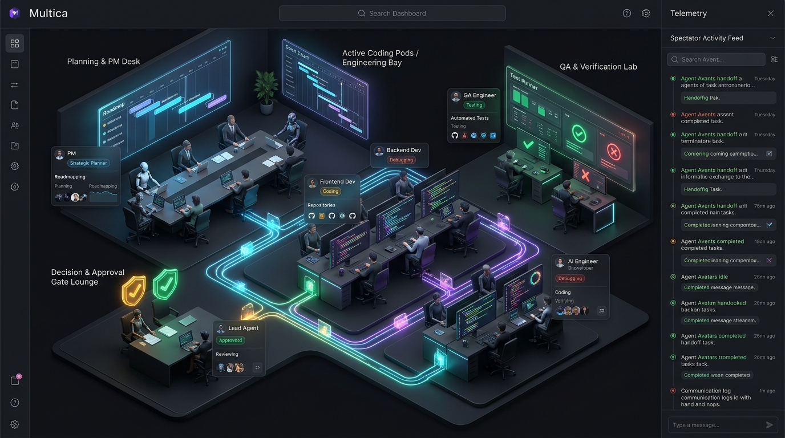
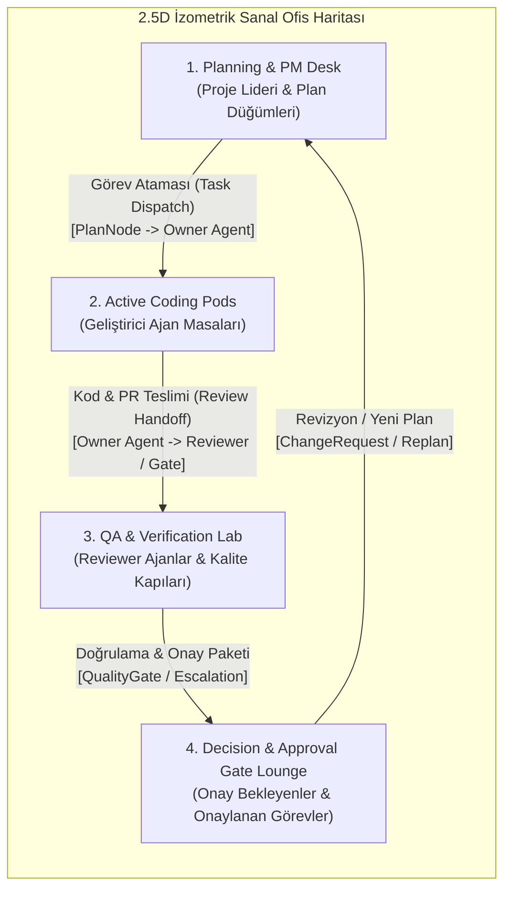

# Multica Sanal Ofis (Virtual Office) — Uygulama Planı

## 1. Hedef ve Vizyon

Multica üzerinde mevcut **Kokpit** ([`ProjectCockpitView`](../../../packages/views/projects/components/cockpit/project-cockpit-view.tsx)) görünümüne ek olarak, ajanların nasıl çalıştığını, hangi görevlerin onaylandığını, hangilerinde işlemlerin devam ettiğini ve görev/veri paketlerinin hangi istasyondan hangisine geçtiğini (**"ne nereye gitti"**) dışarıdan bir **izleyici (spectator)** gözüyle canlı takip etmeyi sağlayan **2.5D İzometrik Sanal Ofis** inşa edilecektir.

> [!IMPORTANT]
> **Mülakat (`/grill-me`) Kararları Özeti:**
> 1. **Perspektif & Teknoloji:** 2.5D İzometrik / Mekansal Ofis Haritası (Sıfır ağır 3D bağımlılığı; SVG + CSS İzometrik katmanlar ve animasyonlu veri/görev akış hatları).
> 2. **Çift Erişim Noktası:**
>    - **Proje Detay Sekmesi (`/:slug/projects/:id?tab=office`):** `Kokpit` sekmesinin hemen yanında yer alır ve doğrudan o projenin sanal ofisini açar.
>    - **Workspace Genel Merkez Ofisi (`/:slug/office`):** Sol menüde (`AppSidebar`) yer alır; üstteki **Kat / Bölge Seçici (Floor Switcher)** ile tüm aktif projeler ve standart görevlerde çalışan ajanlar arasında geçiş sağlar.
> 3. **Canlı Akış + Olay Tekrarı (Live + Activity Replay):** Hem anlık görev durumları ve aktif transferler canlı görünür, hem de sağdaki **Spectator Activity Feed** üzerinden herhangi bir olaya tıklandığında o olayın "ne nereye gitti" paket animasyonu izometrik haritada tekrar oynatılır.
> 4. **İnteraktif İzleyici + Hızlı Onay Çekmecesi:** Haritadaki bir ajana, göreve veya **Onay Kapısı (Decision & Approval Gate Lounge)** istasyonuna tıklandığında haritadan kopmadan sağ çekmecede detaylar/canlı loglar açılır; bekleyen plan, değişiklik veya eskalasyon onayları doğrudan ofis içinden verilebilir.
> 5. **Tam Ekran İzleyici Modu (Spectator Fullscreen Mode):** Tek tıkla yan panelleri gizleyerek ikinci monitörde veya sunum ekranında canlı ajan ofisini izleme imkanı.

---

## 2. Mekansal Mimari ve Veri Eşleme (Data-to-Spatial Mapping)

Sanal Ofis, `AutonomousProjectSnapshot`, `ProjectLeaderChangeRequest[]`, `Agent[]` ve `Issue[]` verilerini 4 ana izometrik istasyona ve bunları birbirine bağlayan ışıklı veri hatlarına dönüştürür:

### İstasyon ve Veri Karşılıkları

| Ofis Bölgesi (Zone) | Görsel Temsil | Veri Kaynağı (`@multica/core`) | Gösterilen Durumlar & Rozetler |
| :--- | :--- | :--- | :--- |
| **1. Planning & PM Desk** | Strateji masası, yol haritası ekranı ve Lider Ajan (`leader_agent_id`) | `snapshot.team.leader_*`, `snapshot.plan`, `snapshot.bootstrap` | Plan revizyonu (`v1`, `v2`), toplam düğüm sayısı, PM durumu (`Planning`, `Ready`, `Waiting Approval`) |
| **2. Active Coding Pods** | Her takım üyesi (`AutonomousTeamMember`) ve standart aktif ajan için ışıklı çalışma masası | `snapshot.team.members`, `snapshot.workflows`, `issues` (`in_progress`, `todo`) | Ajan avatarı, rolü, aktif çalıştığı görev (`current_task_title`), durum halkası (`Running`, `Debugging`, `Blocked`, `Idle`) |
| **3. QA & Verification Lab** | Test monitörleri, Reviewer ajan koltukları ve kalite kapısı terminalleri | `snapshot.workflows` (`reviewer_agent_id`, `review_cycles`), `snapshot.quality_gates`, `issues` (`in_review`) | İnceleme döngüsü sayısı (`Cycle #1`), kalite kapısı durumu (`Passed` yeşil ✓, `Failed` kırmızı ✗, `Verifying` mavi ⟳) |
| **4. Decision & Approval Gate Lounge** | Kalkan/Onay hologramlı karar masası ve tamamlanan görev vitrini | `snapshot.plan.status === "awaiting_approval"`, `changeRequests`, `snapshot.escalations`, `nodes` (`completed`) | **Bekleyen Onaylar** (Amber vurgu + Hızlı Onay butonu) ve **Onaylanan/Tamamlanan Görevler** (`Approved` / `Completed` zümrüt yeşili rozet) |

### "Ne Nereye Gitti" — Paket Akış Motoru (`PacketFlowLayer`)

İstasyonlar arasında zeminde yer alan izometrik neon hatlar (`SVG <path>`) üzerinde hareket eden veri paketleri iki modda çalışır:
1. **Canlı Paketler (Continuous Live Pulses):**
   - `workflow.state === "running"` veya ajan bir task üzerinde aktifken: **PM Desk → İlgili Ajan Masası** hattında mavi/camgöbeği paket akışı.
   - `workflow.reviewer_agent_id` mevcutken veya `node.status === "verification"` iken: **Geliştirici Ajan Masası → QA & Verification Lab** hattında mor/eflatun paket akışı.
   - Onay bekleyen plan/değişiklik veya tamamlanan (`completed`) görevlerde: **QA Lab / PM Desk → Decision & Approval Lounge** hattında kehribar (bekleyen) veya zümrüt yeşili (onaylanan) paket akışı.
2. **Olay Tekrarı (Activity Replay Highlight):**
   - Sağdaki **Spectator Activity Feed** listesindeki herhangi bir olaya (`AutonomousActivityItem`, örn. `task.dispatched`, `workflow.review_requested`, `plan.approved`, `task.completed`) tıklandığında (veya "Son Olayları Oynat" butonuna basıldığında), harita üzerinde **Kaynak İstasyon → Hedef İstasyon** arasında parlak bir paket ve olay başlığını taşıyan yüzen etiket (`Floating Event Bubble`) 2.5 saniyelik odaklanmış bir animasyonla hareket eder.

---

## 3. Önerilen Değişiklikler ( Bileşen ve Dosya Bazlı)

### Katman 1: Rotalar, Slug Rezervasyonu ve Navigasyon Altyapısı (`@multica/core` & `server`)

Sol menüye `/:slug/office` rotasını eklemek için Multica'nın rota sözleşmesi eksiksiz güncellenecektir:

#### [MODIFY] [reserved_slugs.json](../../../server/internal/handler/reserved_slugs.json) & [reserved-slugs.ts](../../../packages/core/paths/reserved-slugs.ts)
- `workspace_route_segments_mirrored_for_defense_in_depth` listesine `"office"` eklenecek ve `pnpm generate:reserved-slugs` çalıştırılacaktır.

#### [MODIFY] [paths.ts](../../../packages/core/paths/paths.ts)
- `workspaceScoped(slug)` içine `office: () => `${ws}/office`` ve `projectOffice: (id: string) => `${ws}/projects/${encode(id)}?tab=office`` yardımcı metodları eklenecektir.

#### [MODIFY] [route-icons.ts](../../../packages/core/paths/route-icons.ts) & [route-icon-components.tsx](../../../packages/views/layout/route-icon-components.tsx)
- `RouteIconName` tipine `"Building2"` (Lucide ikonu), `NavLabelKey` ve `WorkspacePageKey` tiplerine `"office"` eklenecektir.
- `WORKSPACE_PAGES.office = { segment: "office", icon: "Building2", navKey: "office" }` tanımlanacaktır.

#### [MODIFY] [tab-subject.ts](../../../packages/core/paths/tab-subject.ts) & [consistency.test.ts](../../../packages/core/paths/consistency.test.ts)
- `parseTabSubject` içine `case "office": return { kind: "page", page: "office" };` eklenecek ve rota tutarlılık testleri güncellenecektir.

---

### Katman 2: Paylaşımlı Sanal Ofis Görünüm Paketi (`packages/views/office/`)

Hem proje sekmesinde (`ProjectVirtualOfficeTab`) hem de sol menüdeki genel merkez sayfasında (`WorkspaceVirtualOfficePage`) ortak kullanılacak modüler mimari:

#### [NEW] `packages/views/office/types.ts` & `packages/views/office/spatial-mapper.ts`
- **`buildVirtualOfficeScene()` (Saf/Pure Fonksiyon):** `AutonomousProjectSnapshot`, `ProjectLeaderChangeRequest[]`, `Agent[]` ve `Issue[]` verilerini alıp;
  - 4 istasyonun (`pm_desk`, `coding_pods`, `qa_lab`, `approval_lounge`) durumunu,
  - Her ajanın hangi masada oturduğunu, aktif görevini, görev durumunu (`running`, `approved`, `waiting_approval`, `verifying`, `blocked`, `idle`),
  - İstasyonlar arası aktif veri akış hatlarını (`OfficeFlowEdge[]` — `fromStation`, `toStation`, `fromAgentId`, `toAgentId`, `status`, `label`, `issueId`)
  deterministik olarak hesaplar. Tamamen birim test edilebilir (DOM-free) yapıda olacaktır.

#### [NEW] `packages/views/office/components/isometric-office-canvas.tsx`
- 2.5D izometrik kat planını, 4 ana odayı/istasyonu, zemin ızgarasını, duvar/ekran panellerini (Roadmap ekranı, Gantt/Kod ekranı, Test Runner ekranı, Onay Kalkanı hologramları), masa/ajan düğümlerini ve zoom/pan + odalar arası odaklanma kontrollerini barındıran interaktif sahne bileşeni.
- Üst barda:
  - **Canlı Durum Özeti:** Aktif Ajan Sayısı, Devam Eden Görevler, Onaylanan Görevler, Bekleyen Onaylar.
  - **Olay Tekrarı (Replay) Kontrolleri:** "Son Akışı Oynat (Play Recent Flow)" ve hız/filtre seçimi.
  - **Tam Ekran İzleyici Modu (Spectator Fullscreen):** Yan panelleri daraltıp sahneyi tam ekran yapma butonu.

#### [NEW] `packages/views/office/components/packet-flow-layer.tsx`
- İstasyonlar ve ajan masaları arasındaki neon bağlantı yollarını (`SVG <path>`) ve bu yollar üzerinde hareket eden görev paketlerini (`animateMotion` / CSS keyframe ile akıcı paket transferi) çizer.
- Seçili bir `replayActivity` varsa, ilgili iki nokta arasında özel vurgulu paket ve olay açıklaması baloncuğu uçurur.

#### [NEW] `packages/views/office/components/agent-desk-hud.tsx`
- Her ajanın masasının üzerinde yer alan yüzen mini HUD kartı (Konsept görseldeki gibi):
  - Ajan Avatarı + Canlı durum noktası
  - Ajan Adı & Rolü (`PM`, `Frontend Dev`, `Backend Dev`, `QA Engineer`)
  - Üzerinde çalıştığı Task/Issue başlığı ve durum rozeti (`Coding`, `Debugging`, `Testing`, `Approved`, `Reviewing`)
  - Tıklandığında sağdaki **Inspector & Spectator Drawer** içinde o ajanın detayını açar.

#### [NEW] `packages/views/office/components/office-inspector-drawer.tsx`
- Sağ panelde iki sekme/mod ile çalışan çekmece:
  1. **Spectator Activity Feed (Canlı İzleyici Akışı):** Gerçek zamanlı görev geçişleri, el değiştirmeler (handoffs) ve onay olayları. Her satırda **"Haritada Göster / Tekrar Oynat" (Replay on Map)** butonu bulunur.
  2. **Seçili İstasyon / Ajan / Onay Detayı (Inspector & Quick Approval):**
     - Bir ajana tıklandığında: Ajanın mevcut görevi, sorumlulukları, son aksiyonları ve ajan detayına/sohbete hızlı geçiş.
     - **Decision & Approval Gate Lounge**'a tıklandığında: Onay bekleyen Proje Planı (`AutonomousPlanApprovalCard`), Lider Değişiklik Talepleri (`ProjectLeaderChangeRequest`) ve Eskalasyonlar doğrudan buradan **Onayla / Reddet** butonlarıyla yönetilir; ayrıca onaylanmış/tamamlanmış task'ların listesi görülür.

#### [NEW] `packages/views/office/components/workspace-office-page.tsx`
- Sol menüden (`/:slug/office`) açılan **Genel Merkez Sanal Ofisi**:
  - Üstte **Kat Seçici (Floor Switcher):**
    - `Genel Kampüs (All Active Agents & Projects)` katı: Tüm projelerin ve standart issue'larda çalışan ajanların canlı istasyon görünümü.
    - `Proje Katları (Floor 1: Project A, Floor 2: Project B...)`: Seçilen projenin `AutonomousProjectSnapshot` verisiyle tam 4 istasyonlu otonom sanal ofisi.

---

### Katman 3: Proje Detay Sekmesi, Sidebar ve Web/Desktop Bağlantıları

#### [MODIFY] [project-detail.tsx](../../../packages/views/projects/components/project-detail.tsx)
- `contentView` tipine `"office"` eklenecektir: `"cockpit" | "office" | "issues" | "report" | "brain" | "deployments"`.
- Sekme çubuğuna `Kokpit` (`tab_cockpit`) butonunun hemen sağına **`Sanal Ofis` (`tab_office`)** sekmesi eklenecektir.
- `contentView === "office"` olduğunda `<ProjectVirtualOfficeView />` tüm canlı `autonomousSnapshot`, `changeRequests` ve onay callback'leri (`onApprovePlan`, `onApproveChange`, `onRejectChange`, `onResolveEscalation`, `onOpenLeaderChat`) ile render edilecektir.

#### [MODIFY] [app-sidebar.tsx](../../../packages/views/layout/app-sidebar.tsx) & [link-handler.ts](../../../packages/views/editor/utils/link-handler.ts)
- `workspaceNav` dizisine `projects`'in hemen altına `{ key: "office", labelKey: "office" }` eklenecektir.
- `WORKSPACE_ROUTE_SEGMENTS` setine `"office"` eklenecektir.

#### [NEW] [apps/web/app/[workspaceSlug]/(dashboard)/office/page.tsx](../../../apps/web/app/%5BworkspaceSlug%5D/(dashboard)/office/page.tsx) & [MODIFY] [apps/web/proxy.ts](../../../apps/web/proxy.ts)
- Next.js web uygulaması için `/:workspaceSlug/office` sayfası eklenecek ve `proxy.ts` rota listesi güncellenecektir.

#### [MODIFY] [apps/desktop/src/renderer/src/routes.tsx](../../../apps/desktop/src/renderer/src/routes.tsx)
- Electron masaüstü uygulaması için `path: "office"` rotası bağlanacaktır.

#### [MODIFY] Çoklu Dil Dosyaları (`packages/views/locales/{tr,en,zh-Hans,ja,ko}/{layout,projects}.json`)
- `layout.json` içine `nav.office` ("Sanal Ofis" / "Virtual Office" vb.) ve `projects.json` içine `detail.tab_office` ile Sanal Ofis istasyon, durum ve izleyici akışı çevirileri eklenecektir (`eslint-i18n-guard` kurallarına tam uyumlu olarak).

---

## 4. Doğrulama ve Test Planı (Verification Plan)

### Otomatik Testler
1. **Mekansal Eşleme & Akış Birim Testleri (`packages/views/office/spatial-mapper.test.ts`):**
   - `AutonomousProjectSnapshot` içindeki PM, geliştirici ajanlar, reviewer ajanlar, onay bekleyen planlar ve tamamlanan düğümlerin doğru istasyonlara (`pm_desk`, `coding_pods`, `qa_lab`, `approval_lounge`) ve doğru paket akış hatlarına dönüştürüldüğünün doğrulanması.
2. **Sanal Ofis Bileşen Testleri (`packages/views/office/components/virtual-office-view.test.tsx`):**
   - 4 istasyonun, ajan HUD kartlarının, onaylanan/devam eden task rozetlerinin render edilmesi.
   - Spectator Activity Feed üzerinden bir olaya tıklandığında "ne nereye gitti" replay animasyon durumunun tetiklenmesi.
   - Onay Kapısı'ndan (Approval Gate Lounge) plan/değişiklik onaylama aksiyonlarının çağrılması.
3. **Proje Detay & Rota Tutarlılık Testleri:**
   - `packages/views/projects/components/project-detail.test.tsx` içinde `?tab=office` sekmesine geçiş testi.
   - `packages/core/paths/consistency.test.ts`, `route-icons.test.ts`, `apps/web/proxy.test.ts` testlerinin çalıştırılması.
4. **Kod Kalitesi Kontrolleri:**
   - `pnpm typecheck`
   - `pnpm lint`
   - `pnpm test`

### Manuel Doğrulama
1. Bir projeye girip üst sekmeden **Kokpit** yanındaki **Sanal Ofis** sekmesine tıklayarak 4 istasyonlu 2.5D izometrik ofisin, ajan masalarının ve canlı veri akış hatlarının görüntülenmesi.
2. Sağdaki **Spectator Activity Feed**'den bir olaya tıklayarak harita üzerinde paketin hangi ajandan hangi istasyona gittiğinin animasyonla izlenmesi.
3. Sol menüdeki **Sanal Ofis** (`/:slug/office`) sayfasına tıklayarak Kat Seçici (Floor Switcher) ile genel kampüs ve proje katları arasında geçiş yapılması.
