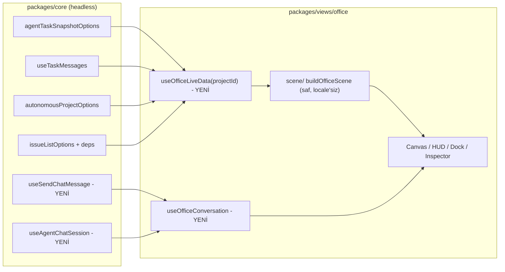

# Sanal Ofis → Gerçek Multica Özelliklerine Bağlama Planı

## Hedef
2.5D ofis görsel olarak güçlü ama **veri katmanı büyük ölçüde sahte**. Hedef: ofisi gerçek verilerle çalışan bir "canlı proje görünümü"ne çevirmek:

1. Hangi ajan hangi işi yapıyor (gerçek task + canlı tool akışı)
2. Blokajlar (issue bağımlılıkları, bloklu plan düğümleri, escalation, başarısız task)
3. Ofis içinden ajanlarla **gerçek** sohbet (PM + ajan bazlı)
4. PM'e proje durumu sorma (gerçek veriden)
5. Ajanlar arası iş akışı/handoff (owner→reviewer, plan bağımlılıkları)
6. Tam yerelleştirme (5 dil), AGENTS.md uyumu

İncelenenler: 3 commit (`75b26e99db`, `69e3de561b`, `498a47ef4d`), uncommitted diff (9 dosya, +489/−229), 4 doküman, ve 4 alt ajan araştırması (i18n, veri bağlama, sohbet, kalite).

> [!IMPORTANT]
> Durum: tsc, eslint (project-detail + office tip kontrolü) ve 29 vitest testi geçiyor. **Ancak `cd packages/views && pnpm exec eslint office` 17 i18n hatası veriyor** (agent-desk-hud 8, commander-dock 7, inspector-drawer 2). `pnpm lint` CI'da kırılır.

---

## 1. Bulgular

### 1.1 Gerçek mi sahte mi? (özet matris)

| Alan | Durum | Gerçek kaynak |
|---|---|---|
| Ajan adı/avatar, lider, plan düğümleri, onay sayıları, completed sayısı | **Gerçek** | snapshot, team, plan |
| Desk `status` | Türetilmiş + tahmin (`idle→running` tahmini, QA→`verifying` tahmini) | `agentTaskSnapshotOptions`, `Agent.status`, issue `dependency_state` |
| `activeTool` | **Sahte** (rol başına sabit: `pnpm test --run`, uydurma dosya yolları) | `task:message` stream (`tool_use`/`tool_result`, `useTaskMessages`) |
| `recentTools` | Hiç doldurulmuyor | aynı stream |
| `activeSkill`, `allowedSkills` | **Sahte** (preset listesi, kullanıcıya özel skill adları) | `Agent.skills`, workspace skills, `Skill` tool_use |
| `activeSpeechBubble` | **Sahte**, Türkçe sabit; `Date.now()` id; deskId eşleşmiyor | son `text/thinking` TaskMessage veya yorum |
| `isDaemonActive` | Zayıf: "proje enabled" demek, her desk'e aynı değer | `deriveAgentAvailability` / runtime `last_seen_at` |
| `tokenUsageMode` | Sahte etiket | `AgentTask.usage`, `snapshot.budget` |
| Rol/kategori/karakter | Alt string eşleşmesi (`pm`, `go`, `ui` alakasız kelimelerde tutar) | `member.family`, `member.role` |
| Flow edge'leri | 5 **statik** edge, yalnız `active` hesaplanıyor; `issueId` yok | workflow owner→reviewer, `plan.edges`, `blocked_by`, escalations |
| Replay events | Gerçek `snapshot.activity` + **uydurma fallback**; station tahmini | `activity.agent_id`, `type` |
| Ofis stats `activeAgents` | Şişirilmiş (kimse aktif değilse hepsi) | task snapshot |
| `inReviewWorkflows` | `reviewer_agent_id` varsa sayıyor (şişik) | workflow.state |
| Blokaj gösterimi | **Hiç yok** | issue deps, node `blocked_*`, `health`, `diagnostics`, failed tasks |
| Commander dock yanıtları | **Tamamen sahte** (`generateContextualAgentReply` + `setTimeout 1100`; "27 görev onaylandı" gibi uydurma bilgiler; "Canlı LLM" rozeti yanıltıcı) | chat session + WS `chat:message`/`chat:done` |

### 1.2 Sohbet (kritik)
- Gerçek `api.sendChatMessage` yalnız `project-detail.tsx` içinde inline çağrılıyor; hatalar `console.warn` ile yutuluyor; yanıt hiç okunmuyor.
- **Bug:** `targetAgentId` yönlendirmede yok sayılıyor — leader session PM'e bağlı, başka ajan seçilse de mesaj PM'e gidiyor.
- `workspace-office-page` hiç handler geçirmiyor → genel ofiste dock %100 sahte.
- Transcript local `useState` → server verisi Query'de olmalı kuralı ihlali; pending/retry yok; `clientMessageId` yok (çift gönderim riski).
- Leader chat yalnız `autonomous.enabled` projelerde var (503 olabilir).

### 1.3 i18n
- ~60 sabit metin; en/tr 54 `office.*` key, **zh-Hans/ja/ko 47** (7 `desk_status.*` eksik).
- Mapper (`.ts`, lint kapsamı dışı) Türkçe `categoryLabel`, balon, varsayılan başlık, edge etiketleri döndürüyor → dil değişince bayat kalır, tüm dillerde Türkçe görünür.
- `team-skill-presets.ts` (core) İngilizce başlık/açıklama taşıyor; core `useT` kullanamaz.
- `toLocaleTimeString([])` sabit locale kullanımı (dock 2, inspector 1).
- Dock'ta `useT` hiç yok.

### 1.4 Diğer kalite sorunları
- 50 adet `text-[Npx]` (8.5–11.5px) → `--text-*` scale ihlali + erişilebilirlik; ~150 sabit palet (slate/sky/#hex) → semantik token yok, açık tema riski.
- `prefers-reduced-motion` hiç yok; pan/zoom state'i her tick'te tüm sahneyi (553 satırlık HUD'lar dahil) yeniden render ediyor; `memo` yok; canvas masaları klavyeyle erişilemiyor.
- `spatial-mapper.ts` 935 satır god-file (sınıflama + layout + sahne + tool tahmini).
- `office-inspector-drawer` (444 satır) ve dock arasında sorumluluk çakışması; `"ceo"` sender ve ikinci `ChatMessageItem` modeli ölü/paralel.
- `project-detail.tsx` office'e `issues` geçirmiyor.
- Snapshot 5 sn polling; `task:*` olaylarında autonomous key'leri invalidate edilmiyor.
- Test boşlukları: dock, packet-flow, canvas klavye/zoom, inspector, `onSendChatMessage`.

### 1.5 Repo hijyeni
> [!WARNING]
> `scratch_screenshot.mjs` (untracked, gitignore'da değil): kişisel e-posta içeriyor, doğrulama kodunu `docker exec psql` ile DB'den okuyarak girişi aşıyor. **Silinmeli, commit edilmemeli.** `docs/architecture/office/` dokümanları makineye özel görsel yolları içeriyordu; repoya alınacaksa yollar düzeltilmeli.
> `context_test.go` değişikliği meşru fixture düzeltmesi (13. kolon `[]byte("[]")`), ilgili prod değişikliğiyle birlikte commit edilmeli.

---

## 2. Hedef mimari (deep module'ler)



**Modül kararları (codebase-design sözlüğü):**
- `useOfficeLiveData(projectId?)` — **derin modül**: dar arayüz `{scene, isPartial, isLoading}`; içeride 5 Query kaynağını birleştirir. Seam = bu hook; testte adapter olarak sahte Query verisi.
- `buildOfficeScene(input)` — saf, **metin üretmeyen**: yalnız id/enum/params döndürür (`category`, `bubble:{kind,params}`, `edge.kind`, `blocker:{kind,...}`). Çeviri view katmanında.
- `spatial-mapper.ts` bölünür: `classify.ts` (family/role → category), `layout.ts` (koordinatlar), `scene-builder.ts`, `live-signals.ts` (task/tool/blocker türetme).
- `useOfficeConversation({desk, projectId})` — `{messages, pending, sendError, send, retry, status}`; dock yalnız sunum.
- Core: `useSendChatMessage` (use-chat-controller'dan çıkarılır: optimistic seed, `clientMessageId`, hata/retry) ve `useAgentChatSession({agentId, projectId})`.

---

## 3. Fazlar

### Faz 0 — Hijyen ve güvenli temel (1 küçük PR)
- `scratch_screenshot.mjs` sil; office docs kararı (aşağıda Soru 3).
- Dock'taki `generateContextualAgentReply`, `setTimeout`, "Canlı LLM" rozeti **hemen kaldırılır** (sahte veri → boş/devre dışı durum). Sahte bubble/tool/skill alanları UI'da gizlenir (veri yoksa hiçbir şey).
- `context_test.go` düzeltmesini ilgili commit'e ata.

### Faz 1 — i18n ve token temizliği
- Mapper'ı "data-not-text" yap; view'da exhaustive map (`CATEGORY_LABEL`, `EDGE_LABEL`, `BUBBLE`...).
- ~70 yeni key: en, tr, zh-Hans, ja, ko (+ eksik 7 `desk_status.*`); kullanılmayan 8 key temizle. UI Copy kuralı: açıklama varsayılan yok; dock header'daki uzun açıklama kaldırılır.
- `team-skill-presets.ts`: `roleId` sabit kalır, başlık/açıklama `office.roles.*` olur (önce kullanım yerleri doğrulanacak).
- Zaman: locale hook + `Intl.DateTimeFormat`.
- `text-[Npx]` → `--text-*`; sabit renk → semantik token (açık/koyu tema kontrolü).
- Doğrulama: `cd packages/views && pnpm exec eslint office` = 0 hata.

### Faz 2 — Gerçek ajan durumu ve canlı akış
- `agentTaskSnapshotOptions` + `useAgentPresence` → `status`, `isDaemonActive` (per-agent), kuyruk (`queuedTasks`), `currentIssueId`.
- Çalışan task id'leri için `useTaskMessages(taskId, true)` (WS cache yalnız mount edilmişse yazılıyor — kritik not) → `activeTool`, `recentTools` (son N, `call_id` eşleşmesi), `activeSkill` (`Skill` tool), balon = son `text/thinking` (veri yoksa gösterme, `Date.now()` id yok).
- `allowedSkills` ← `Agent.skills`. `tokenUsageMode` kaldır; yerine `AgentTask.usage`/`budget`.
- Rol/kategori: `member.family`/`role` önce; anahtar kelime sadece son çare. Plan düğümü ↔ ajan eşleşmesi `assigned_agent_id` ile (rol eşleşmesi değil).
- `project-detail` office'e `issues` (proje filtreli) geçirir.
- `task:*`/`issue:updated` olaylarında `autonomousProjectKeys` invalidate (polling'e bağımlılığı azalt).

### Faz 3 — Blokajlar
- Yeni `Blocker` modeli (saf türetme): issue `blocked_by/dependency_state`, node `blocked_category/reason`, `diagnostics` (+`resume_action`), pending escalation, failed gate, failed `AgentTask.failure_reason`, `Agent.status` blocked/error, awaiting approval.
- Görünüm: masa üstünde kırmızı/amber blokaj rozeti, HUD'da neden + "çöz" aksiyonu (escalation resolve / retry action / ilgili issue'ya git), ofis üst barında `health` özeti (blocked/failed/waiting/resumable), `snapshot.partial` uyarısı.
- Blokaj edge'i: bloklayan ajan → bloklanan ajan (kırmızı kesikli).

### Faz 4 — Gerçek iş akışı (handoff) görünümü
- Statik 5 edge → veri güdümlü: workflow `owner→reviewer` (review_cycles etiketli), `plan.edges` (hard/soft/artifact), escalation→onay salonu; edge'e `issueId`, sayaç, aktiflik gerçek sayıdan.
- Replay: `activity.agent_id` ile `agentName`, tür→station haritası açık tablo; uydurma fallback event'ler silinir.
- `stats` düzeltme: `activeAgents` = gerçek running; `inReview` = `workflow.state`; "approved" anlamı düzelt.

### Faz 5 — Gerçek sohbet ve PM durum soru-cevabı
- `useSendChatMessage` + `useAgentChatSession` (core). PM masası → leader session (autonomous ise); diğer masalar → `(user, agent)` session + `project_id`. Dock transcript'i `chatMessagesOptions` + `pendingChatTaskOptions` + `useTaskMessages` ile; pending/queued/offline/hata+retry durumları; `clientMessageId`.
- Hata/uygunsuzluk durumları: 503 (runtime yok), 403 (invoke yasak), arşivli/offline ajan → composer devre dışı + neden.
- Hızlı sorular iki katmanlı: (a) **deterministik özet kartı** (LLM balonu değil): `projectReportOptions` + snapshot + change requests + issue listesi'nden sprint/tamamlanan/blokaj; (b) serbest metin → gerçek PM'e.
- Mod anahtarı **Sor | İş ata**: `useCreateIssue({assignee_type:"agent", assignee_id, project_id})`; sunucuyu bekle, sonuç `AppLink`.
- `onSendChatMessage` prop zinciri silinir (types/canvas/view); `workspace-office-page` otomatik düzelir. `handleOpenLeaderChat` mantığı ortak hook'a.
- Inspector↔dock sorumluluk ayrımı (Soru 2).

### Faz 6 — Performans ve erişilebilirlik
- Pan/zoom → ref + CSS transform; desk'ler `memo`; `motion-reduce:` tüm sonsuz animasyonlarda.
- Masalar `button`/`role`, klavye odak + Enter/Space, `aria-label`'lar, dock input/send label'ları; ≥ okunabilir font; küçük ekran davranışı.

### Faz 7 — Test
- Mapper: id/enum assert'leri (Türkçe metin assert'leri güncellenir), blokaj/handoff/status matrisleri.
- Hook testleri: `useOfficeLiveData`, `useSendChatMessage` (başarı/hata/retry/idempotency), `useOfficeConversation`.
- Bileşen: dock (gönder/pending/hata/hedef seçimi), canvas klavye, blokaj rozeti, packet-flow, project-detail `onSendChat` kaldırımı.
- Malformed-response testleri (yeni endpoint yok ama task-message/dependency şemaları kullanılıyor).
- Opsiyonel: Playwright e2e (`TestApiClient`, DB-bypass olmadan).

---

## 4. Riskler
- Leader chat yalnız autonomous projelerde; diğerlerinde PM yanıtı = lider ajan/proje lead'i ile normal chat (veya özet kartı).
- Yanıtlar asenkron (kuyruk, offline runtime); token streaming yok, yalnız task-message adımları.
- Global floating chat store ile çakışmama: dock yalnız "Sohbette aç" ile `setActiveSession` çağırır.
- Çok sayıda `useTaskMessages` mount → yalnız çalışan task'lar için, kısıtlı sayıda.
- Mevcut zh/ja/ko/tr locale dosyalarında ofis-dışı eski parite açığı var (projects.json'da yüzlerce key); kapsam dışı, ayrıca raporlanır.
- AGENTS.md: server verisi Zustand'a girmez; create/assign akışı sunucuyu bekler.

## 5. Doğrulama
```bash
pnpm typecheck
pnpm lint
cd packages/views && pnpm exec eslint office
pnpm test
(cd server && go test ./internal/projectorchestration/...)
pnpm exec playwright test   # ofis e2e eklenirse
```
Manuel: (1) gerçek bir proje çalıştır, desk'lerde canlı tool/skill akışını gör; (2) bir issue'yu blokla, rozet ve edge çıksın; (3) PM'e "durum?" sor → özet kartı + gerçek PM yanıtı; (4) başka ajana sor → o ajanın session'ına gitsin; (5) dili 5 dilde değiştir, ofiste Türkçe/İngilizce sabit metin kalmasın; (6) ajan/runtime offline iken composer durumları.

---

## Açık Sorular

> [!IMPORTANT]
> **1. Sıralama:** Önerim Faz 0 → 1 → 2 → 5 → 3 → 4 → 6 → 7 (önce sahteyi kaldır + i18n, sonra canlı veri ve sohbet). Aynı kalsın mı, yoksa blokaj (Faz 3) öne mi alınsın?
> **2. Inspector çekmecesi:** Dock ile çakışıyor. Çekmeceyi "etkinlik akışı + detay/onay", dock'u "sohbet/iş ata" olarak ayırmayı öneriyorum. Uygun mu?
> **3. `docs/architecture/office/`:** Repoya alınsın (yollar düzeltilip) mı, yoksa commit dışı bırakılsın mı?
> **4. Non-autonomous projelerde PM:** Proje lead ajanı ile normal chat mi, yoksa yalnızca deterministik özet kartı mı?
> **5. Teslimat:** Fazlar başına ayrı conventional commit/PR mı, tek dal üzerinde atomik commit'ler mi?
