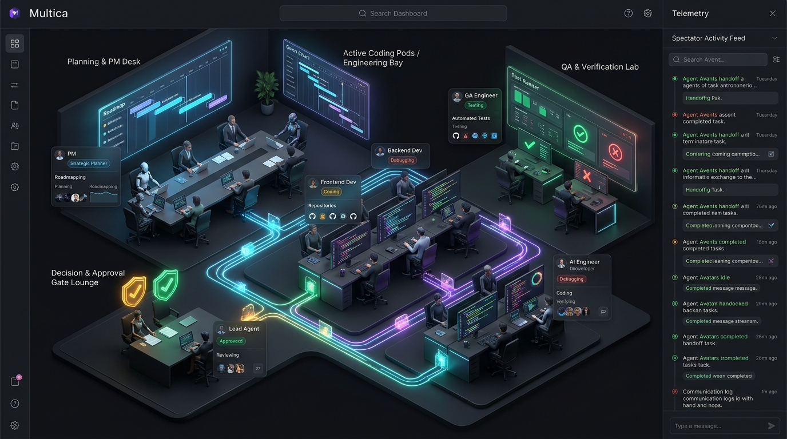

# Multica Sanal Ofis (Virtual Office) — Konsept Görseli

## Görseldeki Temel Bölgeler ve Akış Mekaniği

1. **Planning & PM Desk (Planlama ve Lider Masası):** Proje Lideri (PM) ajanın yol haritasını oluşturduğu, görevleri parçaladığı ve plan onayı beklediği başlangıç noktası.
2. **Active Coding Pods / Engineering Bay (Geliştirme İstasyonları):** Frontend, Backend ve AI mühendis ajanların aktif üzerinde çalıştığı task'ların, kod ilerlemelerinin ve durum rozetlerinin (`Coding`, `Debugging`, `Running`) canlı izlendiği çalışma masaları.
3. **QA & Verification Lab (Test ve Doğrulama Laboratuvarı):** `AutonomousQualityGate` ve reviewer ajanların kodları test ettiği, geçen/kalan kontrollerin canlı göründüğü istasyon.
4. **Decision & Approval Gate Lounge (Karar ve Onay Kapısı):** Onaylanan task'ların (`Approved`), insan onayı bekleyen plan/değişiklik taleplerinin (`ProjectLeaderChangeRequest`, `AutonomousEscalation`) vurgulandığı alan.
5. **Canlı Veri/Görev Hatları ("Ne Nereye Gitti"):** İstasyonlar arasında hareket eden ışıklı paketler ve bağlantılar ile hangi ajanın hangi görevi kime devrettiğinin (handoff) dışarıdan bir izleyici (spectator) gözüyle takibi.
6. **Spectator Activity Feed (Sağ Panel):** Gerçek zamanlı görev geçişleri, onaylar ve ajanlar arası iletişimin kronolojik akışı.
