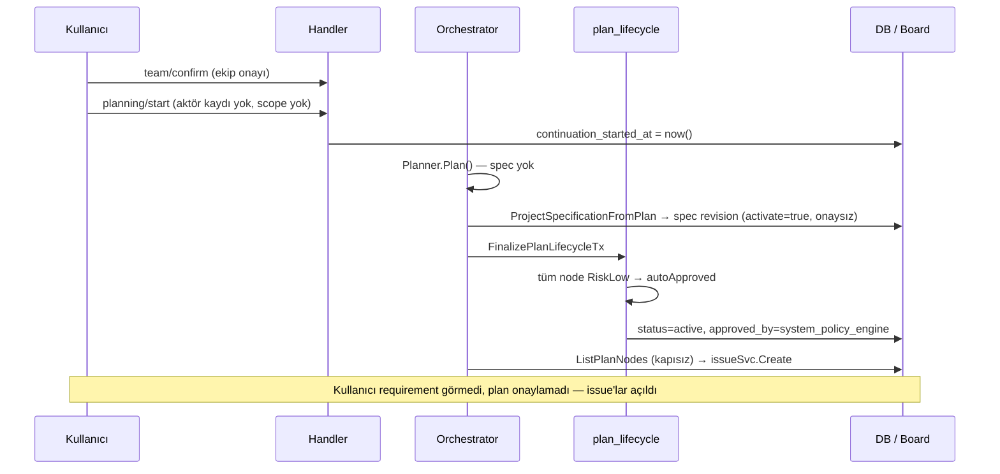
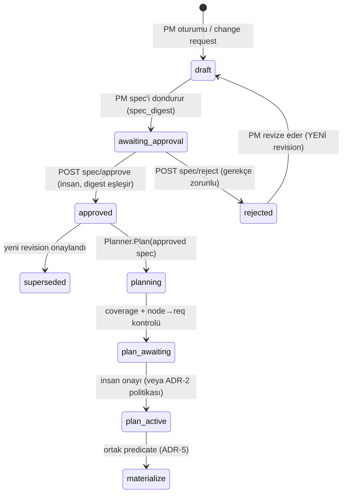
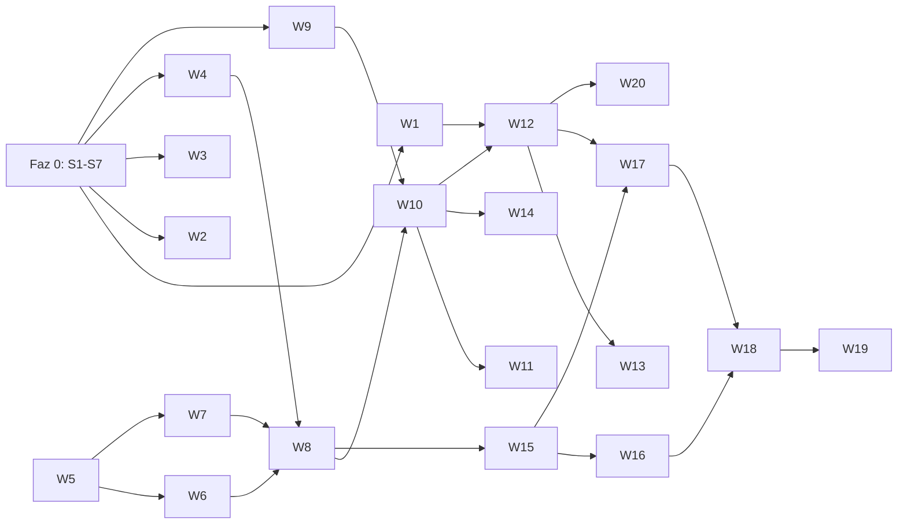

# KAPI & KAYIT — Birleşik Analiz ve Uygulama Planı

> Kapsam: Multica otonom proje yürütmede **(1) Niyet → Görev kapısı** ve **(2) Onay kayıt zinciri**.
> Girdi: Denetim-1 (3 ajanlı, `pasted-text.txt`) + Denetim-2 (birleştirilmiş uzman incelemesi).
> Yöntem: Her iki denetimin iddiaları **koda karşı tek tek doğrulandı**. Çelişkiler kodla çözüldü. İki denetimin de kaçırdığı bulgular eklendi.

## 0. Yönetici Özeti

| Değişmez | Bugünkü durum | Kesinlik |
|---|---|---|
| **KAPI**: Kullanıcı gereksinimleri açıkça onaylamadan plan onaylanamaz, node materialize/dispatch edilemez | **İHLAL** | Kod ile kanıtlandı (uçtan uca yol aşağıda) |
| **KAYIT**: Her onay aktör + zaman + konu + digest + gerekçe ile append-only kaydedilir ve taşınabilir | **İHLAL** | Kod ile kanıtlandı |

KAPI tarafında beş bağımsız açık var. Bunlardan biri tek başına kapatılırsa bile diğerleri kapıyı açık bırakır:

1. **Ters akış.** Spec, plandan sonradan türetilip kendiliğinden aktive ediliyor. Kullanıcı niyeti hiçbir zaman kendi başına onaylanan bir nesne olmuyor.
2. **Düşük risk otomatik onayı.** Bir planın tüm node'ları `RiskLow` ise ve plan change request değilse, plan insan onayı olmadan `active` oluyor.
3. **Coverage bypass.** Rich requirement yoksa validator hiçbir şey kontrol etmiyor. Rich requirement varken bile `requirement_ids` boş olan node'lar geçiyor.
4. **Gate sırası yanlış.** `issueSvc.Create` kapıdan **önce** çalışıyor. Kapı yalnızca issue'yu node'a bağlama (bind) aşamasında kontrol ediliyor. Bu yüzden yetim (orphan) issue oluşabiliyor. *(Bunu iki denetim de kaçırmış.)*
5. **Kapı dışı issue yolları.** Import, bundle task'larını doğrudan issue'ya çeviriyor. Manuel ve ajan kaynaklı issue oluşturma yalnızca takım taslağının durumunu kontrol ediyor. *(Kısmen kaçırılmış.)*

KAYIT tarafındaki tablo: Onay "olay" olarak değil, "son durum kolonu" olarak tutuluyor. Change request approve ve reject işlemlerinde aktör hiç kaydedilmiyor. Planlama başlatma işleminde de aktör yok. Bundle hiçbir onayı taşımıyor ve import mevcut onayları sıfırlıyor.

---

## 1. İki Denetimin Mutabakatı (koda karşı doğrulanmış)

| # | Konu | Denetim-1 | Denetim-2 | Kod doğrulaması | Karar |
|---|---|---|---|---|---|
| M1 | Spec'in plandan ters türetilmesi | Var (kritik) | Bahsetmiyor | **Doğru.** [project_orchestrator.go:784-794](file:///Users/caglar/Desktop/Frontend/multica/server/internal/workflowruntime/project_orchestrator.go#L784-L794): `ProjectSpecificationFromPlan` → `CreateSpecificationRevision(..., "project_bootstrap", ..., activate=true)`. Repo genelinde tek çağrı yeri burası. | D1 haklı. KAPI'nın birinci kök nedeni. |
| M2 | Low-risk otomatik onay | Var | Var | **Doğru.** [plan_lifecycle.go:45-50](file:///Users/caglar/Desktop/Frontend/multica/server/internal/projectorchestration/plan_lifecycle.go#L45-L50), [plan_lifecycle.go:123-133](file:///Users/caglar/Desktop/Frontend/multica/server/internal/projectorchestration/plan_lifecycle.go#L123-L133). `approved_by='system_policy_engine'` aynı kolona yazılıyor; insan ve sistem aktörü ayırt edilemiyor. | Mutabık. |
| M3 | Coverage bypass | Var | Var | **Doğru**, ayrıca ek bir açık var: [change_model.go:148-157](file:///Users/caglar/Desktop/Frontend/multica/server/internal/projectorchestration/change_model.go#L148-L157) rich spec yoksa `nil` dönüyor. Rich spec varken de yalnızca requirement→node yönü kontrol ediliyor. `RequirementIDs` boş olan node sessizce geçiyor (node→requirement yönü zorunlu değil). | Mutabık. Yeni bir alt bulgu eklendi. |
| M4 | Bundle spec taşıyor mu? | Hayır, export `nil` bırakıyor | "Bundle'da plan specification var" | **D1 doğru.** Alan şemada var ([schema.go:164](file:///Users/caglar/Desktop/Frontend/multica/server/internal/projectbundle/schema.go#L164)), ama export yalnızca legacy `requirements[]` okuyor. `Specification` hiç doldurulmuyor ([postgres_export.go:467-488](file:///Users/caglar/Desktop/Frontend/multica/server/internal/projectbundle/postgres_export.go#L467-L488)). Ayrıca `_ = json.Unmarshal` hatayı yutuyor. | D2 yanılıyor: şema var, veri yok. |
| M5 | `requirement_ids` bundle'da mı? | Yok | Belirtmemiş | **Yok.** [schema.go:225-233](file:///Users/caglar/Desktop/Frontend/multica/server/internal/projectbundle/schema.go#L225-L233) `PlanNode` alanında yer almıyor. Import node INSERT'ü de bu kolonu yazmıyor ([postgres_apply.go:~995-1003](file:///Users/caglar/Desktop/Frontend/multica/server/internal/projectbundle/postgres_apply.go#L995-L1003)). | İzlenebilirlik round-trip'te kopuyor. |
| M6 | Import onayı sıfırlıyor | Var | Var | **Doğru.** [postgres_apply.go:1027-1033](file:///Users/caglar/Desktop/Frontend/multica/server/internal/projectbundle/postgres_apply.go#L1027-L1033) | Mutabık. Güvenlik açısından doğru bir davranış, provenance açısından kayıp. |
| M7 | Materialize kapısı | `ListPlanNodes` kapısız | `ListReady`/`BindNodeIssue` kapılı | **İkisi de kısmen doğru.** `ListReady` ([store.go:~637-645](file:///Users/caglar/Desktop/Frontend/multica/server/internal/projectorchestration/store.go#L637-L645)) ve `BindNodeIssue` ([store.go:~748-757](file:///Users/caglar/Desktop/Frontend/multica/server/internal/projectorchestration/store.go#L748-L757)) kapılı. `ListPlanNodes` ise yalnızca `p.status IN ('active','blocked')` koşuluna bakıyor ([store.go:~699](file:///Users/caglar/Desktop/Frontend/multica/server/internal/projectorchestration/store.go#L699)). Conductor bu listeyle [`ensureProjectNodeIssue`](file:///Users/caglar/Desktop/Frontend/multica/server/internal/workflowruntime/project_orchestrator.go#L1571-L1590) → [`issueSvc.Create`](file:///Users/caglar/Desktop/Frontend/multica/server/internal/workflowruntime/project_orchestrator.go#L1880) çağrılarını kapıdan önce yapıyor. | **Yeni bulgu:** yan etki kapıdan önce gerçekleşiyor. `blocked` planda veya digest kaymasında yetim issue oluşur. |
| M8 | Onay defterinin yeri | Yeni `approval_log` tablosu | Mevcut `autonomous_project_escalation` genişletilsin | Escalation tablosu **değişken bir iş kuyruğu**. Status ve resolution en az 7 noktada UPDATE ediliyor: [handler:2762](file:///Users/caglar/Desktop/Frontend/multica/server/internal/handler/project_autonomous.go#L2762), [handler:2788](file:///Users/caglar/Desktop/Frontend/multica/server/internal/handler/project_autonomous.go#L2788), [orchestrator:1314](file:///Users/caglar/Desktop/Frontend/multica/server/internal/workflowruntime/project_orchestrator.go#L1314), [:1339](file:///Users/caglar/Desktop/Frontend/multica/server/internal/workflowruntime/project_orchestrator.go#L1339), [:2655](file:///Users/caglar/Desktop/Frontend/multica/server/internal/workflowruntime/project_orchestrator.go#L2655), [runtime:934](file:///Users/caglar/Desktop/Frontend/multica/server/internal/workflowruntime/runtime.go#L934), [:1267](file:///Users/caglar/Desktop/Frontend/multica/server/internal/workflowruntime/runtime.go#L1267). | **D2'nin önerisi uygulanamaz.** Bu tabloya UPDATE yasaklayan bir trigger eklenirse runtime çöker. **D1 seçildi** (bkz. ADR-3). |
| M9 | D1'in SQL taslağı | `REFERENCES ... ON DELETE CASCADE`, `REFERENCES users ON DELETE RESTRICT` | — | [AGENTS.md:73](file:///Users/caglar/Desktop/Frontend/multica/AGENTS.md#L73) FK ve cascade eklemeyi yasaklıyor. Index'ler `CONCURRENTLY` ve ayrı dosyada olmalı ([AGENTS.md:74](file:///Users/caglar/Desktop/Frontend/multica/AGENTS.md#L74)). | D1 şeması **olduğu gibi kullanılamaz**. Düzeltilmiş hali ADR-3'te. |
| M10 | Change approve/reject aktörü | Yok | "Kanıtlanmadı" | **Yok.** Handler aktörü `_` ile atıyor ([project_autonomous.go:2964-3029](file:///Users/caglar/Desktop/Frontend/multica/server/internal/handler/project_autonomous.go#L2964-L3029)). [`ProjectLeaderApprove`](file:///Users/caglar/Desktop/Frontend/multica/server/internal/handler/handler.go#L244) imzası aktör parametresi almıyor. Event trigger varsayılan olarak `actor_type='system'` yazıyor ([493 migration](file:///Users/caglar/Desktop/Frontend/multica/server/migrations/493_autonomous_project_change_model.up.sql#L212-L230)). | D1 doğru. İnsan kararı "system" olarak kaydediliyor. |
| M11 | Planlama başlatma aktörü | Yok | Ekip onayı var, gereksinim kontrolü yok | **Doğru.** [project_autonomous.go:2392-2437](file:///Users/caglar/Desktop/Frontend/multica/server/internal/handler/project_autonomous.go#L2392-L2437) aktörü atıyor ve yalnızca `continuation_started_at` yazıyor. Yorum satırı bunu "agreed scope onayı" olarak tanımlıyor, ama hiçbir scope veya digest'e bağlanmıyor. | Kapı **adı var, içeriği yok**. |
| M12 | Escalation/production resolve | `resolved_by` var | Var | Production yolunda digest var. Diğer yollarda digest yok. İkisi de `h.DB.Exec` ile transaction dışında çalışıyor. | Ledger yazımı transaction'a alınmalı. |
| M13 | Import'un issue açması | — | — | **Yeni bulgu:** Import, bundle task'larını doğrudan `issue` tablosuna yazıyor (`taskIDs` → `materialized_issue_id`). Kullanıcı gereksinimi onaylamadan backlog oluşuyor. | KAPI kapsamına alınmalı (karar gerekli, bkz. §7). |
| M14 | Manuel/ajan issue oluşturma | — | "Tüm yollar doğrulanmadı" | [issue.go:~3435](file:///Users/caglar/Desktop/Frontend/multica/server/internal/handler/issue.go#L3435) otonom projede yalnızca takım taslağının durumunu kontrol ediyor. Ajanların CLI ile proje içinde issue açıp açamadığı **doğrulanmadı**. | Faz 0 spike (S1). |
| M15 | Otonom issue'ların yaratıcısı | — | — | **Yeni bulgu:** [orchestrator:1880](file:///Users/caglar/Desktop/Frontend/multica/server/internal/workflowruntime/project_orchestrator.go#L1880) `CreatorType: "member", CreatorID: ownerUserID` yazıyor. Sistemin açtığı issue, proje sahibinin açtığı bir issue gibi görünüyor. | Provenance kirliliği. Düşük öncelikli düzeltme. |
| M16 | Restart davranışı | — | `awaiting_approval` hata veriyor | Doğru ([runtime.go:1509](file:///Users/caglar/Desktop/Frontend/multica/server/internal/workflowruntime/runtime.go#L1509)). Ancak yalnızca status'e bakıyor, spec onayına bakmıyor. | Ortak predicate'e bağlanmalı (ADR-5). |

### Uçtan uca istismar yolu (kodla teyitli)



---

## 2. Kök Neden Analizi

| Kök neden | Belirti | Neden tek tek yama yetmez |
|---|---|---|
| **K1 — Niyet birinci sınıf bir nesne değil.** Spec bir çıktı (plandan türetiliyor), girdi değil. | M1, M3, M11 | Yalnızca auto-approve kapatılırsa kullanıcı bu kez plan onaylar ama requirement'ları yine görmemiş olur. |
| **K2 — Onay bir olay değil, bir durum.** Son-yazan-kazanır kolonları kullanılıyor (`approved_at/by`, `confirmed_by`, `resolution` JSONB). | M2, M10, M11, M12 | Kolon eklemek geçmişi, ret kararlarını ve insan/sistem ayrımını çözmez. |
| **K3 — Kapı predicate'i kopyalanmış.** Aynı "çalıştırılabilir plan" koşulu 3+ sorguda ayrı ayrı yazılmış, biri eksik. | M7, M16 | Her yeni sorguda drift tekrar eder. |
| **K4 — Portability onayları kasıtlı olarak taşınamaz kabul ediyor.** | M4, M5, M6, M13 | Alan eklemek yetmez. Import edilen onayın **yerel kapıyı açıp açmayacağına** dair bir politika gerekiyor. |

---

## 3. Hedef Mimari — Karar Kayıtları (ADR)

### ADR-1 · Requirement onay kapısı (K1)

**Karar.** Specification revision'a bir onay yaşam döngüsü eklenir. Plan **yalnızca insan tarafından onaylanmış head spec revision'a** dayanabilir.



- `spec_digest` **Postgres fonksiyonuyla** hesaplanır (`autonomous_project_specification_digest(revision_id)`). Bu, migration 600'deki `autonomous_project_plan_digest` ile aynı kalıptır. Gerekçe: Go tarafındaki kanonik JSON ile SQL tarafı birbirinden kayarsa onaylar sessizce geçersizleşir. Tek kaynak DB'dir.
- Revision satırı immutable kalır ([493 trigger](file:///Users/caglar/Desktop/Frontend/multica/server/migrations/493_autonomous_project_change_model.up.sql#L32)). Onay durumu revision satırına değil, **ledger'a** yazılır. Revision'da onay kolonu olmaz. "Onaylı mı?" sorusu ledger'dan türetilir; istenirse head tablosunda bir projeksiyon tutulabilir.
- **Ters akış kaldırılır.** `projectSpecification == nil` ise planlama `ErrApprovedSpecificationRequired` döner ve proje "spec bekleniyor" durumuna geçer. `ProjectSpecificationFromPlan` yalnızca backfill aracı olarak kalabilir.
- **Validator sertleşir.** (a) Rich requirement yoksa yeni planlar reddedilir. (b) Epic olmayan **her** implementation, migration, review ve QA node'u ≥1 `requirement_id` taşır. (c) Her requirement'ın implementation ve verification kapsaması vardır (mevcut kural).
- `planning/start` korunur ama anlamı değişir. Artık "onaylı spec revision X ile planla" demektir: body'ye `specification_revision_id` ve `spec_digest` eklenir, aktör ledger'a yazılır.

### ADR-2 · Otomatik plan aktivasyonu politikası (K1)

**Önerilen karar.** **İlk plan her zaman insan onayı ister.** Sonraki replan'lar şu koşulların hepsi sağlanırsa otomatik aktive olabilir: tüm node'lar `RiskLow` ve deploy/migration değil, `specification_revision_id` insan onaylı head ile aynı, ve requirement kümesi değişmemiş. Otomatik aktivasyon ledger'a `actor_type='system'` ve `policy_ref` ile yazılır.

- Bu, KAPI değişmezini ihlal etmez. Değişmez "requirement onayı" der; plan onayının her seferinde insan olması şart değildir.
- **Sistem kaydı hiçbir zaman insan kapısını karşılamaz.** Spec onayı için yalnızca `actor_type='human'` sayılır.
- Daha sıkı alternatif (D1 MTR-06: auto-approve tamamen kaldırılsın) kabul edilebilir. Bu bir ürün kararıdır, bkz. §7 Karar-2.

### ADR-3 · Tek onay defteri (K2)

**Karar.** Yeni ve tek bir append-only tablo eklenir: `autonomous_project_approval_event`. Mevcut kolonlar (`plan.approved_*`, `team_draft.confirmed_*`, `escalation.resolution`, `change_request.state`) **çalışma zamanı projeksiyonu** olarak kalır ve ledger kaydıyla **aynı transaction'da** yazılır.

**Escalation genişletmesi neden reddedildi (D2):** Tablo değişken bir iş kuyruğu (M8). Append-only trigger runtime'ı kırar. Ayrıca escalation açılmadan gerçekleşen onaylar (takım, spec, plan) bu tabloya yalnızca sahte escalation satırlarıyla sığar.

**Change-request event tablosunun genişletilmesi neden reddedildi:** `ON DELETE CASCADE` ile change request'e bağlı ve yalnızca o yüzeyi kapsıyor.

Şema taslağı (repo kurallarına uygun: **FK yok, cascade yok**, index'ler ayrı ve `CONCURRENTLY`):

```sql
-- 610_autonomous_project_approval_event.up.sql
CREATE TABLE IF NOT EXISTS autonomous_project_approval_event (
    id               UUID PRIMARY KEY DEFAULT gen_random_uuid(),
    workspace_id     UUID NOT NULL,
    project_id       UUID NOT NULL,
    idempotency_key  TEXT NOT NULL,
    subject_type     TEXT NOT NULL CHECK (subject_type IN (
        'specification_revision','plan','team_draft','planning_start',
        'change_request','escalation','release_manifest','import_adoption')),
    subject_id       TEXT NOT NULL,
    subject_revision BIGINT,
    subject_digest   TEXT NOT NULL CHECK (subject_digest ~ '^[0-9a-f]{64}$'),
    decision         TEXT NOT NULL CHECK (decision IN ('approved','rejected')),
    actor_type       TEXT NOT NULL CHECK (actor_type IN ('human','system')),
    actor_id         UUID,                 -- human ise zorunlu (CHECK), system ise NULL
    actor_display    TEXT NOT NULL,        -- portable ad; users FK YOK
    policy_ref       TEXT,                 -- system kararlarında zorunlu
    rationale        TEXT NOT NULL DEFAULT '',
    source_endpoint  TEXT NOT NULL,
    origin           TEXT NOT NULL DEFAULT 'local' CHECK (origin IN ('local','imported')),
    origin_ref       JSONB NOT NULL DEFAULT '{}'::jsonb, -- kaynak workspace/bundle/orijinal id
    acted_at         TIMESTAMPTZ NOT NULL DEFAULT now(),
    CHECK ((actor_type = 'human' AND (actor_id IS NOT NULL OR origin = 'imported')) OR
           (actor_type = 'system' AND policy_ref IS NOT NULL))
);
-- UPDATE her zaman yasak; DELETE yalnızca tenant purge transaction'ında
-- (SET LOCAL multica.approval_purge = 'on'), çünkü cascade olmadığı için
-- workspace/proje silme cleanup'ı uygulama kodunda yapılmak zorunda.
```

```sql
-- 611_..._idempotency.up.sql  (tek ifade)
CREATE UNIQUE INDEX CONCURRENTLY IF NOT EXISTS uq_approval_event_idem
    ON autonomous_project_approval_event (workspace_id, project_id, idempotency_key);
-- 612_..._subject.up.sql      (tek ifade)
CREATE INDEX CONCURRENTLY IF NOT EXISTS idx_approval_event_subject
    ON autonomous_project_approval_event (workspace_id, project_id, subject_type, subject_id, acted_at);
```

> [!IMPORTANT]
> Denetim-2'nin "DB rolünden UPDATE/DELETE yetkisini al" önerisi, uygulama tek DB rolüyle çalışıyorsa trigger'dan fazla güvence vermez. Faz 0'da (S7) doğrulanmalı. Trigger zorunlu, rol ayrımı opsiyonel.

**Yazan yüzeyler ve digest kapsamı:**

| Yüzey | subject_type | subject_digest |
|---|---|---|
| `spec/approve`, `spec/reject` (yeni) | `specification_revision` | `autonomous_project_specification_digest(rev)` |
| `team/confirm` | `team_draft` | sha256(kanonik `selections`) — SQL fonksiyonu |
| `planning/start` | `planning_start` | onaylı spec digest'i |
| `plan/approve` + ADR-2 otomatik | `plan` | mevcut `plan_digest` |
| change-request approve/reject | `change_request` | sha256(kanonik `proposal` + base spec rev) |
| escalation resolve | `escalation` | production: `manifest_digest`; diğer: sha256(`context`) |
| import adoption (yeni) | `import_adoption` | import edilen plan digest |

**Tek writer:** `projectorchestration.RecordApprovalTx(ctx, tx, ApprovalEvent)`. Ledger'a bu fonksiyon dışında INSERT yapılmaz (bir grep testiyle zorlanır). `ProjectLeaderApprove` imzasına `actor` eklenir. Reject ve escalation resolve işlemleri `TxStarter` ile transaction'a alınır.

### ADR-4 · Portability ve sync (K4)

- Bundle `schema_version` artırılır. Eklenenler: `approvals[]` (ledger kayıtları aynen), `specification_revisions[]` (id, revision, source_kind, içerik, digest), `PlanNode.requirement_ids`, ve export'ta gerçekten doldurulan `PortablePlan.Specification`.
- Aktörler `PortableActorRef` ([schema.go:323](file:///Users/caglar/Desktop/Frontend/multica/server/internal/projectbundle/schema.go#L323)) ile taşınır. Import edilen satırda `actor_id=NULL`, `origin='imported'`, orijinal UUID ise `origin_ref` içinde saklanır.
- **İki denetimin uzlaştırılması:** Import edilen onaylar **provenance olarak aynen saklanır** (D1). Ancak **yerel kapıyı açmazlar** (D2: "eski bundle onaylı sayılmaz", genişletilmiş hali). Yürütme için yerel admin bir `import_adoption` + `specification_revision` onayı verir. Bu kayıt import edilen digest'e referans verir. Böylece zincir kopmaz ve yabancı bir ortamdan gelen plan habersizce çalışmaz.
- **Round-trip:** export → import → export işleminde `approvals[]` alan alan ve sırasıyla eşit çıkar. Yeni yerel adoption kaydı ikinci export'ta **eklenmiş** olarak görünür; bu beklenen bir farktır ve test bunu açıkça doğrular.
- **Çakışma politikası:**
  - Aynı `idempotency_key` + aynı içerik → idempotent no-op.
  - Aynı key + farklı içerik → `ErrApprovalLedgerConflict` (hard error).
  - Aynı subject+revision için farklı digest ve her iki tarafta onay → `409 ErrApprovalProvenanceConflict`.
  - `diff.go` ([BuildPreview](file:///Users/caglar/Desktop/Frontend/multica/server/internal/projectbundle/diff.go#L10)) `approval_conflicts` ve `specification_changes` üretir.
  - Sessiz overwrite yoktur. Force seçeneği de yoktur; çözüm yeni bir yerel onaydır.
- Eski bundle (alan yok) → hata yok. Plan `awaiting_approval`, spec onaysız olarak gelir.

### ADR-5 · Tek "çalıştırılabilir plan" predicate'i (K3)

- Yeni bir SQL fonksiyonu eklenir: `autonomous_project_plan_executable(plan_id) RETURNS boolean`. Koşulları: `status='active'` + digest geçerli + `approved_at` dolu + spec revision = head + head için insan `approved` ledger kaydı var ve sonrasında bir `rejected` kaydı yok.
- `ListReady`, `BindNodeIssue`, `ListPlanNodes`, restart ve repair yolları bu fonksiyonu kullanır.
- **Sıra düzeltmesi:** `ensureProjectNodeIssue` önce bir transaction içinde predicate'i kontrol eder ve node'u kilitler (`FOR UPDATE`), sonra issue'yu yaratır ve aynı transaction'da bind eder. Mümkün değilse en azından kontrol `issueSvc.Create`'ten önce yapılır, bind başarısız olursa issue telafi edilerek iptal edilir.

---

## 4. Faz 0 — Doğrulama Spike'ları (kodlamadan önce)

Hiçbir denetim bu noktaları uçtan uca kanıtlamadı. "Her yol kapandı" diyebilmek için önce bunlar kapatılmalı.

| ID | Soru | Yöntem | Çıktı |
|---|---|---|---|
| S1 | Otonom projede issue yaratan **tüm** yollar hangileri? (handler create, CLI/ajan, autopilot, quick-create, import, change apply, leader tool'ları) | `rg "IssueCreateParams\|INSERT INTO issue"` + çağrı grafiği + ajan CLI yetki kontrolü | Yol envanteri tablosu: yol → kapı var mı → hedef davranış |
| S2 | PM (leader) oturumu "mutabık scope"u nasıl üretiyor? Yapılandırılmış bir spec çıktısı var mı? | [project_leader_executor.go](file:///Users/caglar/Desktop/Frontend/multica/server/internal/workflowruntime/project_leader_executor.go) + leader prompt/tool tanımları | PM→spec draft sözleşmesi (ADR-1'in girişi) |
| S3 | Canlı veride etki ne kadar? | Aşağıdaki SQL'ler | Backfill/grandfather kararı için sayılar |
| S4 | Plan `status='active'` yazan başka yer var mı? | `rg "status\s*=\s*'active'" server/internal` (plan tablosu) | Bypass envanteri |
| S5 | Change request uygulandığında `activate=false` ile yaratılan spec revision ([change_store.go:379](file:///Users/caglar/Desktop/Frontend/multica/server/internal/projectorchestration/change_store.go#L379)) ne zaman head oluyor? CR onayı = spec onayı mı? | change_store akış okuması | CR onayının ADR-1'e eşlenmesi |
| S6 | Frontend yüzeyleri: [autonomous-plan-approval-card](file:///Users/caglar/Desktop/Frontend/multica/packages/views/projects/components/autonomous-plan-approval-card.test.tsx), [requirement-coverage-tab](file:///Users/caglar/Desktop/Frontend/multica/packages/views/projects/components/requirement-coverage-tab.tsx), [autonomous-control-center](file:///Users/caglar/Desktop/Frontend/multica/packages/views/projects/components/autonomous-control-center.tsx), [schemas.ts](file:///Users/caglar/Desktop/Frontend/multica/packages/core/api/schemas.ts) | Okuma | UI değişiklik listesi |
| S7 | Uygulama tek DB rolü mü kullanıyor? Tenant purge nasıl yapılıyor? | Bağlantı konfigürasyonu, workspace delete kodu | Append-only + purge tasarımının teyidi |

```sql
-- S3: etki ölçümü
SELECT count(*) FILTER (WHERE approved_by = 'system_policy_engine') AS auto_approved,
       count(*) FILTER (WHERE status = 'active')                   AS active_plans
FROM autonomous_project_plan;

SELECT count(*) AS derived_specs
FROM autonomous_project_specification_revision WHERE source_kind = 'project_bootstrap';

SELECT count(*) AS nodes_without_requirements
FROM autonomous_project_plan_node n JOIN autonomous_project_plan p ON p.id = n.plan_id
WHERE p.status IN ('active','blocked') AND n.is_epic = FALSE
  AND n.kind IN ('implementation','migration','review','qa')
  AND jsonb_array_length(COALESCE(n.requirement_ids,'[]'::jsonb)) = 0;

SELECT count(*) AS orphan_issues   -- M7 yetim issue şüphesi
FROM issue i
WHERE i.description LIKE '[autonomous-project-node:%'
  AND NOT EXISTS (SELECT 1 FROM autonomous_project_plan_node n WHERE n.materialized_issue_id = i.id);
```

---

## 5. Uygulama İş Paketleri

Boyutlar: **S** ≤ ½ gün · **M** 1–2 gün · **L** 3+ gün. Her paket kendi testleriyle birlikte biter.

### Faz 1 — Kanamayı durdur (hızlı, düşük riskli; ledger'dan bağımsız)

| ID | Başlık | Dosyalar | Kabul kriteri (test edilebilir) | Bağ. | Boyut |
|---|---|---|---|---|---|
| **W1** | Ortak executable predicate + gate sırası | yeni migration (SQL fn), [store.go](file:///Users/caglar/Desktop/Frontend/multica/server/internal/projectorchestration/store.go), [project_orchestrator.go](file:///Users/caglar/Desktop/Frontend/multica/server/internal/workflowruntime/project_orchestrator.go) | `ListPlanNodes`, `ListReady`, `BindNodeIssue` aynı fonksiyonu kullanır. `blocked` veya digest'i kaymış planda `issueSvc.Create` **çağrılmaz** (mock sayaç = 0). Yetim issue testi kırmızıdan yeşile döner. | S4 | M |
| **W2** | İlk planda auto-approve kapat | [plan_lifecycle.go](file:///Users/caglar/Desktop/Frontend/multica/server/internal/projectorchestration/plan_lifecycle.go) | Projenin ilk planı (önceki plan yok) tüm node'ları `RiskLow` olsa bile `awaiting_approval` kalır. Replan davranışı Karar-2'ye göre belirlenir. | — | S |
| **W3** | Validator sertleştirme (yeni planlar) | [change_model.go](file:///Users/caglar/Desktop/Frontend/multica/server/internal/projectorchestration/change_model.go), validator testleri | Yeni plan + rich requirement yok → hata. Requirement'ı olmayan epic dışı impl/review/QA node → `ErrInvalidRequirementCoverage`. Legacy **okuma** yolu kırılmaz (mevcut planlar yüklenebilir). | — | S |
| **W4** | Aktörü olmayan handler'lar aktörü taşır | [project_autonomous.go](file:///Users/caglar/Desktop/Frontend/multica/server/internal/handler/project_autonomous.go), [handler.go:244](file:///Users/caglar/Desktop/Frontend/multica/server/internal/handler/handler.go#L244), runtime `ApproveProjectLeaderChange` | `planning/start`, CR approve ve CR reject işlemleri aktör UUID'sini ilgili kayda yazar (geçici olarak mevcut kolon/event `actor_type='human', actor_ref=uuid`). Reject transaction içinde çalışır. | — | S |

### Faz 2 — Onay defteri

| ID | Başlık | Dosyalar | Kabul kriteri | Bağ. | Boyut |
|---|---|---|---|---|---|
| **W5** | Ledger tablosu, trigger, index'ler | `migrations/610..612_*` (+ down) | INSERT geçer. UPDATE her zaman exception verir. DELETE yalnızca `SET LOCAL multica.approval_purge='on'` ile geçer. CHECK'ler (human→actor_id, system→policy_ref) test edilir. FK yok. Index dosyaları tek ifadelik ve `CONCURRENTLY`. | S7 | M |
| **W6** | Digest SQL fonksiyonları | migration: `..._specification_digest`, `..._team_selection_digest`, `..._change_proposal_digest` | Aynı içerik → aynı digest. Requirement sırası, metni veya içeriği değişince digest değişir. Go'da yeniden hesaplama yapılmaz. | W5 | S |
| **W7** | `RecordApprovalTx` tek writer | `projectorchestration/approval_ledger.go` (+test) | Idempotency: aynı key + aynı içerik → no-op, farklı içerik → hata. Ledger INSERT'ü başka dosyada yoksa grep testi geçer. | W5 | S |
| **W8** | Tüm yüzeyler ledger'a yazar | handler'lar, `plan_lifecycle.go`, runtime CR apply | Plan approve, otomatik aktivasyon (system), team confirm, planning start, CR approve/reject, escalation resolve → her biri projeksiyonla **aynı transaction'da** tam olarak 1 ledger satırı üretir. Rollback testi: projeksiyon yazımı hata verirse ledger satırı da yoktur. | W4, W6, W7 | M |

### Faz 3 — Requirement onay kapısı (KAPI'nın asıl çözümü)

| ID | Başlık | Dosyalar | Kabul kriteri | Bağ. | Boyut |
|---|---|---|---|---|---|
| **W9** | PM → spec draft akışı | leader executor, `change_store.go` (`CreateSpecificationRevision(activate=false)`) | PM oturumu yapılandırılmış bir spec önerisi üretir. Revision `awaiting_approval` olarak yazılır ve head olmaz. | S2 | L |
| **W10** | `spec/approve` & `spec/reject` endpoint'leri | `project_autonomous.go`, router, `packages/core/api/schemas.ts` | Admin olmayan → 403. Digest uyuşmuyor → 409. Approve, head'i günceller ve ledger'a yazar (tek transaction). Reject'te gerekçe zorunludur ve PM oturumuna sistem mesajı olarak iletilir. Zod şeması ve malformed-response testleri eklenir ([AGENTS.md:67-69](file:///Users/caglar/Desktop/Frontend/multica/AGENTS.md#L67-L69)). | W8, W9 | M |
| **W11** | Ters akışı kaldır | [project_orchestrator.go:784-794](file:///Users/caglar/Desktop/Frontend/multica/server/internal/workflowruntime/project_orchestrator.go#L784-L794) | Onaylı spec yoksa `Planner.Plan` **çağrılmaz** ve `CreateSpecificationRevision` çağrılmaz. Proje "spec onayı bekleniyor" durumuna geçer (escalation değil, durum). | W10 | S |
| **W12** | Predicate'e spec onayı eklenir | W1 fonksiyonu, `ApprovePlanTx`, `planning/start` | Spec head onaysız veya reddedilmiş → plan approve 409, ready-node listesi boş, issue yaratma 0. Spec revize edilirse eski plan onayı geçersiz olur. | W1, W10 | M |
| **W13** | Kapı dışı issue yolları | S1 envanterine göre: issue handler, import, CLI | Envanterdeki her yol için ya bir kapı ya da belgelenmiş bir istisna (ör. insanın manuel açtığı issue → ledger'a `manual_issue` notu) bulunur. Her yol için negatif test yazılır. | S1, W12 | M |
| **W14** | UI: spec onay kartı | [autonomous-control-center.tsx](file:///Users/caglar/Desktop/Frontend/multica/packages/views/projects/components/autonomous-control-center.tsx), plan approval card, requirement coverage tab | Requirement listesi ve digest gösterilir. Approve, reject ve gerekçe modal'ı çalışır. Plan kartı, spec onaylanana kadar disabled kalır ve nedenini açıklar. Onay geçmişi zaman çizelgesi ledger'dan okunur. Views testleri eklenir. | W10 | M |

### Faz 4 — Portability ve sync

| ID | Başlık | Dosyalar | Kabul kriteri | Bağ. | Boyut |
|---|---|---|---|---|---|
| **W15** | Bundle şema evrimi | [schema.go](file:///Users/caglar/Desktop/Frontend/multica/server/internal/projectbundle/schema.go) | `schema_version` artar. `approvals[]`, `specification_revisions[]`, `PlanNode.requirement_ids` eklenir. Eski bundle validate olur. | W8 | S |
| **W16** | Export | [postgres_export.go](file:///Users/caglar/Desktop/Frontend/multica/server/internal/projectbundle/postgres_export.go) | `Specification`, revision'lar, `requirement_ids` ve ledger kayıtları export edilir. `_ = json.Unmarshal` kaldırılır, hata döner. | W15 | M |
| **W17** | Import + adoption | [postgres_apply.go](file:///Users/caglar/Desktop/Frontend/multica/server/internal/projectbundle/postgres_apply.go) | Onaylar `origin='imported'` olarak aynen yazılır. Plan `awaiting_approval` kalır ve imported kayıtlar predicate'i **sağlamaz**. `import_adoption` endpoint'i yerel onay verir. `requirement_ids` korunur. | W15, W12 | M |
| **W18** | Sync çakışma tespiti | [diff.go](file:///Users/caglar/Desktop/Frontend/multica/server/internal/projectbundle/diff.go), portability handler | Preview `approval_conflicts` ve `specification_changes` içerir. Çakışmada sync 409 döner. Aynı kayıt tekrar gelirse idempotent davranır. | W16, W17 | M |
| **W19** | Round-trip testi | projectbundle testleri | export→import→export: `approvals[]` alan alan ve sırasıyla eşit (adoption kaydı hariç, beklenen ek). `requirement_ids` ve spec eşit. Çelişkili digest içeren import hata verir. | W16–W18 | S |

### Faz 5 — Geçiş, sertleştirme, kanıt

| ID | Başlık | Kabul kriteri | Bağ. | Boyut |
|---|---|---|---|---|
| **W20** | Mevcut veri geçişi | Karar-1'e göre: türetilmiş spec'ler `legacy_unapproved` olarak işaretlenir. Aktif projeler ya grandfather edilir (ledger'a `system`, `policy_ref='legacy_grandfather'`) ya da duraklatılıp onaya düşürülür. Backfill idempotenttir. | W12 | M |
| **W21** | Provenance düzeltmesi (M15) | Otonom issue'lar `CreatorType` olarak sistem/ajan kimliğiyle açılır, bildirim ve analitik regresyon vermez. | — | S |
| **W22** | GATES.md + docs | KAPI/KAYIT için gate maddeleri, CHECK komutları ve kanıt eklenir ([GATES.md](file:///Users/caglar/Desktop/Frontend/multica/GATES.md)). `docs/architecture` altına ADR'ler yazılır. | tümü | S |



---

## 6. Negatif Test Matrisi (KAPI kanıtı)

KAPI değişmezinin sağlandığını söylemek için bu testlerin **hepsinin** yeşil olması gerekir.

| # | Senaryo | Beklenen |
|---|---|---|
| T1 | Spec yok, `planning/start` | Planner çağrılmaz, spec revision yaratılmaz |
| T2 | Spec `awaiting_approval`, plan approve | 409 |
| T3 | Spec reddedildi, conductor turu | `issueSvc.Create` 0 çağrı |
| T4 | Tüm node `RiskLow`, ilk plan | `awaiting_approval` |
| T5 | Onaylı spec, plan onaylandıktan sonra spec revize edildi | Ready-node boş, eski plan onayı geçersiz |
| T6 | `requirement_ids` boş olan impl node | Validator hatası |
| T7 | Plan `blocked`, materialize edilmemiş node | Issue yaratılmaz (yetim yok) |
| T8 | Import edilen bundle'da onay geçmişi var | Kayıtlar saklanır, yürütme başlamaz |
| T9 | Eski bundle import | Onaysız, hata yok |
| T10 | S1 envanterindeki her issue yolu, onaysız spec ile | Yol bazında red veya belgelenmiş istisna |
| T11 | Restart/repair, onaysız spec | `ErrPlanApprovalRequired` |
| T12 | Ledger UPDATE / DELETE (purge flag yok) | Exception |
| T13 | Aynı idempotency key, farklı içerik | Hata |
| T14 | Sync: aynı subject için farklı digest + iki tarafta onay | 409, preview'da conflict |

Doğrulama komutları: `cd server && go test ./internal/projectorchestration ./internal/workflowruntime ./internal/projectbundle ./internal/handler -count=1`, views için `pnpm --filter @multica/views exec vitest run projects/`, en sonda `make check`.

---

## 7. Sizin Kararınızı Bekleyen Noktalar

> [!IMPORTANT]
> Bu üç karar W2, W17 ve W20'nin içeriğini değiştirir. Faz 1'e bunlar olmadan başlanabilir. W2 için varsayılan "ilk plan her zaman insan onayı ister".

1. **Mevcut aktif projeler (W20).** Onaysız (plandan türetilmiş) spec ile çalışan projeler: **(a)** grandfather edilip ledger'a `legacy_grandfather` olarak işlenir ve çalışmaya devam eder, ya da **(b)** duraklatılıp spec onayına düşürülür. *Öneri: (b) yeni issue açmayı durdurur, devam eden işleri bitirmeye izin verir.* S3 sayıları bu kararı netleştirir.
2. **Replan otomatik aktivasyonu (ADR-2).** Onaylı spec altında düşük riskli replan'lar otomatik aktive olsun mu? *Öneri: evet, ledger'a sistem kaydı düşülerek.* Alternatif: her plan insan onayı ister (D1 MTR-06).
3. **Import edilen onaylar (ADR-4) ve import'un issue açması (M13).** *Öneri:* Onaylar provenance olarak taşınır ama yerel kapıyı açmaz. Import edilen task'lar issue olarak yaratılır ama `import_adoption` onayına kadar atanmaz ve dispatch edilmez.

---

## 8. Denetimlerden Ayrışma Özeti

- **D1'den alınanlar:** Ters akış bulgusu, yeni ledger tablosu kararı, spec approve/reject endpoint'leri, import adoption fikri, UI paketi.
- **D1'den düzeltilenler:** SQL'deki FK ve cascade kullanımı (repo kuralı ihlali). Spec revision'a onay kolonu eklenmesi (immutable revision ile çelişiyor; onay durumu ledger'a taşındı). Go tarafında digest hesaplanması (SQL fonksiyonu yapıldı). Kabul kontrol listesindeki erken `[x]` işaretleri (henüz hiçbiri uygulanmadı).
- **D2'den alınanlar:** İhtiyatlı "bilinmiyor" işaretleri (Faz 0'a dönüştürüldü), idempotency anahtarı, "eski bundle onaylı sayılmaz" ilkesi, aynı gate'in otomatik aktivasyonda ve materialize'da da uygulanması.
- **D2'den reddedilenler:** Escalation tablosunun ledger yapılması (M8). "Bundle'da specification var" iddiası (M4).
- **İkisinin de kaçırdıkları:** Gate'in issue yaratıldıktan sonra kontrol edilmesi (M7). Validator'da node→requirement yönünün eksikliği (M3). Import'un issue açması (M13). Otonom issue'ların insan yaratıcı gibi görünmesi (M15). CR olay trigger'ının insan kararını `system` olarak yazması (M10).
