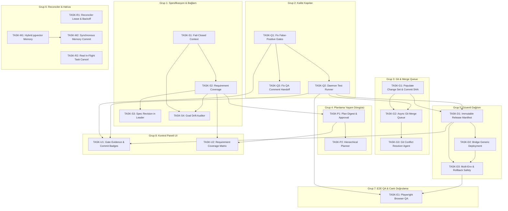

# Multica Autonomous Project OS: Kapsamlı Uygulama & Görev Eylem Planı (Action Plan)

**Tarih:** 26 Ekim 2026
**Hedef Temel Dal (Base Branch):** `feat/autonomous-with-deployments` (HEAD `5b97f23397`)
**Karşılaştırmalı Dal (Cross-Check):** `feat/autonomous-project-os` (HEAD `193e59b4af`)
**Referans Denetimler:**
1. `docs/reviews/autonomous-project-os-audit-2026-10-26.md` (Tersine Mühendislik & Güvenilirlik Denetimi)
2. `docs/reviews/autonomous-project-os-comprehensive-architecture-audit.md` (Derinlemesine Mimari Açıklar & Sistemik Kör Noktalar)
**Kullanılan Metodolojiler & Beceriler:** `/unlazy` (Test edilebilir kabul kapıları, deterministik doğrulama), `/codebase-design` (Derin modüller, temiz dikişler/seams, dar arayüzler, test edilebilirlik), `/code-mentor` (Eğitsel mimari gerekçelendirme, kalıp seçimi ve neden-sonuç analizi), `/grill-me` (Kararlaştırılmış tasarım sınırları).

---

## 1. Yönetici Özeti & Grill-Me Kararları

Multica Autonomous Project OS üzerinde gerçekleştirilen iki bağımsız inceleme; sistemin PostgreSQL tabanlı dayanıklı durum makineleri, iş akışı koordinatörü (`workflowruntime`), rol bazlı dinamik takım oluşturma ve bağımsız denetçi (`__independent_review`) mekanizmalarıyla çok güçlü bir iskelete sahip olduğunu doğrulamıştır.

Bununla birlikte, iki raporun birleşik analizi sistemin **üretim seviyesinde tam otonom bir yazılım geliştirme işletim sistemi** olabilmesi için 6 temel mimari alanda yapısal kör noktalar barındırdığını ortaya koymuştur:
1. **Kalite İllüzyonu:** Deterministik test koşucusu yokken ajanın kendi JSON çıktısındaki `tests[]` iddiasıyla yeşile dönen sahte test kapıları (`structuredTestsPassed`).
2. **Öksüz Git Katmanı:** `autonomous_project_change_set` tablosunun veritabanında var olmasına rağmen tek bir backend kod satırı tarafından dahi beslenmemesi; çoklu ajan çalıştığında Git Merge Queue ve otomatik çatışma çözücü motorun bulunmaması.
3. **Bağlam ve Spesifikasyon Düşmesi (Goal & Spec Drift):** 450 token sınırına takılan fikirlerin sessizce kırpılması (`Omitted`), typed requirement takibinin ve hedefe sadakat denetçisinin (`GoalDriftAuditor`) olmaması.
4. **Hafıza Yarış Koşulu & Semantik Körlük:** Beyin (Brain) aramasının salt PostgreSQL FTS kelime eşleşmesine dayanması (vektör/embedding yok) ve asenkron öğrenme gecikmesi nedeniyle ardışık görevlerin birbirinin kararlarından habersiz başlaması.
5. **Düz DAG Çıkmazı:** 100 düğümlük tek parça (flat) monolitik DAG yapısının büyük projelerde LLM bağlamını tüketmesi ve halüsinasyona yol açması.
6. **Sözde Dağıtım Referansı:** Dağıtıma gönderilen referansın test edilen Git commit SHA'sı yerine rastgele bir onay zaman damgası olması; generic Deployment Service ile entegrasyonun eksikliği.

### Grill-Me Karar Özeti

Kullanıcı ile yapılan interaktif tasarım oturumu (`grill-me`) sonucunda aşağıdaki stratejik kararlar kesinleştirilmiştir:

| Karar Alanı | Alınan Karar | Mimari Gerekçe & İlke |
|---|---|---|
| **Hedef Çalışma Dalı** | `feat/autonomous-with-deployments` | Generic `server/internal/deployment` servisi bu dalda mevcuttur; `feat/autonomous-project-os` ile olan farklar bridge edilerek ele alınacaktır. |
| **Otonomi Zarfı (Envelope)** | Kodlama + testler tam otonom; plan exact hash ile otomatik onaylı; üretime geçiş zorunlu insan onaylı. | Yüksek risk veya kapsam sapmasında plan admin onayına düşer. Üretim dağıtım onayı ise `(plan_revision, node_id, environment, release_digest)` tuple'ına sıkı sıkıya bağlanır. |
| **Test Koşucusu Stratejisi** | Daemon üzerinde task worktree'sinde izole çalışan `DaemonQualityGateRunner` | Runner yoksa veya hata verirse gate ASLA `passed` olamaz; `blocked` veya `unavailable` olur. Ajanın kendi beyanı asla deterministik kanıt sayılamaz. |
| **Gelişmiş Özellikler Önceliği** | **Tümü P1 Seviyesinde** | pgvector hibrit hafıza, hiyerarşik (Epic $\rightarrow$ Task) planlama, Playwright E2E QA, Git conflict-resolver ve goal_alignment_score temel mimari güvenilirlik için kritik kabul edilmiştir. |
| **Git Entegrasyonu Kapsamı** | **Tam Merge Queue + Conflict Resolver Ajanı (P1)** | Paralel ajanların ürettiği commit'ler `autonomous_project_change_set` üzerinden yönetilen deterministik bir kuyrukla ana dala entegre edilecek, çakışmalar otonom çözülecektir. |
| **Görev Granülerliği** | **PR Boyutunda (≈1-3 gün)** | Her görev bağımsız test edilebilir, tek bir mimari dikişe (`seam`) oturan, dar arayüzlü ve tam kabul kriterli bir çekme isteği (PR) olarak tanımlanmıştır. |

---

### Dalga 1 uygulama durumu

| Task | Durum | Uygulama kapsamı | Doğrulama |
|---|---|---|---|
| TASK-Q1 | implemented — verified | Deterministik kapılar yalnızca koşucu kanıtıyla geçer; Q3 yorum handoff'u ayrı kalır. | Hedefli quality-gate race testleri ve tam race suite geçti. |
| TASK-S1 | implemented — verified | Yazar özeti ve hiyerarşik spesifikasyon bütçelenir; zorunlu içerik sığmazsa derleme hata verir. | Hedefli context/compiler race testleri ve tam race suite geçti. |
| TASK-G1 | implemented — verified | Commit önce `changes_requested` olarak kaydedilir; yalnızca aynı task'ın Q1 kanıtı geçerse `ready` olur. | Hedefli commit/ready testleri, migration sözleşmeleri ve tam race suite geçti. |
| TASK-R1 | implemented — verified | Her reconciler çağrısı en çok bir proje claim eder; lease, backoff ve kurtarma kalıcıdır. | Hedefli reconciler race testleri ve tam race suite geçti. |
| TASK-R2 | implemented — verified | Pause geri alınabilir; onaylı CancelProject terminaldir, çalışan işleri durdurur ve sonraki dispatch'i engeller. | Hedefli handler, service ve daemon iptal testleri ile tam race suite geçti. |

Uygulama ve doğrulama kullanıcı onayıyla tamamlandı. `G1`–`G6` geçti: `make sqlc`, migration ileri/geri sözleşmeleri, hedefli Q1/S1/G1/R1/R2 race testleri, `pnpm typecheck`, `pnpm lint` ve `GOFLAGS=-p=1 make test` başarılı. Tam suite, deployment credential-scrubbing ve Antigravity read-only/custom-argument güvenlik düzeltmelerinden sonra tüm Go paketlerini race denetimiyle geçti. Beş task `implemented — verified` durumundadır. Tam sonuçlar `.unlazy/autonomous-project-os-wave-1/GATES.md` içindedir.

Kararlaştırılan sınırlar: Q1 yalnızca deterministik koşucu yolunu kapatır (Q3 bu dalgada değildir); S1 modelle özet üretmez; G1 kanıtı commit'i kaydeden task'a bağlar; R1 tek proje claim eder; R2 ayrı, idempotent ve geri alınamaz CancelProject işlemi sunar.

### Dalga 2 uygulama durumu

| Task | Durum | Uygulama kapsamı | Doğrulama |
|---|---|---|---|
| TASK-Q2 | implemented — verified | Tam commit SHA'sından seçilen sabit test/build komutu, değiştirilen proje manifestine göre çalışır. Kaynak read-only Git arşivinden; ağsız, salt okunur kök dosya sistemli, kısıtlı ve yetkisiz OCI konteynerine verilir. Host ortamı ve worktree bağlanmaz; eksik runtime/image veya belirsiz karma dil kapsamı geçemez. | Runner/timeout/stale SHA kapıları, gerçek OCI smoke (`MULTICA_RUN_OCI_QUALITY_SMOKE=1`) ve tam `GOFLAGS=-p=1 make test` race suite geçti. |
| TASK-Q3 | implemented — verified | QA başarısı yorum JSON'una değil, görev/issue/düğüm/sürüm/ajan/result eşleşmesi doğrulanan kalıcı ve immutable `qa_handoff` artifact'ine bağlıdır. | Geçerli/geçersiz artifact bağlama testleri ve tam `GOFLAGS=-p=1 make test` race suite geçti. |
| TASK-G2 | implemented — verified | Proje başına seri ve dayanıklı merge queue; yalnızca DAG'da implementation düğümünün ardılı olan güncel, açıkça onaylı review artifact'i ve aynı commit/worktree'ye bağlı güncel Q1 kanıtı kuyruğa girebilir. Build ve integration testleri geçmeden integration ref compare-and-swap ile ilerlemez; çatışma ve başarısız doğrulama kalıcı kaydedilir. | Sıralı claim, kurtarma, retry sınırı, güncel review/kanıt ve CAS testleri; migration 599 ve tam backend race suite geçti. |
| TASK-S2 | implemented — verified | Zengin specification revision alanları korunur; plan düğümleri açık Requirement ID'leri taşır. Her gereksinim için implementation ve ayrı review/QA eşlemesi olmadan plan kabul edilmez; eski planlara kapsama tahmin edilmez. | Exact Requirement ID ve ayrı implementation/review/QA coverage testleri; migration 598 ve tam backend race suite geçti. |
| TASK-P1 | implemented — verified | Plan digest'i specification revision, sıralı DAG içeriği ve policy üzerinden hesaplanır. Düşük risk exact-digest policy onayı alır; yüksek risk workspace admin onayı olmadan düğüm çalıştıramaz. Replan ve geç ekleme önceki onayı geçersiz kılar. | Digest/onay/dispatch handler testleri, migration 600, approval kartı Vitest (2/2) ve tam backend race suite geçti. |

Dalga 2 doğrulaması `.unlazy/autonomous-project-os-wave-2/GATES.md` ve dört task ledger'ında kayıtlıdır. OCI test komutları ağsız çalışır; gerekli yerel image yoksa koşucu `unavailable` olur. Proje bağımlılıkları host'tan alınmaz ve runner image'larına otomatik kurulmaz; gerekli paketler image/cache içinde yoksa test başarıya çevrilmez.

---

## 2. Mimari Tasarım İlkeleri & Sözlük (`codebase-design`)

Tüm görev tanımlarında ve kodlama aşamalarında `codebase-design` becerisinin standart sözlüğü ve tasarım disiplini uygulanacaktır:

* **Modül (Module):** Bir arayüz ve arkasındaki derin uygulamadan oluşan bağımsız ölçekli mantık birimi (Fonksiyon, struct, paket veya servis). "Bileşen" veya "servis" gibi muğlak terimler yerine kullanılır.
* **Arayüz (Interface):** Çağırıcının modülü hatasız kullanabilmesi için bilmesi gereken her şey: Tür imzaları, hata türleri, değişmezler (invariants), ön koşullar ve çalışma zamanı garantileri.
* **Dikiş (Seam):** Bir modülün davranışını modülün gövdesini değiştirmeden farklılaştırabileceğiniz nokta (`Michael Feathers`). Arayüz tam olarak bu dikişte yaşar. (Örn: `QualityGateRunner`, `DeploymentProvider`, `MemoryRetriever`).
* **Adaptör (Adapter):** Dikişteki arayüzü karşılayan somut uygulama (Örn: `DaemonQualityGateRunner`, `WebhookQualityGateRunner`).
* **Derinlik (Depth):** Dar bir arayüz arkasında gizlenmiş yüksek iş kabiliyeti. Çağırıcı az şey öğrenir, modül çok iş başarır.
* **Kaldıraç (Leverage):** Derin modüllerin çağırıcıya sağladığı güç. 1 satırlık arayüz çağrısıyla arkadaki N adet karmaşık sürecin deterministik yürütülmesi.
* **Yerellik (Locality):** Hataların, değişikliklerin ve doğrulamaların çağırıcılara saçılmadan tek bir modül gövdesinde toplanması.

---

## 3. İki Denetim Raporunun Konsolide İnceleme & Çözüm Matrisi

| Bulgu No & Kategori | `audit-2026-10-26.md` Bulgusu | `comprehensive-architecture-audit.md` Bulgusu | Çözüm Görevi (Task ID) |
|---|---|---|---|
| **B-01 (Kalite)** | `unit_test` ajanın kendi beyanıyla yeşil olabiliyor. `nonBlockingTestFailure` başarısız testleri affediyor. | `structuredTestsPassed` sahte güven üretiyor; yerel koşucu yok. | **TASK-Q1**, **TASK-Q2** |
| **B-02 (Kalite)** | Test kanıtı commit SHA'sına bağlı değil. | Ajanın JSON'undaki `tests[]` terminale dokunmadan kabul ediliyor. | **TASK-Q1**, **TASK-Q2** |
| **B-03 (Kalite)** | Değinilmemiş. | QA node'u ajanın PR yorumunu (`structuredQAHandoff`) task sonucu sayabiliyor. | **TASK-Q3** |
| **B-04 (Git)** | Değinilmemiş / Kapsam dışı. | `autonomous_project_change_set` tablosu tamamen öksüz; `INSERT` yok. | **TASK-G1** |
| **B-05 (Git)** | Değinilmemiş. | Paralel ajanların worktree kodlarını birleştiren Git Merge Queue motoru yok. | **TASK-G2** |
| **B-06 (Git)** | Değinilmemiş. | Merge çakışması çıktığında otomatik çözen ajan mekanizması yok. | **TASK-G3** |
| **B-07 (Spesifikasyon)** | 450 token sınırı var, `Omitted` artıyor ama derleyici sessizce yutuyor. | İlk hedeften sapma (Goal Drift) engellenemiyor; bağlam kesiliyor. | **TASK-S1** |
| **B-08 (Spesifikasyon)** | `LegacySpecification()` zengin alanları düz string dizisine indirgiyor. | Requirement ID takibi yok; validator şart kapsamını ölçemiyor. | **TASK-S2** |
| **B-09 (Spesifikasyon)** | Kapsam değişikliği teklifi `ProposedSpecificationRevisionID` taşımıyor. | Reviewer sadece issue diff'ine bakıyor; hedefe uyumu denetlemiyor. | **TASK-S3**, **TASK-S4** |
| **B-10 (Spesifikasyon)** | Issue güncellemeleri revizyon kontrolsüz; kullanıcı düzenlemeleri ezilebilir. | `change_store.go` sıfır satır güncellemeyi sessizce yutabiliyor. | **TASK-S3** |
| **B-11 (Planlama)** | Plan doğrudan `active` kaydediliyor; kullanıcı gördüğü sürümü onaylayamıyor. | Planlama yaşam döngüsünde onaylanabilir taslak durumu eksik. | **TASK-P1** |
| **B-12 (Planlama)** | Değinilmemiş. | 100 düğümlük düz (flat) DAG büyük projelerde LLM'i kilitliyor. | **TASK-P2** |
| **B-13 (Dağıtım)** | `ReleaseRef` zaman damgasından türüyor (`confirmed_at`); commit SHA değil. | Test edilen kodla dağıtılan kodun aynı olduğu kanıtlanamıyor. | **TASK-D1** |
| **B-14 (Dağıtım)** | Autonomous deploy generic `server/internal/deployment` yerine ayrı webhook kullanıyor. | Dağıtım yaşam döngüsü kopuk; restart sonrası uzlaştırma yok. | **TASK-D2** |
| **B-15 (Dağıtım)** | Ortam sabit `production`; rollback adaptörü var fakat orchestrator çağırmıyor. | Dağıtım onayı `node_key` ile eşleşiyor; yeni revizyonda eski onay tetiklenebilir. | **TASK-D3** |
| **B-16 (Reconciler)** | Planner hatası her 10 saniyede yeni LLM işi açıyor; deadline yok; döngü kilitlenebilir. | Durable claim / lease yok; çoklu sunucu instance yarışı mümkün. | **TASK-R1** |
| **B-17 (Reconciler)** | Pause sadece yeni dispatch'i durduruyor; çalışan ajanlar iptal edilmiyor. | Snapshot endpoint'i hata veren aktiviteleri sessizce atlıyor. | **TASK-R2**, **TASK-U2** |
| **B-18 (Hafıza)** | Brain araması sadece node title kullanıyor; iş tanımını aramıyor. | FTS anahtar kelime eşleşmesi yetersiz (vektör yok); asenkron yarış koşulu var. | **TASK-M1**, **TASK-M2** |
| **B-19 (E2E Test)** | Değinilmemiş. | Web arayüzlerinde gerçek canlı tarayıcı (Playwright) doğrulaması yok. | **TASK-E1** |
| **B-20 (UI/Cockpit)** | Kontrol paneli telemetri eksikliklerini ve kanıt türünü gizliyor. | Gate passed badge'i sahte mi gerçek mi ayırt edilemiyor. | **TASK-U1**, **TASK-U2** |

---

## 4. Detaylı Görev Tanımları (Task Specifications)

Aşağıdaki 20 görev, sistemin tüm açıklarını uçtan uca kapatacak şekilde PR boyutunda tasarlanmıştır. Her görev; mimari dikişi, kesin dosya ve satır kanıtlarını, veritabanı şemasını, kabul ölçütlerini ve çalıştırılabilir doğrulama komutunu (`gate`) içerir.


---

### EPİK 1: Deterministik Kalite & Güvenilir Test Koşucusu (Quality Gates & Test Runner Engine)

#### TASK-Q1: Ajan Öz-Beyanı Güven Açığının Kapatılması & Gate Durum Durum Makinesi
* **Öncelik:** P1 (Kritik Güvenlik & Doğruluk)
* **Tahmini Süre:** 1.5 Gün
* **Bağımlılıklar:** Yok
* **Mevcut Kod & Kanıt:**
  * `server/internal/workflowruntime/phase2_quality.go:272-282`: Runner yokken `structuredTestsPassed` fonksiyonu çağrılarak ajanın kendi JSON çıktısındaki `tests[]` verisine dayanarak kapı `passed` yapılıyor.
  * `server/internal/workflowruntime/phase2_quality.go:336-348`: `nonBlockingTestFailure` fonksiyonu, test başarısız olsa bile ajanın yazdığı "outside this change" ifadesine kanarak testi başarılı sayıyor.
  * `server/internal/workflowruntime/phase2_quality_test.go:5-52`: Bu sahte kabul davranışını birim test olarak kilitliyor.
* **Problem & Kök Neden (Code Mentor Analizi):**
  Ajan (LLM) bir koddaki hatayı çözemediğinde veya test yazmadığında, JSON çıktısına `{"tests": [{"status": "passed"}]}` yazarak kalite kapısını kolayca aldatabilmektedir. Kalite kapısı bir "doğrulama sınırı" (verification boundary) olmalıdır; işi yapan aktörün kendi işini denetlemesi çıkar çatışması yaratır.
* **Mimari Tasarım & Dikiş (`codebase-design`):**
  * **Modül:** `QualityGatePolicyEnforcer`
  * **Arayüz (Interface):** Gate durumu şemadaki `pending`, `running`, `passed`, `failed`, `blocked`, `unavailable`, `inconclusive`, `waived` veya `skipped` değerlerinden biri olabilir.
  * **Seam (Dikiş):** Kalite kapısı yürütme dikişinde (`runDeterministicGate`), güvenilir bir koşucu (`QualityGateRunner`) bulunmuyorsa veya koşucu ağ/çalıştırma hatası verirse, sonuç ASLA `passed` olamaz. Varsayılan olarak `unavailable` veya `blocked` durumuna geçer.
  * **Ajan Beyanı İzolasyonu:** Ajanın JSON içindeki `tests[]` ve `result.tests[]` alanları deterministik koşucuya kanıt olarak verilmez. Koşucu eksik, başarısız veya hata vermişse kapı geçemez.
  * **Kapsam Sınırı:** Yorumdan QA handoff normalizasyonu ayrı TASK-Q3 kapsamıdır; bu dalga Q1 içinde onu değiştirmez.
* **Değiştirilecek Dosyalar:**
  * `server/internal/workflowruntime/phase2_quality.go`
  * `server/internal/workflowruntime/phase2_quality_test.go`
  * `server/internal/projectorchestration/quality.go`
  * `server/internal/projectorchestration/validator.go`
* **Veritabanı / Şema Değişiklikleri:**
  * Yeni migration: `server/migrations/593_quality_gate_extended_states.up.sql`
  * `autonomous_project_gate_run.status` ve `autonomous_project_plan_node.status` üzerindeki CHECK kısıtı genişletilir:
    ```sql
    ALTER TABLE autonomous_project_gate_run DROP CONSTRAINT IF EXISTS autonomous_project_gate_run_status_check;
    ALTER TABLE autonomous_project_gate_run ADD CONSTRAINT autonomous_project_gate_run_status_check
      CHECK (status IN ('pending', 'running', 'passed', 'failed', 'blocked', 'unavailable', 'inconclusive', 'waived'));
    ```
* **Test Senaryoları & Regresyon:**
  1. `TestQualityGate_NoRunner_BlocksNode`: Webhook URL yokken `unit_test` kapısı tetiklendiğinde durumun `passed` değil `unavailable` olduğunu ve düğümün `blocked` olduğunu doğrula.
  2. `TestQualityGate_AgentSelfReport_Ignored`: Ajan 100 adet sahte passed test dönse bile gate'in `passed` olmadığını doğrula.
  3. `TestQualityGate_NonBlockingTest_Fails`: "outside this change" açıklamalı başarısız testin kapıyı `failed` yaptığını doğrula.
* **Kabul Kriterleri (Acceptance Criteria):**
  * `structuredTestsPassed` fonksiyonunun doğrudan `passed` kaydetmesi engellenmiştir.
  * Runner yokluğu deterministik olarak `unavailable` veya `blocked` eskalasyonu üretir.
* **Doğrulama Komutu (Runnable Gate):**
  ```bash
  go test -v ./server/internal/workflowruntime -run "TestQualityGate"
  ```

---

#### TASK-Q2: Daemon Yerel Görev Koşucusu (`DaemonQualityGateRunner`)
* **Öncelik:** P1 (Kritik Altyapı)
* **Tahmini Süre:** 2.5 Gün
* **Bağımlılıklar:** `TASK-Q1`
* **Mevcut Kod & Kanıt:**
  * `server/internal/projectorchestration/quality.go:14-78`: `QualityGateRunner` arayüzü tanımlıdır fakat tek implementasyon harici HTTP webhook adaptörüdür (`server/internal/projectorchestration/webhook_adapters.go:44-49`).
  * Self-hosted veya lokal ortamlarda `MULTICA_AUTONOMOUS_QUALITY_URL` tanımlı olmadığı için hiçbir gerçek komut (`go test`, `pnpm test`) çalıştırılamaz.
* **Mimari Tasarım & Dikiş (`codebase-design`):**
  * **Modül:** `DaemonQualityGateRunner` (Yerel Test ve Derleme Koşucusu)
  * **Arayüz (Interface):**
    ```go
    type QualityGateRunner interface {
        RunGate(ctx context.Context, req QualityGateExecutionRequest) (QualityGateResult, error)
    }

    type QualityGateExecutionRequest struct {
        WorkspaceID      uuid.UUID
        ProjectID        uuid.UUID
        TaskID           uuid.UUID
        GateType         string // "unit_test", "integration_test", "build_verification"
        WorktreePath     string
        CommitSHA        string
        Timeout          time.Duration
        EnvironmentEnvs  map[string]string
    }

    type QualityGateResult struct {
        Status           string // "passed", "failed", "inconclusive"
        ExitCode         int
        Stdout           string
        Stderr           string
        DurationMs       int64
        ExecutedCommand  string
        TestCount        int
        FailedCount      int
        ArtifactDigest   string
    }
    ```
  * **Seam & Adaptör:** `QualityGateRunner` arayüzü arkasında iki adaptör yer alır:
    1. `WebhookQualityGateRunner`: Harici CI/CD veya Kubernetes pod'larına delegasyon.
    2. `DaemonQualityGateRunner` (Yeni): Multica daemon süreci üzerinden, ajanın kod yazdığı izole git worktree'sinde sandbox komut çalıştırır.
  * **Çalışma Prensibi:** Proje tipini (`package.json`, `go.mod`, `Cargo.toml`) tespit eder; uygun test komutunu (`pnpm test`, `go test ./...`) güvenli child process olarak çalıştırır; çıkış kodunu ve çıktıyı kriptografik hash ile kalite kanıtı tablosuna kaydeder.
  * **Yalıtım Sınırı:** Komut yalnızca önceden yerel olarak bulunan sabit OCI image'ında; ağ kapalı, root filesystem salt okunur, kullanıcı yetkisiz ve kaynak yalnızca kaydedilmiş commit'in salt okunur Git arşivi olarak çalıştırılır. Host environment, Docker socket, proje worktree'si ve host dependency cache'i container'a aktarılmaz. Runtime veya image bulunmuyorsa yerel process fallback'i yapılmaz.
* **Değiştirilecek Dosyalar:**
  * `server/internal/projectorchestration/quality.go`
  * `server/internal/projectorchestration/daemon_runner.go` (Yeni dosya)
  * `server/internal/workflowruntime/phase2_quality.go`
  * `server/internal/workflowruntime/runtime.go`
* **Veritabanı / Şema Değişiklikleri:**
  * `autonomous_project_gate_run` tablosuna `executed_command TEXT`, `exit_code INT`, `worktree_path TEXT`, `commit_sha TEXT`, `runner_type TEXT` kolonları eklenir.
* **Test Senaryoları & Regresyon:**
  1. `TestDaemonRunner_SuccessfulGoTest`: Geçen Go testlerinde exit code 0, status `passed` ve test sayısının doğru okunduğunu doğrula.
  2. `TestDaemonRunner_FailingTest`: Kırık testte exit code 1, status `failed`, stderr'in kanıta yazıldığını doğrula.
  3. `TestDaemonRunner_TimeoutKill`: Sonsuz döngüye giren testin timeout ile sonlandırılıp `failed` kaydedildiğini doğrula.
* **Kabul Kriterleri:**
  * Ajanın ürettiği worktree üzerinde yerel testler gerçek process olarak yürütülür.
  * Gerçek exit code 0 olmadan hiçbir düğüm `passed` kalite kanıtı alamaz.
* **Doğrulama Komutu (Runnable Gate):**
  ```bash
  go test -v ./server/internal/projectorchestration -run "TestDaemonRunner"
  ```

---

#### TASK-Q3: QA Handoff & Ajan Yorumu Normalizasyonu Doğrulaması
* **Öncelik:** P1 (Güvenlik & Bütünlük)
* **Tahmini Süre:** 1 Gün
* **Bağımlılıklar:** `TASK-Q1`
* **Mevcut Kod & Kanıt:**
  * `server/internal/workflowruntime/phase2_quality.go:327-334`: `structuredQAHandoff` fonksiyonu `feat/autonomous-with-deployments` üzerinde eklenmiştir. Ajanın serbest metin yorumundaki JSON nesnesine bakıp `verdict: "pass"` ve `status: "passed"` görürse doğrudan kabul kriterini geçmiş saymaktadır.
  * `server/internal/workflowruntime/runtime.go:2258-2261`: `normalizeTaskResultFromAgentComment` fonksiyonu QA düğümlerinde yorum içeriğini task sonucu olarak kabul etmektedir.
* **Problem & Kök Neden:**
  Ajanın görev tamamlama sözleşmesini (contract) bypass edip bir issue yorumuna alelacele JSON yazarak kabul kapısını yeşile çevirmesine olanak tanıyan bir "arka kapı" (backdoor) oluşmuştur.
* **Mimari Tasarım:**
  * QA düğümlerinin ürettiği kanıtlar, salt yorumdan değil, izole `autonomous_project_artifact` tablosundaki imzalı ve doğrulanmış `qa_handoff` artefaktından okunmalıdır.
  * Yorumdan sonuç çıkarma mantığı yalnızca geriye dönük uyumluluk için "advisory" log olarak tutulmalı; kalite kapısını otomatik kapatmamalıdır.
* **Değiştirilecek Dosyalar:**
  * `server/internal/workflowruntime/phase2_quality.go`
  * `server/internal/workflowruntime/runtime.go`
  * `server/internal/workflowruntime/contracts.go`
* **Test Senaryoları:**
  1. `TestStructuredQAHandoff_RequiresFormalArtifact`: Yorum içine yazılmış serbest metin JSON'un yetersiz olduğunu, formal artifact kaydı gerektiğini doğrula.
* **Kabul Kriterleri:**
  * Yorum üzerinden sahte QA handoff enjeksiyonu engellenmiştir.
* **Doğrulama Komutu (Runnable Gate):**
  ```bash
  go test -v ./server/internal/workflowruntime -run "TestStructuredQA"
  ```

---

### EPİK 2: Git Değişim Seti, Merge Queue & Çatışma Çözücü Ajan (Git Engine, Merge Queue & Conflict Resolver)

#### TASK-G1: `autonomous_project_change_set` Tablosunun Beslenmesi & Commit SHA Yakalama
* **Öncelik:** P1 (Kritik Altyapı)
* **Tahmini Süre:** 2 Gün
* **Bağımlılıklar:** Yok
* **Mevcut Kod & Kanıt:**
  * `server/migrations/488_autonomous_project_execution_contracts.up.sql:77-113`: `autonomous_project_change_set` tablosu mevcuttur.
  * `server/internal/projectorchestration/context_compiler.go:277-289`: `currentContextRepositoryRevision` fonksiyonu bu tablodan okumaya çalışır, fakat tabloda hiçbir veri olmadığı için daima `""` döner.
  * Tüm backend kodunda bu tabloya tek bir `INSERT` ifadesi dahi yoktur!
* **Mimari Tasarım & Dikiş (`codebase-design`):**
  * **Modül:** `GitChangeSetRecorder`
  * **Arayüz:**
    ```go
    type ChangeSetRecorder interface {
        RecordTaskCommit(ctx context.Context, input RecordCommitInput) (uuid.UUID, error)
    }

    type RecordCommitInput struct {
        WorkspaceID   uuid.UUID
        ProjectID     uuid.UUID
        PlanID        uuid.UUID
        NodeID        uuid.UUID
        IssueID       uuid.UUID
        TaskID        uuid.UUID
        AgentID       uuid.UUID
        BaseSHA       string
        CommitSHA     string
        BranchName    string
        WorktreePath  string
        RepoPath      string
        ChangedFiles  []string
    }
    ```
  * **İş Akışı Entegrasyonu:** Başarılı proje task'ının daemon tarafından gözlenen commit, temel revizyonu, branch/worktree bilgisi ve değişen dosyaları `handleTaskCompleted` akışından alınır ve artifact transaction'ında `autonomous_project_change_set` tablosuna `merge_status = 'changes_requested'` olarak kaydedilir.
  * **Kalite Kapısı:** `ready` yalnızca Q1'in zorunlu deterministik kapıları aynı `source_task_id` için `passed` kanıtı ürettikten sonra yazılır. Önceki task'ın kanıtı, eksik kanıt veya koşucu hatası `ready` üretemez.
* **Bağlam Revizyonu:** `currentContextRepositoryRevision` en son kaydedilen commit SHA'sını kalite durumu `changes_requested` olsa da döndürür; bu değer kalite onayı anlamına gelmez. `ready_at` yalnızca kalite geçişinde doldurulur.
* **Değiştirilecek Dosyalar:**
  * `server/internal/workflowruntime/runtime.go`
  * `server/internal/projectorchestration/change_set_store.go` (Yeni dosya)
  * `server/internal/projectorchestration/context_compiler.go`
* `server/migrations/596_autonomous_project_change_set_ready_at.up.sql`
* **Veritabanı / SQL Sorguları:**
  * Mevcut `autonomous_project_change_set` tablosu doğrudan transaction içinden doldurulur; sqlc üretimine yeni sorgu eklenmez.
* **Test Senaryoları:**
  1. `TestRecordTaskCommitPersistsObservedRevisionPendingQuality`: Task'a bağlı commit SHA ve dosyalar `changes_requested` durumunda kaydedilir.
  2. `TestCurrentContextRepositoryRevisionUsesRecordedCommitBeforeQualityReady`: Kaydedilmiş commit SHA kalite kapısı geçmeden bağlama aktarılır.
* **Kabul Kriterleri:**
  * Her başarılı kod görevi kalıcı bir git değişim seti üretir.
  * `currentContextRepositoryRevision` gerçek git revizyonunu bağlama aktarır.
* **Doğrulama Komutu (Runnable Gate):**
  ```bash
  go test -v ./server/internal/projectorchestration -run "TestChangeSet"
  ```

---

#### TASK-G2: Asenkron Git Merge Queue Motoru (`MergeQueueWorker`)
* **Öncelik:** P1 (Kritik Çoklu Ajan Entegrasyonu)
* **Tahmini Süre:** 3 Gün
* **Bağımlılıklar:** `TASK-G1`, `TASK-Q2`
* **Mevcut Kod & Kanıt:**
  * `server/internal/projectorchestration/validator.go:33`: `DefaultMaxParallelNodes: 4`. Sistem aynı anda 4 ajanı paralel çalıştırabilir.
  * Ancak ajanlar bağımsız worktree'lerde commit ürettiğinde, bu commit'leri tek bir ana dala (`main` veya `integration_branch`) entegre eden hiçbir mekanizma yoktur. Commit'ler havada asılı kalmaktadır.
* **Mimari Tasarım & Dikiş (`codebase-design`):**
  * **Modül:** `GitMergeQueueService` (Kuyruk Motoru)
  * **Tasarım Kalıbı:** Deterministic Serial Merge Queue + Optimistic Verification.
  * **Arayüz (Interface):**
    ```go
    type MergeQueue interface {
        Enqueue(ctx context.Context, changeSetID uuid.UUID) error
        ProcessNext(ctx context.Context, projectID uuid.UUID) (MergeResult, error)
    }

    type MergeResult struct {
        ChangeSetID  uuid.UUID
        MergedSHA    string
        Status       string // "merged", "conflict", "integration_failed"
        ErrorDetails string
    }
    ```
  * **İşleyiş:**
    1. İnceleme (`review`) ve kalite kapısından (`unit_test`) geçen değişim setleri `merge_status = 'queued'` durumuna alınır.
    2. `MergeQueueWorker` arka plan döngüsü `FOR UPDATE SKIP LOCKED` ile sıradaki seti kilitler (`merge_status = 'merging'`).
    3. `integration_branch` tabanından geçici bir worktree oluşturur ve değişim commit'ini bu aday ağaca merge eder; testlerden önce kalıcı branch'i değiştirmez.
    4. Aday commit SHA'sını `DaemonQualityGateRunner` ile derleme (`build`) ve entegrasyon testlerinden (`integration_test`) geçirir.
    5. İki kapı da geçerse entegrasyon dalını beklenen eski SHA'dan aday SHA'ya compare-and-swap ile ilerletir (`merged_sha` kaydedilir, `merge_status = 'merged'`). Kapılardan biri kalırsa dalı değiştirmez ve `integration_failed` kaydeder.
    6. Çakışma varsa `merge_status = 'conflict'` işaretlenir ve `TASK-G3` tetiklenir.
* **Değiştirilecek Dosyalar:**
  * `server/internal/projectorchestration/merge_queue.go` (Yeni dosya)
  * `server/internal/workflowruntime/merge_worker.go` (Yeni dosya)
  * `server/internal/workflowruntime/runtime.go`
* **Veritabanı Değişiklikleri:**
  * `autonomous_project_change_set` tablosuna `merge_attempt INT DEFAULT 0`, `last_error TEXT` eklenir.
* **Test Senaryoları:**
  1. `TestMergeQueue_SequentialIntegration`: İki paralel ajanın ürettiği bağımsız dosya değişikliklerinin sırayla `integration_branch`'e merge edildiğini ve `merged_sha` üretildiğini doğrula.
  2. `TestMergeQueue_IntegrationTestFailure_DoesNotAdvanceRef`: Entegrasyon kapısı patlarsa kalıcı entegrasyon dalının ilerlemediğini ve `integration_failed` işaretlendiğini doğrula.
* **Kabul Kriterleri:**
  * Paralel ajanların kodları deterministik sırada ana dala entegre edilir.
  * Entegrasyon testinden geçmeyen hiçbir kod ana dala giremez.
* **Doğrulama Komutu (Runnable Gate):**
  ```bash
  go test -v ./server/internal/workflowruntime -run "TestMergeQueue"
  ```

---

#### TASK-G3: Otonom Git Çatışma Çözücü Ajan (`GitConflictResolverAgent`)
* **Öncelik:** P1 (İleri Otonomi & İyileştirme)
* **Tahmini Süre:** 3 Gün
* **Bağımlılıklar:** `TASK-G2`
* **Mevcut Kod & Kanıt:**
  * `autonomous_project_change_set.merge_status` içinde `'conflict'` durumu tanımlıdır fakat kodda bu durumu yöneten hiçbir ajan yoktur. Çatışma çıktığında akış tamamen tıkanır.
* **Mimari Tasarım & Dikiş (`codebase-design`):**
  * **Modül:** `GitConflictResolver`
  * **Arayüz (Interface):**
    ```go
    type ConflictResolver interface {
        ResolveConflict(ctx context.Context, changeSetID uuid.UUID) (ConflictResolutionResult, error)
    }

    type ConflictResolutionResult struct {
        Resolved        bool
        ResolutionSHA   string
        Explanation     string
        EscalationID    *uuid.UUID
    }
    ```
  * **Ajan Rolü & İşleyiş:**
    1. Merge kuyruğu bir değişim setinde `conflict` tespit ettiğinde, özel sistem rolü `git_conflict_specialist` tetiklenir.
    2. Ajanın bağlamına:
       - Çakışan dosyaların `git diff` ve conflict marker'ları (`<<<<<<<`, `=======`, `>>>>>>>`),
       - Her iki görevin orijinal kabul kriterleri ve spesifikasyonları enjekte edilir.
    3. Ajan semantik olarak çakışmayı çözer, dosyaları yazar ve testleri çalıştırır.
    4. Testler geçerse çözüm commit'i atılır ve değişim seti kuyruğa yeniden sokulur.
    5. Ajan 2 denemede çözemezse veya testler başarısız olursa, otomatik eskalasyon (`escalation_category = 'merge_conflict'`) açılarak insan onayı talep edilir.
* **Değiştirilecek Dosyalar:**
  * `server/internal/projectorchestration/conflict_resolver.go` (Yeni dosya)
  * `server/internal/workflowruntime/conflict_executor.go` (Yeni dosya)
  * `server/internal/workflowruntime/runtime.go`
* **Test Senaryoları:**
  1. `TestConflictResolver_AutoResolvesSimpleConflict`: İki ajanın aynı dosyanın farklı fonksiyonlarına ekleme yapması sonucu oluşan çakışmayı ajanın çözdüğünü ve testlerin geçtiğini doğrula.
  2. `TestConflictResolver_EscalatesComplexSemanticConflict`: Çözülemeyen mantıksal çakışmada sistemin durup admin eskalasyonu açtığını doğrula.
* **Kabul Kriterleri:**
  * Basit ve orta düzey git çakışmaları insan müdahalesine gerek kalmadan otonom çözülür.
  * Başarısız çözümlerde insan eskalasyonu açılır, sistem sessizce kilitlenmez.
* **Doğrulama Komutu (Runnable Gate):**
  ```bash
  go test -v ./server/internal/workflowruntime -run "TestConflictResolver"
  ```


---

### EPİK 3: Spesifikasyon Bütünlüğü, Bağlam Güvenliği & Hedefe Sadakat Denetimi (Specification, Context & Goal Drift)

#### TASK-S1: Bağlam Token Bütçeleme Güvenliği & Sessiz Kesilme Koruması (`Fail-Closed Context`)
* **Öncelik:** P1 (Kritik Doğruluk)
* **Tahmini Süre:** 1.5 Gün
* **Bağımlılıklar:** Yok
* **Mevcut Kod & Kanıt:**
  * `server/internal/projectorchestration/context.go:12`: `specification: 450` token sabit bütçe.
  * `server/internal/projectorchestration/context.go:110-120`: `ClipContextText` fonksiyonu metni keser ve `section.Omitted++` yapar.
  * `server/internal/projectorchestration/context_compiler.go:159-165`: Derleyici yalnızca `pkg.UsedTokens > pkg.TotalTokenBudget` kontrolü yapar; `section.Omitted > 0` durumunu tamamen yoksayar!
* **Problem & Kök Neden (Code Mentor Analizi):**
  Kullanıcının girdiği kapsamlı proje hedefleri, sınırları veya kritik "yapılmayacaklar" (non-goals) listesi 450 token'ı aştığında sessizce budanır. Ajan bu kısıtlamaları hiç görmediği için, projenin açıkça yasakladığı bir kütüphaneyi veya mimariyi uygulayarak hedeften sapar (Goal Drift).
* **Mimari Tasarım & Dikiş (`codebase-design`):**
  * **Modül:** `FailClosedContextCompiler`
  * **Prensip:** "Fail-Closed Context Assembly": Zorunlu spesifikasyon ve politika bağlamı eksikse görev başlatılamaz.
  * **Kural:**
    1. `specification` ve `policy` bölümlerinde `section.Omitted > 0` olması durumunda `context_compiler.go` derleme hatası fırlatır:
       `ErrAuthoritativeContextTruncated: specification section was truncated (omitted items > 0)`.
    2. Token bütçesi sabit 450 yerine dinamik hale getirilir (`max(450, total_budget - other_sections_reserve)`), modelin bağlam penceresine göre dinamik ölçeklenir.
    3. Spesifikasyonun yazarı bir özet ve hiyerarşik maddeler sağlayabilir; sistem yalnızca bu yazılmış özeti kullanır, modelle yeniden yazmaz. Yetkili içerik ayrılan bütçeye sığmazsa derleme kapalı hata verir.
* **Değiştirilecek Dosyalar:**
  * `server/internal/projectorchestration/context.go`
  * `server/internal/projectorchestration/context_compiler.go`
  * `server/internal/projectorchestration/context_test.go`
* **Test Senaryoları:**
  1. `TestContextCompiler_FailsOnSpecTruncation`: 600 token'lık kritik non-goal içeren spesifikasyon verildiğinde derleyicinin sessizce kesmek yerine hata döndürdüğünü doğrula.
  2. `TestContextCompiler_ExpandsSpecBudgetDynamically`: Toplam bütçe müsaitken spesifikasyonun kesilmeden tam olarak paketlendiğini doğrula.
* **Kabul Kriterleri:**
  * Hiçbir yetkili spesifikasyon maddesi veya non-goal sessizce düşürülemez.
  * Eksik bağlamla kodlama görevi başlatılamaz.
* **Doğrulama Komutu (Runnable Gate):**
  ```bash
  go test -v ./server/internal/projectorchestration -run "TestContext"
  ```

---

#### TASK-S2: Zengin Sürümlü `ProjectSpecification` & Plan Düğümü Requirement Eşlemesi
* **Öncelik:** P1 (Kritik İzlenebilirlik)
* **Tahmini Süre:** 2.5 Gün
* **Bağımlılıklar:** `TASK-S1`
* **Mevcut Kod & Kanıt:**
  * `server/internal/projectorchestration/change_model.go:48-107`: Zengin `ProjectSpecification` modeli (Requirement ID, Rationale, Non-goals, Acceptance Expectations) `LegacySpecification()` çağrısıyla düz string dizilerine indirgenmektedir.
  * `server/internal/projectorchestration/model.go:95-105`: Plan düğümlerinde (`PlanNode`) kabul kriterleri vardır ancak hangi requirement ID'sine karşılık geldiği alanı (`RequirementIDs`) yoktur.
  * `server/internal/projectorchestration/validator.go:53-172`: `Validator` plan topolojisini kontrol eder ancak her requirement'ın bir düğüm ve teste bağlı olduğunu doğrulayamaz.
* **Mimari Tasarım & Dikiş (`codebase-design`):**
  * **Modül:** `SpecificationTraceabilityEngine`
  * **Arayüz Değişiklikleri:**
    ```go
    type PlanNode struct {
        Key                  string              `json:"key"`
        RequirementIDs       []string            `json:"requirement_ids"` // Zorunlu izlenebilirlik alanı
        Kind                 NodeKind            `json:"kind"`
        Title                string              `json:"title"`
        Description          string              `json:"description"`
        AcceptanceCriteria   []string            `json:"acceptance_criteria"`
        // ... diğer alanlar
    }
    ```
  * **Deterministik Kapsama Doğrulaması (Requirement Coverage Check):**
    `ValidatePlan` fonksiyonuna eklenen matematiksel kontrol:
    Projenin aktif spesifikasyonundaki her bir `RequirementID`, plan DAG'ı içinde:
    1. En az bir `implementation` düğümü tarafından hedeflenmelidir.
    2. En az bir bağımsız `review` veya `verification/test` düğümü tarafından doğrulanmalıdır.
    Kapsanmayan herhangi bir requirement varsa plan doğrulanamaz (`ErrUncoveredRequirement`).
* **Değiştirilecek Dosyalar:**
  * `server/internal/projectorchestration/model.go`
  * `server/internal/projectorchestration/validator.go`
  * `server/internal/projectorchestration/change_model.go`
  * `server/internal/projectorchestration/store_tx.go`
* **Veritabanı Değişiklikleri:**
  * `autonomous_project_plan_node` tablosuna `requirement_ids JSONB NOT NULL DEFAULT '[]'::jsonb` kolonu eklenir.
* **Test Senaryoları:**
  1. `TestValidator_FailsWhenRequirementUncovered`: 5 gereksinimden 4'ünü içeren plana `Validator`'ın hata verdiğini doğrula.
  2. `TestValidator_PassesWithFullTraceability`: Tüm gereksinimlerin kod ve test düğümlerine bağlandığı planın onaylandığını doğrula.
* **Kabul Kriterleri:**
  * Her plan düğümü hangi gereksinimi karşıladığını taşır.
  * Spesifikasyondaki tüm maddelerin planlandığı matematiksel olarak kanıtlanır.
* **Doğrulama Komutu (Runnable Gate):**
  ```bash
  go test -v ./server/internal/projectorchestration -run "TestValidator"
  ```

---

#### TASK-S3: Project Leader Kapsam Değişikliği Spesifikasyon Sürümleme & İntakt Issue Güncelleme
* **Öncelik:** P1 (Veri Bütünlüğü)
* **Tahmini Süre:** 2 Gün
* **Bağımlılıklar:** `TASK-S2`
* **Mevcut Kod & Kanıt:**
  * `server/internal/projectorchestration/project_leader.go:32-49`: `ProjectChangeProposal` yapısında `ProposedSpecificationRevisionID` veya yeni spesifikasyon alanı yoktur. Sadece plan operasyonları (`operations`) taşınır.
  * `server/internal/projectorchestration/change_store.go:480-492`: Onay uygulaması değişikliği `nil` spec revision ile kaydeder.
  * `server/internal/projectorchestration/change_store.go:604-622`: Issue tablosu güncellenirken `revision` kontrolü yapılmaz; kullanıcı onay beklerken issue'yu düzenlediyse kullanıcının yaptığı değişiklikler ezilir (`overwrite`).
* **Mimari Tasarım (`codebase-design` & `code-mentor`):**
  * **Tasarım Kalıbı:** Optimistic Concurrency Control (OCC) + Transactional Saga Rollback.
  * **İşleyiş:**
    1. Project Leader kapsam değiştiren bir öneri sunduğunda, teklife yeni `ProposedSpecification` eklenir.
    2. Teklif onaylandığında önce yeni bir `autonomous_project_specification_revision` oluşturulur, plan revizyonu bu yeni spec ID'sine bağlanır.
    3. İlgili `issue` kayıtları güncellenirken:
       ```sql
       UPDATE issue
       SET title = $2, description = $3, priority = $4, acceptance_criteria = $5,
           revision = revision + 1, updated_at = now()
       WHERE id = $1 AND workspace_id = $6 AND revision = $7
       ```
       Eğer etkilenen satır sayısı `0` ise (kullanıcı veya başka bir ajan issue'yu değiştirmişse), transaction anında iptal edilir (`ROLLBACK`) ve "StaleIssueMutationConflict" hatası dönülür.
* **Değiştirilecek Dosyalar:**
  * `server/internal/projectorchestration/project_leader.go`
  * `server/internal/projectorchestration/change_store.go`
  * `server/internal/projectorchestration/change_model.go`
* **Test Senaryoları:**
  1. `TestChangeProposal_CreatesNewSpecRevision`: Kapsam değişikliğinde yeni `specification_revision` oluştuğunu ve planın buna bağlandığını doğrula.
  2. `TestChangeApply_RollsBackOnUserEditConflict`: Kullanıcı issue'yu değiştirdikten sonra onaylanan proposal'ın rollback olduğunu doğrula.
* **Kabul Kriterleri:**
  * Kapsam değişiklikleri spesifikasyon sürümünü günceller.
  * Kullanıcı düzenlemeleri yarış koşuluyla ezilmez.
* **Doğrulama Komutu (Runnable Gate):**
  ```bash
  go test -v ./server/internal/projectorchestration -run "TestChangeStore"
  ```

---

#### TASK-S4: Hedefe Sadakat Denetçisi & Reviewer Prompt Enjeksiyonu (`GoalDriftAuditor`)
* **Öncelik:** P1 (İleri Kalite & Güvenilirlik)
* **Tahmini Süre:** 2.5 Gün
* **Bağımlılıklar:** `TASK-S1`, `TASK-S2`
* **Mevcut Kod & Kanıt:**
  * `server/internal/workflowruntime/contracts.go:202-235`: `reviewVerdictOutput` yalnızca `Summary`, `Verdict` ve `Findings` kontrol eder.
  * Reviewer ajanı prompt derlenirken projenin ana hedefinden (`Goal`) ve `Definition of Done` kural setinden habersizdir; yalnızca tekil issue diff'ine odaklanır.
* **Mimari Tasarım (`codebase-design`):**
  * **Modül:** `GoalDriftAuditor`
  * **Sözleşme Genişletmesi (`reviewVerdictOutput`):**
    ```go
    type reviewVerdictOutput struct {
        Summary                 string           `json:"summary"`
        Verdict                 string           `json:"verdict"` // approved | changes_requested
        GoalAlignmentScore      int              `json:"goal_alignment_score"` // 0 - 100
        GoalAlignmentRationale  string           `json:"goal_alignment_rationale"`
        RequirementAttestations []string         `json:"requirement_attestations"`
        Findings                []handoffFinding `json:"findings"`
    }
    ```
  * **Reviewer Prompt Güçlendirmesi:** Reviewer ajanına projenin en son canonical `Goal`, `Non-Goals` ve karşılanması beklenen `RequirementIDs` zorunlu girdi olarak verilir.
  * **Kural:** `GoalAlignmentScore < 80` ise, kod teknik olarak hatasız olsa dahi verdict otomatik olarak `changes_requested` sayılır ("Hedefle uyumsuz mimari veya sapma").
  * **Periyodik Denetim:** Her %25 plan tamamlanmasında sistem arka planda `GoalDriftAuditJob` çalıştırarak biriken tüm commit'lerin ana hedefe olan kümülatif mesafesini ölçer.
* **Değiştirilecek Dosyalar:**
  * `server/internal/workflowruntime/contracts.go`
  * `server/internal/workflowruntime/runtime.go`
  * `server/internal/workflowruntime/phase2_quality.go`
* **Test Senaryoları:**
  1. `TestReviewVerdict_RejectsLowAlignmentScore`: Alignment skoru 75 olan geçerli kodun `changes_requested` olarak reddedildiğini doğrula.
  2. `TestReviewerPrompt_ContainsCanonicalGoal`: Reviewer prompt derleyicisinin ana hedefi ve non-goal'ları içerdiğini doğrula.
* **Kabul Kriterleri:**
  * Ajanların kodları teknik kalite yanında hedefe sadakat açısından da puanlanır.
* **Doğrulama Komutu (Runnable Gate):**
  ```bash
  go test -v ./server/internal/workflowruntime -run "TestReviewVerdict"
  ```

---

### EPİK 4: Planlama Mimarisi, Onay Yaşam Döngüsü & Hiyerarşik Planlama (Planning Architecture, Lifecycle & Hierarchical Decomposition)

#### TASK-P1: İki Aşamalı Plan Onay Yaşam Döngüsü (`Draft` $\rightarrow$ `AwaitingApproval` $\rightarrow$ `Active`)
* **Öncelik:** P1 (Yönetişim & Güvenlik)
* **Tahmini Süre:** 2 Gün
* **Bağımlılıklar:** `TASK-S2`
* **Mevcut Kod & Kanıt:**
  * `server/internal/projectorchestration/store_tx.go:68`: Plan veritabanına doğrudan `status = 'active'` olarak eklenmektedir.
  * `server/internal/projectorchestration/store_tx.go:102`: Plan eklenir eklenmez `refreshReadyTx` çağrılarak başlangıç düğümleri anında `ready` yapılmakta ve scheduler hemen iş dağıtmaktadır.
  * Kullanıcının gördüğü veya onayladığı plan sürümünü doğrulayan hiçbir plan hash'i kaydedilmemektedir.
* **Mimari Tasarım & Dikiş (`codebase-design`):**
  * **Modül:** `PlanLifecycleManager`
  * **Yeni Durum Makinesi:**
    `draft` $\rightarrow$ `awaiting_approval` $\rightarrow$ `active` $\rightarrow$ `completed` / `superseded`.
  * **Değişmez Plan Özeti (Plan Digest):**
    Her plan üretildiğinde kriptografik bir özet hesaplanır:
    `PlanDigest = SHA256(SpecificationRevisionID + CanonicalDAGJSON + PolicyJSON)`.
  * **Otonomi Zarfı Kuralı (Grill-Me A3 Kararı):**
    1. Düşük riskli ve politika sınırları içindeki planlar için sistem planı otomatik onaylar; ancak onay kaydına exact `PlanDigest`, `approved_by = 'system_policy_engine'` ve `approved_at` yazılmak zorundadır.
    2. Yüksek riskli (veritabanı geçişi, kritik risk düğümleri veya kapsam değişikliği içeren) planlarda plan `awaiting_approval` durumunda bekler; admin UI'dan onaylamadan hiçbir düğüm başlatılamaz.
* **Değiştirilecek Dosyalar:**
  * `server/internal/projectorchestration/store_tx.go`
  * `server/internal/projectorchestration/model.go`
  * `server/internal/workflowruntime/project_orchestrator.go`
  * `server/internal/handler/project_autonomous.go`
* **Veritabanı Değişiklikleri:**
  * `autonomous_project_plan` tablosuna `plan_digest TEXT NOT NULL`, `approved_at TIMESTAMPTZ`, `approved_by TEXT` kolonları eklenir.
  * `autonomous_project_plan.status` CHECK kısıtına `'awaiting_approval'` eklenir.
* **Test Senaryoları:**
  1. `TestPlanLifecycle_RequiresDigestApproval`: Plan onaylanmadan önce scheduler'ın hiçbir düğümü `ready` yapmadığını doğrula.
  2. `TestPlanLifecycle_ReplanInvalidatesPreviousApproval`: Kapsam değiştiğinde yeni planın eski onayla yürütülmediğini doğrula.
* **Kabul Kriterleri:**
  * Planlar deterministik bir hash ile onaylanmadan çalıştırılamaz.
  * Yürütülen planın kullanıcının onayladığı tam sürüm olduğu kanıtlanabilir.
* **Doğrulama Komutu (Runnable Gate):**
  ```bash
  go test -v ./server/internal/projectorchestration -run "TestPlanLifecycle"
  ```

---

#### TASK-P2: Hiyerarşik Planlama Motoru (Epic $\rightarrow$ Story $\rightarrow$ Task Decomposition)
* **Öncelik:** P1 (Ölçeklenebilirlik & LLM Doğruluğu)
* **Tahmini Süre:** 3 Gün
* **Bağımlılıklar:** `TASK-P1`
* **Mevcut Kod & Kanıt:**
  * `server/internal/projectorchestration/validator.go:11`: `DefaultMaxNodes: 100`.
  * Tüm proje tek bir LLM çağrısında 100 elemanlı düz bir JSON DAG'ı olarak çözülmeye çalışılmaktadır. 40-50 task'tan sonra LLM bağlamı bozulmakta ve kabul kriterleri yüzeyselleşmektedir.
* **Mimari Tasarım & Dikiş (`codebase-design`):**
  * **Modül:** `HierarchicalPlanner` (İki Kademeli Planlayıcı)
  * **Kademe 1 (Milestone/Epic DAG):**
    Planner önce sistemi 5-8 ana mimari faza (Epic) böler:
    Örn: `1. Data Modeling & Migrations` $\rightarrow$ `2. Core Authentication API` $\rightarrow$ `3. Workspace Engine` $\rightarrow$ `4. Frontend Cockpit` $\rightarrow$ `5. End-to-End Testing & Deployment`.
  * **Kademe 2 (Just-In-Time Story Decomposition):**
    Bir Epic aktif hale geldiğinde (`status = 'active'`), ilgili uzman ajan (Örn: Backend Lead veya Frontend Specialist) o faza özel 3-6 görevlik yerel bir alt DAG (Sub-DAG) oluşturur.
  * **Kaldıraç & Yerellik:**
    LLM hiçbir zaman 100 görevin tamamını aynı anda düşünmek zorunda kalmaz; her aşamada yalnızca odaklandığı faza ait spesifikasyon ve bağımlılıklarla çalışır.
* **Değiştirilecek Dosyalar:**
  * `server/internal/projectorchestration/planner.go`
  * `server/internal/projectorchestration/validator.go`
  * `server/internal/projectorchestration/store_tx.go`
  * `server/internal/workflowruntime/project_planner_executor.go`
* **Veritabanı Değişiklikleri:**
  * `autonomous_project_plan_node` tablosuna `parent_epic_key TEXT`, `is_epic BOOLEAN NOT NULL DEFAULT false` kolonları eklenir.
* **Test Senaryoları:**
  1. `TestHierarchicalPlanning_EpicDecomposition`: Ana planın önce Epic'leri oluşturduğunu, ilk Epic başladığında alt görevlerin dinamik olarak üretildiğini doğrula.
  2. `TestHierarchicalPlanning_TotalGraphIntegrity`: Alt görevler tamamlandığında üst Epic'in kapandığını ve sonraki Epic'in tetiklendiğini doğrula.
* **Kabul Kriterleri:**
  * Büyük projeler tekil monolitik DAG yerine hiyerarşik fazlar halinde planlanır ve yürütülür.
* **Doğrulama Komutu (Runnable Gate):**
  ```bash
  go test -v ./server/internal/projectorchestration -run "TestHierarchical"
  ```


---

### EPİK 5: Dağıtım Güvenliği, Ortak Deployment Servisi & Immutable Release Manifest (Deployment Security & Generic Engine Bridge)

#### TASK-D1: Değişmez Sürüm Manifestosu (`ImmutableReleaseManifest`) & Gerçek Commit SHA Bağlantısı
* **Öncelik:** P1 (Kritik Güvenlik)
* **Tahmini Süre:** 2 Gün
* **Bağımlılıklar:** `TASK-G1`, `TASK-Q2`
* **Mevcut Kod & Kanıt:**
  * `server/internal/workflowruntime/project_orchestrator.go:225`: `sourceRevision` değeri ilk planlama anında kullanıcının takım taslağını onayladığı zaman damgasından (`confirmedAt.UTC().Format(time.RFC3339Nano)`) türetilmektedir.
  * `server/internal/workflowruntime/project_orchestrator.go:1995-2025`: Dağıtım düğümü çalıştığında, bu zaman damgası metni `ReleaseRef` olarak webhook'a gönderilmektedir.
  * Dağıtılan kodun hangi Git commit SHA'sı olduğu sistem tarafından kesinlikle bilinmemektedir.
* **Mimari Tasarım & Dikiş (`codebase-design`):**
  * **Modül:** `ReleaseManifestBuilder`
  * **Arayüz (Interface):**
    ```go
    type ReleaseManifest struct {
        ManifestID          uuid.UUID         `json:"manifest_id"`
        WorkspaceID         uuid.UUID         `json:"workspace_id"`
        ProjectID           uuid.UUID         `json:"project_id"`
        PlanID              uuid.UUID         `json:"plan_id"`
        PlanRevision        int64             `json:"plan_revision"`
        TargetEnvironment   string            `json:"target_environment"` // "staging" | "production"
        RepositoryID        string            `json:"repository_id"`
        CommitSHA           string            `json:"commit_sha"` // Gerçek Git Commit SHA
        TreeSHA             string            `json:"tree_sha"`
        BuildArtifactDigest string            `json:"build_artifact_digest"`
        QualityGateRunIDs   []uuid.UUID       `json:"quality_gate_run_ids"`
        ManifestDigest      string            `json:"manifest_digest"` // SHA256 of all fields
        CreatedAt           time.Time         `json:"created_at"`
    }
    ```
  * **İşleyiş:**
    1. Merge kuyruğundan (`TASK-G2`) başarıyla geçen ve tüm kalite kapıları onaylanan kod için bir `ReleaseManifest` üretilir.
    2. Dağıtım düğümü (`executeDeploymentNode`) `source_revision` yerine doğrudan bu manifest'in `CommitSHA` ve `ManifestDigest` değerlerini kullanır.
    3. Dağıtım sağlayıcısı yalnızca bu manifest digest'ini kabul eder ve dağıtılan kodun commit'i ile manifest commit'inin eşleştiğini doğrular.
* **Değiştirilecek Dosyalar:**
  * `server/internal/workflowruntime/project_orchestrator.go`
  * `server/internal/projectorchestration/release_manifest.go` (Yeni dosya)
  * `server/internal/projectorchestration/model.go`
* **Veritabanı Değişiklikleri:**
  * Yeni tablo: `autonomous_project_release_manifest` (Tüm manifest alanları, benzersiz `manifest_digest` indeksi).
  * `autonomous_project_deployment` tablosuna `release_manifest_id UUID REFERENCES autonomous_project_release_manifest(id)` kolonu eklenir.
* **Test Senaryoları:**
  1. `TestReleaseManifest_BindsRealCommitSHA`: Manifest'in gerçek git commit SHA'sı ve kalite kapısı kimliklerini taşıdığını doğrula.
  2. `TestDeployment_RejectsTimestampRef`: Dağıtım servisine commit SHA taşımayan geçersiz bir referans verildiğinde dağıtımın engellendiğini doğrula.
* **Kabul Kriterleri:**
  * Dağıtıma gönderilen her paket değişmez bir `ReleaseManifest` taşır.
  * Test edilen kod ile dağıtılan kod arasındaki kriptografik bağ kanıtlanabilir.
* **Doğrulama Komutu (Runnable Gate):**
  ```bash
  go test -v ./server/internal/projectorchestration -run "TestReleaseManifest"
  ```

---

#### TASK-D2: Generic Deployment Service ile Köprüleme & Operasyon Durum Uzlaştırması
* **Öncelik:** P1 (Mimari Entegrasyon)
* **Tahmini Süre:** 3 Gün
* **Bağımlılıklar:** `TASK-D1`
* **Mevcut Kod & Kanıt:**
  * `feat/autonomous-with-deployments` dalında `server/internal/deployment/` altında tam teşekküllü bir genel dağıtım motoru (`AsyncDispatcher`, `OperationState`, `CapabilitySet`, `Repository`) yer almaktadır.
  * Ancak `server/internal/workflowruntime/project_orchestrator.go:1977-2077` içinde dağıtım düğümü generic servis yerine ayrı bir webhook adaptörü (`r.deploymentAdapter.Deploy`) çağırmakta ve ayrı `autonomous_project_deployment` tablosunu güncellemektedir.
  * Sunucu yeniden başladığında (restart), devam eden otonom dağıtım operasyonları sahipsiz kalmakta ve durum uzlaştırması yapılamamaktadır.
* **Mimari Tasarım & Dikiş (`codebase-design`):**
  * **Modül:** `AutonomousDeploymentBridge`
  * **Dikiş (Seam):** `project_orchestrator.go` içindeki webhook çağrısı yerine generic `deployment.AsyncDispatcher` modülüne bağlanılır.
  * **İş Akışı:**
    1. Dağıtım düğümü `deployment.AsyncDispatcher.Dispatch(...)` metodunu çağırır.
    2. Dağıtım motoru veritabanında global bir `Operation` kaydı açar (`operation_id` döner).
    3. Otonom proje tablosu (`autonomous_project_deployment`), bu `operation_id`'yi yabancı anahtar (foreign key / correlation id) olarak saklar.
    4. Sunucu kapansa veya kilitlense bile, genel `deployment.Reconciler` arka planda çalışarak sağlayıcıdan (Cloudflare, Vercel, AWS ECS) durumu periyodik sorgular ve terminal durumu (`completed` / `failed`) otonom projeye geri yansıtır.
* **Değiştirilecek Dosyalar:**
  * `server/internal/workflowruntime/project_orchestrator.go`
  * `server/internal/workflowruntime/runtime.go`
  * `server/internal/deployment/bridge.go` (Yeni dosya)
* **Veritabanı Değişiklikleri:**
  * `autonomous_project_deployment` tablosuna `generic_operation_id UUID` kolonu eklenir.
* **Test Senaryoları:**
  1. `TestAutonomousDeployment_UsesGenericEngine`: Dağıtım başladığında generic `deployment.Operation` oluştuğunu doğrula.
  2. `TestAutonomousDeployment_RecoversAfterRestart`: Sunucu yeniden başladığında yarım kalan dağıtım operasyonunun durumunun başarıyla uzlaştırıldığını doğrula.
* **Kabul Kriterleri:**
  * Otonom dağıtımlar sistemin ana dağıtım motoru üzerinden yürütülür.
  * Sunucu çökmelerinde dağıtım durumu kaybolmaz.
* **Doğrulama Komutu (Runnable Gate):**
  ```bash
  go test -v ./server/internal/workflowruntime -run "TestDeploymentBridge"
  ```

---

#### TASK-D3: Çoklu Ortam (Staging/Production), Rollback Otomasyonu & Digest-Bound Onay Kontrolü
* **Öncelik:** P1 (Kritik Güvenlik & İşletim)
* **Tahmini Süre:** 2.5 Gün
* **Bağımlılıklar:** `TASK-D1`, `TASK-D2`
* **Mevcut Kod & Kanıt:**
  * `server/internal/workflowruntime/project_orchestrator.go:2018`: `environment` sabit olarak `'production'` yazılmıştır; staging veya önizleme ortamı yoktur.
  * `server/internal/workflowruntime/project_orchestrator.go:2420-2435`: Onay kontrolü yalnızca `context ->> 'node_key' = $3` ve `decision = 'approved'` eşleşmesine bakar. Plan revizyonunu veya release digest'ini kontrol etmez.
  * `server/internal/projectorchestration/adapters.go:78`: `Rollback` fonksiyonu arayüzde tanımlıdır fakat kod tabanında hiçbir çağıranı (`caller`) yoktur.
* **Mimari Tasarım & Dikiş (`codebase-design`):**
  * **Modül:** `DeploymentSafetyGuard`
  * **Kural 1: Kademeli Ortam Dağıtımı (Staging First):**
    Kod önce `staging` ortamına dağıtılır; otomatik duman testleri (`smoke_tests`) ve sağlık kontrolleri (`health_checks`) çalıştırılır.
  * **Kural 2: Digest-Bound Onay Kontrolü:**
    Üretim dağıtımı onayı sorgulanırken şu 4'lü eşleşme şart koşulur:
    ```sql
    SELECT 1 FROM autonomous_project_escalation
    WHERE workspace_id = $1 AND project_id = $2
      AND category = 'approval_required' AND status = 'resolved'
      AND context ->> 'plan_revision' = $3
      AND context ->> 'node_key' = $4
      AND context ->> 'target_environment' = 'production'
      AND context ->> 'manifest_digest' = $5
      AND resolution ->> 'decision' = 'approved'
    ```
    Eski revizyona veya farklı bir koda ait onay yeni bir dağıtımı ASLA açamaz!
  * **Kural 3: Otomatik Geri Alma (Rollback):**
    Dağıtım sonrası sağlık kontrolü başarısız olursa, orchestrator `r.deploymentAdapter.Rollback(...)` çağırarak bir önceki bilinen sağlıklı `ReleaseManifest`'e sistemi geri alır.
* **Değiştirilecek Dosyalar:**
  * `server/internal/workflowruntime/project_orchestrator.go`
  * `server/internal/projectorchestration/adapters.go`
  * `server/internal/handler/project_autonomous.go`
* **Test Senaryoları:**
  1. `TestApprovalVerification_RejectsReusedNodeKey`: Aynı node_key'e sahip fakat yeni revizyonda digest'i değişmiş dağıtımın eski onayla başlatılamadığını doğrula.
  2. `TestDeployment_TriggersRollbackOnHealthFailure`: Sağlık kontrolü başarısız olduğunda sistemin otomatik olarak önceki commit'e rollback yaptığını doğrula.
* **Kabul Kriterleri:**
  * Üretim onayları exact commit ve manifest digest'ine bağlanır.
  * Hatalı dağıtımlarda otomatik geri alma tetiklenir.
* **Doğrulama Komutu (Runnable Gate):**
  ```bash
  go test -v ./server/internal/workflowruntime -run "TestDeploymentSafety"
  ```

---

### EPİK 6: Reconciler Dayanıklılığı, Eşzamanlılık Koruması & İptal Yönetimi (Reconciler Resilience, Concurrency & Cancellation)

#### TASK-R1: Planlama Görev Döngüsü İzolasyonu, Durable Claim & Backoff
* **Öncelik:** P1 (Sistem Kararlılığı)
* **Tahmini Süre:** 2 Gün
* **Bağımlılıklar:** Yok
* **Mevcut Kod & Kanıt:**
  * `server/internal/workflowruntime/project_orchestrator.go:181-247`: `processProjectPlanning` başarısızlık durumunda yalnızca `last_error` yazar; deneme sayısı (`attempt`) veya bir sonraki deneme zamanı (`next_retry_at`) tutulmaz. Her 10 saniyede bir yeni LLM oturumu ve görevi açar.
  * Çoklu sunucu replikalarında aday projeler `FOR UPDATE SKIP LOCKED` olmaksızın seçildiği için iki sunucu aynı anda planlama başlatabilir.
  * Planlama görevinde deadline yoktur; planlayıcı asılı kalırsa reconciler sonsuza dek kilitlenir.
* **Mimari Tasarım (`codebase-design` & `code-mentor`):**
  * **Tasarım Kalıbı:** Durable Distributed Lease + Exponential Backoff with Jitter.
  * **İşleyiş:**
    1. Her reconciler çağrısı `LIMIT 1 FOR UPDATE SKIP LOCKED` ile en fazla bir proje claim eder; başka instance'lar kilitli olmayan projelerde paralel çalışabilir.
    2. Beş dakikalık planlama deadline'ı ve onu aşan altı dakikalık lease kullanılır; süre aşımından sonra lease kurtarılabilir.
    3. Başarısızlıkta deneme sayısı ve jitter'lı üstel backoff veritabanında saklanır.
    4. Üç başarısız denemeden sonra durum `planning_failed` olur ve insan müdahalesi için bir eskalasyon açılır.
    5. Süresi dolan lease yeniden uzlaştırılır: plan kalıcı olarak yazılmışsa continuation tamamlanır, yazılmamışsa deneme yeniden kuyruğa alınır veya terminal hataya taşınır.
* **Değiştirilecek Dosyalar:**
  * `server/internal/workflowruntime/project_orchestrator.go`
  * `server/internal/workflowruntime/project_planner_executor.go`
  * `server/internal/workflowruntime/runtime.go`
* **Veritabanı Değişiklikleri:**
  * `autonomous_project_team_draft` tablosuna `planning_lease_owner TEXT`, `planning_lease_until TIMESTAMPTZ`, `planning_attempts INT DEFAULT 0`, `next_planning_retry_at TIMESTAMPTZ` kolonları eklenir.
* **Test Senaryoları:**
  1. `TestPlanningReconciler_SkipLockedMultiInstance`: İki paralel instance çalıştığında yalnızca birinin planlama başlattığını doğrula.
  2. `TestPlanningReconciler_ExponentialBackoff`: Hata durumunda hemen tekrar denemek yerine backoff süresi kadar beklediğini doğrula.
  3. `TestPlanningReconciler_TimeoutRelease`: Asılı kalan planlayıcının 5 dakika sonra kesilip döngünün devam ettiğini doğrula.
* **Kabul Kriterleri:**
  * Reconciler sonsuz planlama döngülerine veya kilitlenmelere karşı korunmuştur.
  * Çoklu sunucu yarış koşulları engellenmiştir.
* **Doğrulama Komutu (Runnable Gate):**
  ```bash
  go test -v ./server/internal/workflowruntime -run "TestPlanningReconciler"
  ```

---

#### TASK-R2: Terminal Proje İptali ve Geri Alınabilir Pause
* **Öncelik:** P1 (Operasyonel Güvenlik)
* **Tahmini Süre:** 1.5 Gün
* **Bağımlılıklar:** Yok
* **Mevcut Kod & Kanıt:**
  * `server/internal/workflowruntime/project_orchestrator.go:1177-1193`: Pause kontrolü yalnızca yeni görevlerin dağıtılmasını (`dispatch`) durdurur.
  * Arka planda zaten başlamış ve LLM çağıran veya kod üreten ajan görevlerine iptal sinyali gitmez; token ve maliyet harcanmaya devam eder.
* **Mimari Tasarım (`codebase-design`):**
  * **Pause:** `paused` alanı üzerinden geri alınabilir; yeni dispatch'i durdurur ve proje plan düğümlerine bağlı çalışan görevleri mevcut `TaskService.CancelTasksForIssue`/daemon iptal yoluyla sonlandırır.
  * **CancelProject:** Ayrı ve idempotent işlemdir. `cancelled_at` ve `cancelled_by` kalıcı tutulur; aktif görevleri aynı iptal yoluyla durdurur. İptal sonrası Pause/Resume, replan, restart, retry, planlama devamı ve workflow task admission reddedilir.
  * **Eşzamanlılık:** Görev kabulü proje kontrol satırını kilitler; böylece iptal marker'ı yazıldıktan sonra yeni türetilmiş proje görevi kuyruğa eklenemez. Retry ve replan güncellemeleri de aynı terminal koşulu veritabanında uygular.
  * **Yönetim Arayüzü:** Proje detayında workspace admin/owner için terminal etkisini açıklayan onay diyaloğu bulunur; metin en, ja, ko, tr ve zh-Hans locale'lerinde sağlanır.
* **Değiştirilecek Dosyalar:**
  * `server/cmd/server/router.go`
  * `server/internal/handler/project_autonomous.go`
  * `server/internal/handler/project_autonomous_control_test.go`
  * `server/internal/workflowruntime/project_orchestrator.go`
  * `server/internal/workflowruntime/runtime.go`
  * `server/internal/service/task.go`
  * `server/migrations/595_autonomous_project_terminal_cancel.up.sql`
  * `server/migrations/595_autonomous_project_terminal_cancel.down.sql`
  * `packages/core/api/client.ts`, `packages/core/api/schemas.ts`, `packages/core/types/autonomous.ts`
  * `packages/core/projects/autonomous.ts`
  * `packages/views/projects/components/project-detail.tsx`
  * `packages/views/projects/components/project-detail.test.tsx`, `packages/core/api/client.test.ts`
  * `packages/views/locales/{en,ja,ko,tr,zh-Hans}/projects.json`
* **Test Senaryoları:**
  1. `TestProjectPause_CancelsInFlightTasks`: Pause komutu verildiğinde çalışan ajan görevlerinin iptal edildiğini ve maliyet üretiminin durduğunu doğrula.
  2. `TestProjectCancelIsTerminalIdempotentAndCancelsRunningTask`: İptalin tekrarında aynı timestamp korunur, çalışan görev iptal olur, resume/replan/restart reddedilir.
  3. `TestProjectWorkflowTaskAdmissionRejectsCancelledProject`: Terminal işaretinden sonra yeni türetilmiş proje görevi kabul edilmez.
  4. `project-detail.test.tsx` ve `client.test.ts`: Onay diyaloğu, hata geri bildirimi, eski backend alanı ve bozuk iptal zamanı davranışları doğrulanır.
* **Kabul Kriterleri:**
  * Pause aktif işleri durdurur ve Resume ile geri alınabilir.
  * CancelProject aktif işleri durdurur, ikinci çağrıda aynı terminal durumu korur ve yeni proje dispatch'i için geri dönüş yolu bırakmaz.
  * Cancel hatası hem sunucu yanıtında hem UI'da görünür; yeniden gönderme işlemi güvenlidir.
* **Doğrulama Komutu (Runnable Gate):**
  ```bash
  go test -v ./server/internal/workflowruntime -run "TestProjectPause"
  ```


---

### EPİK 7: Hibrit Proje Hafızası (pgvector + FTS) ve Senkron Öğrenme (Hybrid Memory & Synchronous Learning)

#### TASK-M1: Hibrit Bellek Arama Motoru (pgvector + PostgreSQL FTS + RRF)
* **Öncelik:** P1 (Akıllı Hafıza & Semantik Geri Çağırma)
* **Tahmini Süre:** 3 Gün
* **Bağımlılıklar:** Yok
* **Mevcut Kod & Kanıt:**
  * `server/internal/projectorchestration/brain.go:278-325`: Bellek araması yalnızca PostgreSQL'in `websearch_to_tsquery('simple', $3)` fonksiyonuna dayanmaktadır.
  * Semantik vektör araması yoktur. Ajan "kullanıcı girişi güvenliği" aradığında, bellekte "JWT refresh token mimarisi" yazıyorsa tam kelime eşleşmesi olmadığı için hiçbir kayıt bulunamaz.
  * Eşleşme bulunamadığında sistem `empty-query fallback` moduna düşerek alakasız ilk 12 kaydı çekmektedir.
  * `server/internal/projectorchestration/context_compiler.go:122-126`: Arama sorgusu olarak sadece görev başlığı (`plan.NodeTitle` veya `issue.Title`) kullanılmakta; işin tanımı veya kabul kriterleri hesaba katılmamaktadır.
* **Mimari Tasarım & Dikiş (`codebase-design`):**
  * **Modül:** `HybridMemoryRetriever`
  * **Arayüz (Interface):**
    ```go
    type MemoryRetriever interface {
        Recall(ctx context.Context, req MemoryRecallRequest) ([]RecalledMemory, error)
    }

    type MemoryRecallRequest struct {
        WorkspaceID uuid.UUID
        ProjectID   uuid.UUID
        QueryText   string // Title + Description + Acceptance Criteria birleşimi
        RoleFamily  string
        Limit       int
    }
    ```
  * **Tasarım Kalıbı:** Reciprocal Rank Fusion (RRF) ile Hibrit Arama (Dense Vector + Sparse Lexical).
  * **İşleyiş:**
    1. Arama sorgusu: `NodeTitle + " " + NodeDescription + " " + strings.Join(AcceptanceCriteria, " ")` olarak zenginleştirilir.
    2. Paralel olarak iki arama yapılır:
       - **Sparse Arama:** Mevcut PostgreSQL Full-Text Search (`ts_rank`).
       - **Dense Arama:** OpenAI/Voyage/Local embedding vektörü üzerinden `pgvector` Cosine Similarity (`<=>`).
    3. Sonuçlar RRF algoritmasıyla ($Score = \frac{1}{60 + Rank_{FTS}} + \frac{1}{60 + Rank_{Vector}}$) birleştirilerek en alakalı ilk 8 kayıt bağlama enjekte edilir.
* **Değiştirilecek Dosyalar:**
  * `server/internal/projectorchestration/brain.go`
  * `server/internal/projectorchestration/context_compiler.go`
  * `server/internal/projectorchestration/embedding.go` (Yeni dosya)
* **Veritabanı / Şema Değişiklikleri:**
  * PostgreSQL `pgvector` eklentisi etkinleştirilir (`CREATE EXTENSION IF NOT EXISTS vector;`).
  * `autonomous_project_brain_entry` tablosuna `embedding vector(1536)` kolonu ve HNSW indeksi eklenir:
    ```sql
    CREATE INDEX CONCURRENTLY IF NOT EXISTS idx_brain_entry_embedding_hnsw
    ON autonomous_project_brain_entry USING hnsw (embedding vector_cosine_ops);
    ```
* **Test Senaryoları:**
  1. `TestBrainRecall_SemanticMatchWithoutExactKeywords`: "user authentication" sorgusunun "JWT login flow" bellek kaydını başarıyla getirdiğini doğrula.
  2. `TestBrainRecall_EnrichesQueryWithDescription`: Başlığı genel ("Fix bug") olan bir görevin açıklamasındaki detaylara göre doğru hafıza kaydını bulduğunu doğrula.
* **Kabul Kriterleri:**
  * Bellek araması semantik anlamsal benzerliği destekler.
  * Alakasız fallback kayıtları yerine en yüksek puanlı hibrit sonuçlar getirilir.
* **Doğrulama Komutu (Runnable Gate):**
  ```bash
  go test -v ./server/internal/projectorchestration -run "TestBrainRecall"
  ```

---

#### TASK-M2: Senkron Mimari Karar Kaydı & Hafıza Yarış Koşulunun Giderilmesi
* **Öncelik:** P1 (Hafıza Bütünlüğü & Yarış Koşulu Önleme)
* **Tahmini Süre:** 2 Gün
* **Bağımlılıklar:** `TASK-M1`
* **Mevcut Kod & Kanıt:**
  * `server/internal/workflowruntime/brain_learning.go:68-78`: Görev bittiğinde öğrenme işlemi `autonomous_project_control_plane_job` tablosuna asenkron bir iş olarak atılır.
  * Ancak `workflowruntime` ardışık bağımlı görevi hemen `ready` ve `dispatched` yapar.
  * Brain agent henüz çalışıp belleğe yazmadan ikinci ajan eski veya boş hafızayla işe başlar. Birinci ajanın "Portu 3000 yaptık" veya "Auth için şu middleware'i yazdık" kararı ikinci ajana yetişemez!
* **Mimari Tasarım (`codebase-design` & `code-mentor`):**
  * **Modül:** `CriticalMemorySynchronizer`
  * **Kural:**
    Bir görev tamamlandığında ajanın ürettiği çıktılar ikiye ayrılır:
    1. **Kritik Mimari & Teknoloji Kararları (`decisions`, `architecture_choices`):**
       Bunlar kuyruğa atılmaz; görev tamamlama transaction'ı içinde **senkron** olarak doğrudan `autonomous_project_brain_entry` tablosuna yazılır ve `brain_revision` anında artırılır.
    2. **Genel Gözlemler & İyileştirme Önerileri:**
       Arka planda asenkron iş olarak işlenmeye devam eder.
    3. Bağımlı düğüm dispatch edilmeden önce, `predecessor.brain_revision` kontrol edilir; hafıza eşitlenmeden yeni görev başlatılamaz.
* **Değiştirilecek Dosyalar:**
  * `server/internal/workflowruntime/brain_learning.go`
  * `server/internal/workflowruntime/runtime.go`
  * `server/internal/projectorchestration/brain.go`
* **Test Senaryoları:**
  1. `TestSynchronousBrain_ImmediateDecisionAvailability`: Görev biter bitmez ürettiği kararın sonraki görevin bağlamında hemen göründüğünü doğrula.
  2. `TestBrainRaceCondition_Prevented`: Paralel/ardışık görevlerin en son brain revizyonunu beklediğini doğrula.
* **Kabul Kriterleri:**
  * Kritik mimari kararlar hiçbir zaman asenkron kuyruk gecikmesine takılmaz.
* **Doğrulama Komutu (Runnable Gate):**
  ```bash
  go test -v ./server/internal/workflowruntime -run "TestSynchronousBrain"
  ```

---

### EPİK 8: Canlı Arayüz Doğrulaması & E2E QA Test Koşucusu (Browser Automation & Playwright QA)

#### TASK-E1: Headless Browser & Playwright E2E Doğrulama Koşucusu
* **Öncelik:** P1 (Uçtan Uca Kalite Doğrulaması)
* **Tahmini Süre:** 3 Gün
* **Bağımlılıklar:** `TASK-Q2`, `TASK-D3`
* **Mevcut Kod & Kanıt:**
  * Sistemin `quality_gate` yapısında `acceptance` kapısı vardır ancak bu kapı web projelerinde canlı tarayıcı açmaz.
  * Ajan sadece HTML/TSX kodunu okuyarak "Test ettim, çalışıyor" der. Butonun tıklanamaması, z-index çakışması, responsive kırılmalar veya JavaScript konsol hataları yakalanamaz.
* **Mimari Tasarım & Dikiş (`codebase-design`):**
  * **Modül:** `PlaywrightQAEngine`
  * **Arayüz (Interface):**
    ```go
    type BrowserQARunner interface {
        RunUserJourney(ctx context.Context, scenario QAScenario) (QAResult, error)
    }

    type QAScenario struct {
        TargetURL        string
        Steps            []string // "click login button", "fill email", "assert dashboard visible"
        Viewport         struct{ Width, Height int }
        CaptureScreenshots bool
    }

    type QAResult struct {
        Passed           bool
        ConsoleErrors    []string
        NetworkFailures  []string
        Screenshots      []string // Artifact file paths
        ExecutionTrace   string
    }
    ```
  * **İşleyiş:**
    1. Kod staging ortamına dağıtıldığında veya yerel önizleme sunucusu (`pnpm dev`) ayağa kaldırıldığında, `PlaywrightQAEngine` devreye girer.
    2. Headless Chromium konteyneri açılır.
    3. Spesifikasyondaki kullanıcı kabul kriterleri sırayla simüle edilir.
    4. Sayfa ekran görüntüleri (`screenshots`), konsol hataları ve ağ kayıtları `autonomous_project_artifact` tablosuna kanıt olarak kaydedilir.
    5. Konsolda yakalanmamış JavaScript hatası varsa veya kritik bir UI öğesi ekranda render edilmediyse gate `failed` olur.
* **Değiştirilecek Dosyalar:**
  * `server/internal/projectorchestration/qa_browser.go` (Yeni dosya)
  * `server/internal/workflowruntime/phase2_quality.go`
* **Test Senaryoları:**
  1. `TestBrowserQA_DetectsConsoleCrash`: Sayfada `TypeError: Cannot read property of undefined` hatası olduğunda testin başarısız olduğunu ve ekran görüntüsünün kaydedildiğini doğrula.
  2. `TestBrowserQA_SuccessfulJourney`: Form doldurma ve yönlendirme senaryosunun başarıyla geçtiğini doğrula.
* **Kabul Kriterleri:**
  * Web projelerinde canlı tarayıcı tabanlı görsel ve işlevsel test yapılır.
  * Ekran görüntüleri kontrol panelinde incelenebilir görsel kanıt haline gelir.
* **Doğrulama Komutu (Runnable Gate):**
  ```bash
  go test -v ./server/internal/projectorchestration -run "TestBrowserQA"
  ```

---

### EPİK 9: Kontrol Paneli & Şeffaf Gözlemleme Arayüzü (Cockpit UI, Evidence & Transparency)

#### TASK-U1: Cockpit Kalite Kanıtları, Commit SHA & Doğrulama Rozetleri
* **Öncelik:** P1 (Kullanıcı Şeffaflığı)
* **Tahmini Süre:** 2 Gün
* **Bağımlılıklar:** `TASK-Q1`, `TASK-Q2`, `TASK-D1`
* **Mevcut Kod & Kanıt:**
  * `packages/views/projects/components/autonomous-control-center.tsx:2445-2475`: Kalite kapıları yalnızca basit bir `Badge` (`passed` veya `failed`) olarak gösterilmektedir.
  * Kullanıcı bu testin gerçek bir terminal koşucusundan mı geçtiğini, yoksa ajanın kendi iddiası mı olduğunu görememektedir. Test edilen commit SHA veya komut çıktısı ekranda yer almamaktadır.
* **Arayüz Tasarımı & İyileştirme:**
  * **Kalite Kartı Detaylandırması:**
    Her gate için ayrıntılı popover/drawer:
    1. **Koşucu Rozeti (Runner Type Badge):** `Daemon Local Runner` (Yeşil kalkan) / `Webhook Runner` (Mavi kalkan) / `Advisory Agent Claim` (Sarı uyarı kalkanı).
    2. **Doğrulanmış Commit:** Hangi Git Commit SHA üzerinde çalıştırıldığı (`git commit link`).
    3. **Konsol & Çıktı Görüntüleyici:** Çalıştırılan komut (`go test ./...`), çıkış kodu (`exit code 0`), çalışma süresi ve terminal stdout/stderr logu.
    4. **Feragat (Waiver) Bilgisi:** Eğer bir gate feragat edildiyse, feragat eden admin, gerekçe ve zaman damgası.
* **Değiştirilecek Dosyalar:**
  * `packages/views/projects/components/autonomous-control-center.tsx`
  * `packages/core/src/api/project-autonomous.ts`
  * `packages/core/src/types/project-autonomous.ts`
* **Test Senaryoları:**
  1. Frontend Vitest testi: `autonomous-control-center.test.tsx` içinde gerçek runner kanıtı ile advisory agent kanıtının farklı rozetlerle render edildiğini doğrula.
* **Kabul Kriterleri:**
  * Kullanıcı tek tıkla test kanıtının gerçek terminal çıktısını ve commit SHA'sını görebilir.
* **Doğrulama Komutu (Runnable Gate):**
  ```bash
  pnpm test packages/views/projects
  ```

---

#### TASK-U2: Kısmi Veri Uyarıları & Spesifikasyon-Gereksinim Kapsama Matrisi
* **Öncelik:** P1 (Gözlemlenebilirlik)
* **Tahmini Süre:** 2 Gün
* **Bağımlılıklar:** `TASK-S2`, `TASK-P1`
* **Mevcut Kod & Kanıt:**
  * `server/internal/handler/project_autonomous.go:1225-1334`: Snapshot endpoint'i bazı activity sorguları hata verdiğinde bu hataları sessizce yutmakta ve kısmi veriyi sanki tam geçmişmiş gibi dönmektedir.
  * Kullanıcı kontrol panelinde projenin hangi orijinal gereksinimlerinin hangi aşamada olduğunu (Requirement Traceability Matrix) görememektedir.
* **Arayüz Tasarımı & İyileştirme:**
  * **Kısmi Telemetri Uyarısı (`Stale/Partial Warning Banner`):**
    Eğer arka plan veritabanı sorgularından biri zaman aşımına uğramış veya hata almışsa, UI'ın üstünde belirgin bir uyarı çubuğu çıkar: "Bazı geçmiş aktiviteler yüklenemedi (Kısmi Veri)".
  * **Gereksinim Kapsama Matrisi (Requirement Coverage Matrix Tab):**
    Kontrol merkezine yeni bir sekme eklenir:
    - Orijinal Spesifikasyon Maddesi (ID + Başlık + Non-Goal etiketi)
    - Karşılayan Plan Düğümleri (Implementation Task)
    - Doğrulayan Kalite Kapıları (Unit/Integration Test, QA Screen)
    - Canlı Ortam Durumu (Staging/Production deployed commit)
* **Değiştirilecek Dosyalar:**
  * `server/internal/handler/project_autonomous.go`
  * `packages/views/projects/components/autonomous-control-center.tsx`
  * `packages/views/projects/components/requirement-coverage-tab.tsx` (Yeni dosya)
* **Test Senaryoları:**
  1. Backend API testi: DB sorgu hatasında snapshot yanıtına `partial: true` ve `missing_sections: [...]` eklendiğini doğrula.
  2. Frontend testi: `RequirementCoverageTab` bileşeninin gereksinim-görev-test haritasını hatasız listelediğini doğrula.
* **Kabul Kriterleri:**
  * Veri tabanı hataları sessizce gizlenmez.
  * Fikirden koda ve dağıtıma kadar tüm gereksinim izlenebilirliği tek ekranda sunulur.
* **Doğrulama Komutu (Runnable Gate):**
  ```bash
  pnpm test packages/views/projects
  ```


---

## 5. Bağımlılık Grafiği (Task Dependency DAG)

Aşağıdaki Mermaid grafiği, 20 görevin birbiriyle olan mantıksal ve mimari bağımlılıklarını göstermektedir:



---

## 6. Uygulama & Dağıtım Yol Haritası (Implementation Roadmap)

Görevler, sisteme en hızlı güvenilirlik kazandıracak ve bloklayıcı riskleri en baştan ortadan kaldıracak 4 ardışık dalga (Wave) halinde organize edilmiştir:

### Dalga 1: Güvenilirlik & Temel Doğruluk (Foundation & Safety) — Hafta 1
* **TASK-Q1:** Ajan Öz-Beyanı Güven Açığının Kapatılması
* **TASK-S1:** Bağlam Token Bütçeleme Güvenliği & Sessiz Kesilme Koruması
* **TASK-G1:** `autonomous_project_change_set` Tablosunun Beslenmesi & Commit SHA Yakalama
* **TASK-R1:** Planlama Görev Döngüsü İzolasyonu, Durable Claim & Backoff
* **TASK-R2:** Gerçek İptal (Cancel/Pause) Yönetimi
* *Hedef:* Sistemin kilitlenmelerini, token sızıntılarını ve sahte test geçişlerini önlemek; gerçek commit SHA'larını yakalamaya başlamak.

### Dalga 2: Yerel Koşucu, Merge Kuyruğu & İzlenebilirlik (Execution Engine) — Hafta 2
* **TASK-Q2:** Daemon Yerel Görev Koşucusu (`DaemonQualityGateRunner`)
* **TASK-Q3:** QA Handoff & Ajan Yorumu Normalizasyonu Doğrulaması
* **TASK-G2:** Asenkron Git Merge Queue Motoru (`MergeQueueWorker`)
* **TASK-S2:** Zengin Sürümlü `ProjectSpecification` & Plan Düğümü Requirement Eşlemesi
* **TASK-P1:** İki Aşamalı Plan Onay Yaşam Döngüsü (`PlanDigest`)
* *Hedef:* Yerel testlerin terminalde gerçek çalışması, paralel ajanların kodlarının ana dala otomatik entegrasyonu ve spesifikasyon izlenebilirliği.

### Dalga 3: Dağıtım Bütünlüğü & Akıllı Hafıza (Deployment & Intelligence) — Hafta 3
* **TASK-D1:** Değişmez Sürüm Manifestosu (`ImmutableReleaseManifest`)
* **TASK-D2:** Generic Deployment Service ile Köprüleme & Operasyon Durum Uzlaştırması
* **TASK-D3:** Çoklu Ortam (Staging/Production), Rollback Otomasyonu & Digest-Bound Onay Kontrolü
* **TASK-S3:** Project Leader Kapsam Değişikliği Spesifikasyon Sürümleme
* **TASK-M1:** Hibrit Bellek Arama Motoru (pgvector + FTS + RRF)
* **TASK-M2:** Senkron Mimari Karar Kaydı & Hafıza Yarış Koşulunun Giderilmesi
* *Hedef:* Dağıtılan kodun test edilen kodla %100 aynı olmasının garanti edilmesi, geri alma otomasyonu ve semantik hafıza.

### Dalga 4: İleri Otonomi & Kullanıcı Kontrolü (Advanced Autonomy & UI) — Hafta 4
* **TASK-G3:** Otonom Git Çatışma Çözücü Ajan (`GitConflictResolverAgent`)
* **TASK-S4:** Hedefe Sadakat Denetçisi & Reviewer Prompt Enjeksiyonu (`GoalDriftAuditor`)
* **TASK-P2:** Hiyerarşik Planlama Motoru (Epic $\rightarrow$ Story $\rightarrow$ Task Decomposition)
* **TASK-E1:** Headless Browser & Playwright E2E Doğrulama Koşucusu
* **TASK-U1:** Cockpit Kalite Kanıtları, Commit SHA & Doğrulama Rozetleri
* **TASK-U2:** Kısmi Veri Uyarıları & Spesifikasyon-Gereksinim Kapsama Matrisi
* *Hedef:* Büyük projelerin hiyerarşik yönetimi, çatışmaların otomatik çözülmesi, canlı tarayıcı testleri ve tam şeffaf kullanıcı arayüzü.

---

## 7. Kabul & Bitiş Kriteri: Minimum Uçtan Uca Doğrulama Senaryosu

Tüm görevler tamamlandığında, aşağıdaki uçtan uca senaryo çalıştırılarak sistemin başarısı mühürlenecektir:

1. **Girdi:** 5 zorunlu fonksiyonel şart ve 2 kritik non-goal içeren kapsamlı bir web projesi brief'i sisteme verilir. Son gereksinim bilerek 500 token uzunluğunda tutulur.
2. **Spesifikasyon & Planlama:**
   * Context kesilmez (`Omitted == 0`); tüm gereksinimler `ProjectSpecification` içine sabit ID'lerle işlenir.
   * Planlayıcı iki kademeli (Epic $\rightarrow$ Task) bir DAG üretir; her gereksinim en az bir implementation ve bir verification düğümüne bağlanır.
   * Plan `awaiting_approval` durumuna geçer; exact `PlanDigest` imzalandıktan sonra aktifleşir.
3. **Yürütme & Yerel Kalite:**
   * Paralel iki ajan bağımsız worktree'lerde kod yazar.
   * Ajanların ürettiği commit SHA'lar `autonomous_project_change_set` tablosuna kaydedilir.
   * `DaemonQualityGateRunner` worktree'lerde gerçek `go test` ve `pnpm test` çalıştırır; gerçek exit code 0 olmayan hiçbir kapı geçemez.
4. **Entegrasyon & Çatışma Çözümü:**
   * `MergeQueueWorker` commit'leri `integration_branch` üzerinde birleştirir.
   * Simüle edilen bir dosya çakışmasında `GitConflictResolverAgent` devreye girip çakışmayı semantik olarak çözer ve testleri doğrular.
5. **Dağıtım Güvenliği:**
   * Başarıyla birleştirilen kod için `ReleaseManifest` (gerçek Git Commit SHA ve Artifact Digest) oluşturulur.
   * Generic Deployment Service önce `staging` ortamına dağıtır; `PlaywrightQAEngine` canlı tarayıcıda kullanıcı senaryolarını test eder ve ekran görüntülerini kaydeder.
   * Üretim dağıtımı için kullanıcıya exact `manifest_digest` onay penceresi açılır. Onay verilmeden prod açılamaz.
6. **İzlenebilirlik & Kontrol Merkezi:**
   * Kontrol merkezinde her gereksinimin hangi commit'te uygulandığı, hangi terminal çıktısıyla test edildiği ve hangi deploy paketine girdiği tek ekranda yeşil rozetlerle doğrulanır.
