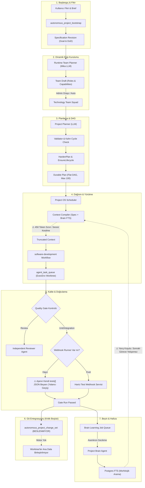

# Multica Autonomous Project OS: Derinlemesine Tersine Mühendislik, Mimari Açıklar ve Çözüm Yol Haritası

**Tarih:** 26 Ekim 2026
**İncelenen Branch / Worktree:** `feat/autonomous-project-os` (`reverse_engineer_multica_os`), HEAD `193e59b4af`
**Kapsam:** Kontrol Düzlemi (Control Plane), Takım Sağlama (Team Provisioning), Beyin/Hafıza (Brain & Context Intelligence), Planlayıcı & DAG Doğrulama (Planner & Validator), Kalite Kapıları (Quality Gates), Git & Worktree Yürütme Katmanı ve Project Manager / Cockpit Arayüzü.
**Referans Doküman:** `docs/reviews/autonomous-project-os-audit-2026-10-26.md` ile karşılaştırmalı derin analiz.

---

## 1. Yönetici Özeti (Executive Summary)

Multica projesi üzerinde geliştirilen **Autonomous Project OS**, piyasadaki basit "prompt-to-code" veya tekil CLI ajanlarının çok ötesinde; **durum makinelerine (state machines) dayalı, dayanıklı (durable), PostgreSQL kilitleriyle yarış koşullarından korunan ve backend otoritesini koruyan** ileri düzey bir otonom yazılım geliştirme orkestrasyonudur.

Sistem modelin serbestçe veritabanı veya git üzerinde işlem yapmasını engellemekte; rol ayrımı (**Project Manager** $\leftrightarrow$ **Team Leader** $\leftrightarrow$ **Specialist Squad**), zorunlu bağımsız inceleme (`__independent_review`) kapıları ve deterministik DAG doğrulaması ile güçlü bir iskelet kurmaktadır.

**Ancak derin kod incelememiz ve tersine mühendisliğimiz, bu yapının "bir fikri otonom olarak alıp hatasız koda ve çalışan ürüne dönüştürme" iddiasında 6 kritik sistemik kör nokta ve eksik motor içerdiğini ortaya koymuştur:**

1. **Öksüz Git Değişim Seti ve Entegrasyon Motorunun Yokluğu:** `autonomous_project_change_set` tablosu tasarlanmış fakat hiçbir backend kodu tarafından beslenmemektedir. Paralel çalışan ajanların worktree'lerde yazdığı kodları birleştiren, çakışmaları (conflict) çözen bir Git Merge Queue motoru kodda mevcut değildir.
2. **Yalancı-Pozitif Deterministik Test Kapısı (`structuredTestsPassed`):** Harici bir test webhook servisi yoksa, sistem terminalde hiçbir test çalıştırmadan, işi yapan ajanın kendi JSON çıktısındaki `{"tests": [{"status": "passed"}]}` iddiasını deterministik test kanıtı saymaktadır.
3. **Bağlam Kesilmesi ve Spesifikasyon Düşmesi (Context & Goal Drift):** İlk girilen fikir ve PRD, 450 token'lık sabit bağlam sınırına takıldığında sessizce kesilmekte (`Omitted`), requirement ID takibi olmadığı için ajanların ilk hedeften sapması engellenememektedir.
4. **Hafızada Semantik Körlük ve Öğrenme Yarış Koşulu (Brain Race Condition):** Brain araması sadece PostgreSQL FTS anahtar kelime eşleşmesine dayanmakta (vektör/embedding yok); bir ajanın öğrendiği ders asenkron kuyruk yüzünden sonraki ajana yetişememektedir.
5. **Monolitik 100-Düğüm Düz DAG Sınırı:** Hiyerarşik planlama (Milestone $\rightarrow$ Epic $\rightarrow$ Task) olmadığı için 40-50 task'tan sonra LLM bağlamı dağılmakta ve halüsinasyon riski katlanmaktadır.
6. **Sözde Dağıtım Referansı (Pseudo Release Ref):** Dağıtıma giden referans, test edilen git commit SHA'sı değil; onay zamanından türetilen rastgele bir string'dir.

---

## 2. Sistemin Mevcut Mimarisi ve Tersine Mühendislik Akışı

Aşağıdaki diyagram, sistemin kod tabanındaki fiili çalışma mekanizmasını ve tespit edilen kırılma noktalarını göstermektedir:



---

## 3. Kod Seviyesinde Kanıtlı Kritik Hatalar ve Sistemik Boşluklar

### 🔴 BULGU 1: `autonomous_project_change_set` Tablosunun Öksüz Olması ve Git Entegrasyon/Merge Motorunun Yokluğu

* **Kod Kanıtı:**
  * Şema: `server/migrations/488_autonomous_project_execution_contracts.up.sql:77-113`
  * Kullanım yeri: `server/internal/projectorchestration/context_compiler.go:277-289`
* **Analiz:**
  Veritabanında `autonomous_project_change_set` tablosu oluşturulmuştur. Bu tablo `source_task_id`, `base_sha`, `commit_sha`, `branch_name`, `worktree_path`, `changed_files`, `merge_status` ('ready', 'queued', 'merging', 'merged', 'conflict'), `merge_order` ve `integration_branch` gibi profesyonel bir Git Merge Kuyruğu için gereken tüm alanlara sahiptir.
  **Ancak bütün Go kod tabanında (`server/internal/`) bu tabloya tek bir satır `INSERT` yapan kod bulunmamaktadır!**
* **Doğrudan Sonuçları:**
  1. `context_compiler.go:282` satırındaki `currentContextRepositoryRevision` fonksiyonu her zaman boş string (`""`) dönmektedir.
  2. Birden çok ajan paralel çalıştığında (`max_parallel_nodes: 4`), her ajan kendi worktree'sinde bağımsız commit atar; fakat bu commit'lerin ana dala (`main`) sırayla entegre edilmesini, çakışma (conflict) durumunda rebase/merge yapılmasını yöneten hiçbir motor yoktur.

---

### 🔴 BULGU 2: Deterministik Kalite Kapısının Ajanın Kendi İddiasına Güvenmesi (`structuredTestsPassed` Zaafı)

* **Kod Kanıtı:**
  * Runner kontrolü: `server/internal/workflowruntime/phase2_quality.go:186-208, 270-282`
  * Sahte test kontrolü: `server/internal/workflowruntime/phase2_quality.go:301-348`
  * Webhook adaptörü: `server/internal/projectorchestration/webhook_adapters.go:44-49`
* **Analiz:**
  Sistem `development` ve üzeri otonomi seviyelerinde `unit_test` kapısını şart koşar. Ancak `qualityGateRunner` yalnızca harici bir `MULTICA_AUTONOMOUS_QUALITY_URL` tanımlandığında ayağa kalkar. Bu URL tanımlı değilse sistem şu koda düşer:
  ```go
  } else if testCount, passed := structuredTestsPassed(requirement.GateType, artifact); passed {
      gateErr = r.recordPolicyGate(ctx, q, requirement.GateType, "passed", "", map[string]any{
          "mode": "structured_test_evidence", "task_id": taskID,
          "artifact_type": artifactType, "reported_test_count": testCount,
      })
  }
  ```
  `structuredTestsPassed` ise terminale dokunmaz; ajanın ürettiği JSON içindeki `result.tests[]` listesine bakar. Hatta `nonBlockingTestFailure` fonksiyonu, test başarısız olsa bile ajanın yazdığı "outside this change" açıklamasına kanarak testi başarılı sayar (`phase2_quality.go:347`).
* **Doğrudan Sonuçları:**
  Lokal veya self-hosted ortamda gerçek test çalıştırılmamaktadır. LLM halüsinasyon görüp "5 test yazdım ve hepsi geçti" dediği anda bozuk veya derlenmeyen kod kalite kapısından onay almaktadır.

---

### 🔴 BULGU 3: Bağlam Kesilmesi ve İlk Fikirden Sapma (Goal & Specification Drift)

* **Kod Kanıtı:**
  * Bütçe ve kesilme: `server/internal/projectorchestration/context.go:5-18, 95-120`
  * Spesifikasyon sadeleştirme: `server/internal/projectorchestration/change_model.go:48-107`
  * Context derleme: `server/internal/projectorchestration/context_compiler.go:112-120, 159-165`
* **Analiz:**
  1. **Token Budgets & Omission:** Context compiler içinde `specification` bölümüne yalnızca 450 token bütçe ayrılmıştır. Kullanıcının girdiği kapsamlı brief/PRD bu bütçeyi aştığında, `NewBoundedContext` metni keser ve `Omitted` sayacını artırır. Ancak sistem bu kesilmeyi bir hata saymaz; ajan eksik gereksinimlerle koda başlar.
  2. **Requirement Kaybı:** Zengin `ProjectSpecification` yapısı (ID, rationale, non-goals, priority), `LegacySpecification()` çağrısıyla düz string dizilerine indirgenir.
  3. **Hedefe Sadakat Denetimi Yok:** Reviewer ajanına sadece o anki issue'nun diff'i ve kabul kriterleri verilir. Sistemin bütününde "Üretilen kod projenin ana hedefine (`Goal`) ne kadar uyuyor?" sorusunu denetleyen hiçbir kapı yoktur.

---

### 🔴 BULGU 4: Brain Hafızasında Semantik Körlük ve Öğrenme Yarış Koşulu

* **Kod Kanıtı:**
  * FTS Arama: `server/internal/projectorchestration/brain.go:278-325`
  * Asenkron Kuyruk: `server/internal/workflowruntime/brain_learning.go:68-78`
  * Brain Ajanı: `server/internal/workflowruntime/brain_executor.go:53-91`
* **Analiz:**
  1. **Semantik Arama Yok:** Brain belleği yalnızca PostgreSQL'in `websearch_to_tsquery('simple', $3)` fonksiyonuyla aranır. Vektör embedding (pgvector) yoktur. Eğer ajan "authentication" ararsa ama belleğe "JWT login" kaydedilmişse FTS eşleşmez. Sistem bu durumda alakasız ilk 12 kaydı çeken boş sorgu moduna (`empty-query fallback`) düşer.
  2. **Yarış Koşulu (Race Condition):** Bir ajan tamamlandığında öğrendiği kararlar `autonomous_project_control_plane_job` tablosuna asenkron atılır. Bir sonraki bağımlı görev hemen başlatıldığı için, Brain agent'ı henüz çalışıp belleği yazmadan ikinci ajan eski bağlam ile işe başlar.

---

### 🔴 BULGU 5: Monolitik 100-Düğüm Flat DAG Çıkmazı

* **Kod Kanıtı:**
  * Planlayıcı sözleşmesi: `server/internal/projectorchestration/planner.go:67-130, 252-298`
  * Düğüm limiti: `server/internal/projectorchestration/validator.go:11`
* **Analiz:**
  Sistem projeyi tek bir LLM çağrısında en fazla 100 düğümlük tek bir JSON planı olarak çözmeye çalışır. Hiyerarşik planlama (Milestone $\rightarrow$ Epic $\rightarrow$ Story $\rightarrow$ Task) yoktur.
* **Doğrudan Sonuçları:**
  Büyük çaplı projelerde (ör. full-stack SaaS) 50. task'tan sonra LLM bağlam penceresi şişer, kabul kriterleri yüzeyselleşir ve sistem ufak detaylarla ana mimariyi birbirine karıştırır.

---

### 🔴 BULGU 6: Dağıtım Referansının Kod Commit SHA'sı Olmaması

* **Kod Kanıtı:**
  * Dağıtım yürütme: `server/internal/workflowruntime/project_orchestrator.go:1977-2077`
  * Kaynak revizyon türetimi: `server/internal/workflowruntime/project_orchestrator.go:225-235`
* **Analiz:**
  `executeDeploymentNode` çalıştığında webhook'a gönderilen `ReleaseRef`, test edilen ve onaylanan bir Git Commit SHA'sı değildir. İlk planlama anında kullanıcının takım onayını verdiği zaman damgasından (`confirmed_at.UTC().Format(time.RFC3339Nano)`) türetilmiş bir metindir. Dağıtılan kodun hangi commit olduğu doğrulanamaz.

---

## 4. İki Denetim Raporunun Karşılaştırma Matrisi

Aşağıdaki tablo, `docs/reviews/autonomous-project-os-audit-2026-10-26.md` dosyasındaki bulgular ile bizim derin tersine mühendislik analizimizin bulgularını ve farklarını özetlemektedir:

| İnceleme Alanı | Diğer Raporun Bulgusu | Bizim Raporumuzun Derinleştiği Nokta / Yeni Keşif |
|---|---|---|
| **Kalite ve Test Kapısı** | `unit_test` ajanın kendi beyanıyla yeşil olabiliyor. Webhook runner opsiyonel. | **Tam Teşhis:** Yerel hiçbir derleme/test çalıştırıcısı (local sandbox runner) kodlanmamış. `nonBlockingTestFailure` fonksiyonu başarısız testleri de "değişiklik dışı" diyerek affetmektedir. |
| **Git & Kod Entegrasyonu** | Değinilmemiş / Kapsam dışı kalmış. | **Kritik Keşif:** `autonomous_project_change_set` tablosu tamamen öksüzdür (`INSERT` yok). Çoklu ajan paralel çalıştığında Git Merge Queue ve otomatik conflict resolution motoru yoktur. `currentContextRepositoryRevision` her zaman boştur. |
| **Spesifikasyon & Fikir Kaybı** | 450 token sınırı var, alanlar `LegacySpecification()` ile düşüyor. | **Tam Teşhis:** İlk fikre sadakati (Goal Fidelity) zaman içinde ölçen bir "Goal Drift Auditor" yoktur. Reviewer ajanı projeden habersiz sadece issue diff'ini onaylar. |
| **Proje Hafızası (Brain)** | Kısaca bağlam derleyiciye girdi olarak geçtiği belirtilmiş. | **Kritik Keşif:** Brain semantik vektör aramasına sahip değildir (FTS kelime eşleşmesi zorunluluğu). Asenkron öğrenme gecikmesi yüzünden paralel/ardışık ajanlar arasında yarış koşulu vardır. |
| **Planlama Mimarisi** | Onaylanan plan sürümünün kullanıcı arayüzüyle bağı tartışılmış. | **Kritik Keşif:** 100 düğümlük tek parça (flat) monolitik DAG mimarisi büyük projelerde kaçınılmaz halüsinasyona yol açmaktadır; Hiyerarşik Dekompozisyon zorunludur. |
| **Dağıtım Güvenliği** | `ReleaseRef` zaman damgasından türüyor, commit SHA değil. | **Onaylandı:** Test edilen artifact ile dağıtılan kod arasında kriptografik/git bağı kurulamamaktadır. |

---

## 5. Sistemi Profesyonel Seviyeye Taşıyacak 6 Aşamalı Uygulama Planı

Bu sistemi endüstriyel standartta, güvenilir ve gerçekten otonom bir yazılım geliştirme işletim sistemine dönüştürmek için atılması gereken adımlar:

### Aşama 1: Yerleşik Deterministik Test & Sandbox Koşucusu (Local Test Runner)
1. `QualityGateRunner` arayüzü için `DaemonQualityGateRunner` geliştirilmelidir.
2. Multica daemon'ının izole task worktree'sinde `pnpm test`, `go test ./...`, `npm run build` komutlarını gerçek ortamda çalıştırması sağlanmalıdır.
3. Ajanın JSON çıktısındaki `tests[]` beyanı kesinlikle deterministik kanıt olarak kabul edilmemeli; yalnızca gerçek exit code `0` ise kapı `passed` olmalıdır.

### Aşama 2: Git Multi-Agent Merge Queue Motoru (Reconciliation Pipeline)
1. Task tamamlandığında `autonomous_project_change_set` tablosuna gerçek `base_sha`, `commit_sha` ve `worktree_path` kaydedilmelidir.
2. Arka planda çalışan bir `MergeQueueWorker` yazılmalı; onaylanan değişiklikler sırayla `integration_branch` üzerinde test edilip `main` dala merge edilmelidir.
3. Merge çakışması çıktığında otomatik devreye giren bir **Git Conflict Resolver Agent** mekanizması kurulmalıdır.

### Aşama 3: Hedefe Sadakat Denetçisi (Goal Fidelity & Drift Auditor)
1. Token bütçesi dinamikleştirilmeli; `Specification` asla sessizce kesilmemelidir. Kesilme riski varsa planlama başlamadan hata verilmelidir.
2. Reviewer ajanının promptuna `Initial Goal` ve `Definition of Done` enjekte edilmeli; çıktıya zorunlu `goal_alignment_score (0-100)` alanı eklenmelidir. %80 altı skorlar revizyon istemelidir.
3. Her %25 ilerlemede kontrol düzlemi otomatik bir "Proje Sapma Değerlendirmesi" (Milestone Alignment Audit) yapmalıdır.

### Aşama 4: Hiyerarşik Planlama (Epic $\rightarrow$ Story $\rightarrow$ Task)
1. Tek seferde 100 düğüm üretmek yerine iki kademeli planlayıcıya geçilmelidir:
   * **Kademe 1 (High-Level Plan):** Mimari, Veri Modeli, Çekirdek API, Kullanıcı Arayüzü, Entegrasyon (5-8 Ana Faz/Epic).
   * **Kademe 2 (Just-In-Time Story Decomposition):** Bir faz başladığında, ilgili rol uzmanı o faza özel 3-6 görevlik yerel DAG üretmelidir.

### Aşama 5: Hibrit Bellek (pgvector + FTS) ve Senkron Öğrenme
1. `autonomous_project_brain_entry` tablosuna `embedding vector(1536)` kolonu eklenmeli ve hibrit arama (RRF - Reciprocal Rank Fusion) uygulanmalıdır.
2. Kritik mimari ve teknoloji kararları (`entry_type = 'architecture_decision'`) task bittiği anda senkron olarak belleğe işlenmeli; sonraki ajanların bu kararları kaçırması önlenmelidir.

### Aşama 6: Otonom E2E QA ve Canlı Arayüz Doğrulaması (Browser Automation)
1. Web arayüzü içeren projelerde test aşamasında Playwright / Headless Browser konteyneri ayağa kaldırılmalıdır.
2. QA Specialist ajanı, spesifikasyondaki kullanıcı senaryolarını canlı ortamda simüle etmeli, ekran görüntülerini `autonomous_project_artifact` tablosuna görsel kanıt olarak kaydetmelidir.

---

## 6. Özet Sonuç

Multica'nın `autonomous-project-os` altyapısı, veritabanı şeması ve orkestrasyon felsefesi açısından **sektördeki en sağlam temellerden birine** sahiptir.

Ancak yukarıda kod kanıtlarıyla sunulan **Yerel Test Koşucusu, Git Merge Kuyruğu, Hedefe Sadakat Denetimi ve Hibrit Hafıza** katmanları tamamlanmadan sistemin "kendi kendine çalışan güvenilir bir yazılım fabrikası" olması mümkün değildir. Bu rapordaki 6 aşamalı yol haritası uygulandığında, Multica dünya çapında referans gösterilecek tam otonom bir yazılım işletim sistemi haline gelecektir.

---
*Bu rapor, `/Users/caglar/Desktop/Frontend/multica/docs/reviews/autonomous-project-os-comprehensive-architecture-audit.md` adresinde kalıcı olarak saklanmaktadır.*
